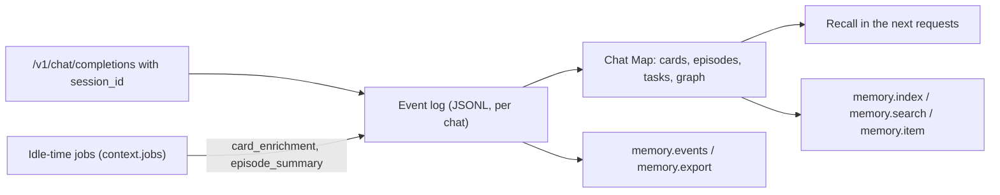

# Chat memory (`memory.*`)

The Engine keeps an event log for every chat sent with a `session_id` (and not `temporary_chat`), and builds a Chat Map from it: one card per message, episodes, open tasks and a graph. Recall in a chat, and the `memory.*` methods, read them. The chat request side is in [Chat Completions](../../../inference/chat_completions.md#-chat-event-log).



| Method | Does |
|---|---|
| [`memory.events`](memory.events.md) | The chat's event log, oldest first, a page at a time |
| [`memory.index`](memory.index.md) | The Chat Map: cards (no message text), episodes, tasks, graph |
| [`memory.search`](memory.search.md) | Messages of a chat that fit a query, or text from other chats |
| [`memory.item`](memory.item.md) | The exact message behind a reference `m:<position>` |
| [`memory.export`](memory.export.md) | Events and cards as one JSON document |
| [`memory.import`](memory.import.md) | An app that keeps the chat itself gives it back (RAM only) |
| [`memory.delete`](memory.delete.md) | Removes everything the Engine keeps about a chat |
| [`memory.grants`](memory.grants.md) / [`memory.revoke_grants`](memory.revoke_grants.md) | Tools allowed in the chat without asking |
| [`chat.import_app`](../chat/chat.import_app.md) | Copies the App's older chats into event logs |

## Where a chat is kept (`storage`)

A chat request's `storage` decides where the Engine keeps the chat:

| `storage` | Event log, ledger, saved KV | Use |
| --- | --- | --- |
| `engine` (default) | On disk under `<CLUAIZ_HOME>` | The Engine is the memory |
| `external` | In RAM only; nothing of the chat is written to disk | The app keeps the chat (its own files or database) |
| `none` | Nothing (same as `temporary_chat: "lite"`) | Private chats |

With `external`, every answer carries every event the app has not had yet: `memory_events` in the
non-streaming response, and in the closing stream chunk (the one with `engine`). That is what the
request and the answer added, and what was added after the previous answer: the model's idle-time
card (`card_enrichment`) is written after an answer, so it comes with the next one (or at once from
[`memory.events`](memory.events.md)). Each event goes out once; the app stores them. A note
the model makes with `remember` is a `note` event of the chat (`text`, `scope`, `status`, `by`,
`source`) and is not kept by the Engine; the app shows it, keeps it, and can put the notes it wants
into its system message. After an Engine restart (RAM is empty) the app sends the events back with
[`memory.import`](memory.import.md) (`{"events": [...]}`, at most 200,000), and recall, the Chat Map
and the event endpoints work again. The chat's KV is not saved to disk.

Measured (2026-10-24, isolated server): two turns with `storage: "external"` left no file of the
chat on disk (no event log, ledger or saved KV); after a restart and an import of the 4 collected
events, `history_mode: "none"` recalled "vega" and port 6060 from them. 2026-10-25
(`memory_journeys.py` EXT1): the card of the first turn and a `remember` note came in the second
answer's `memory_events`, each event once, with no chat folder and no note in the Engine's notes
file.

## Export format (for apps and their databases)

[`memory.export`](memory.export.md) and `memory_events` use the same event shape, so an app can
keep a chat in any store (files, SQLite, cluaizdb, …) on its side; the Engine itself never links
a database.

```json
{ "format": "cluaiz-chat-export", "version": 1, "chat_id": "my-chat",
  "events": [ { "v": 1, "id": "ev_…", "chat": "my-chat", "seq": 1, "ts": "2026-10-24T05:23:01.000Z",
                "kind": "message", "role": "user", "text": "…", "pos": 0, "key": "h:…", "source": "client" } ],
  "cards": [ { "…": "derived; can always be rebuilt from the events" } ] }
```

| Field | Meaning |
| --- | --- |
| `v` | Event format version (1) |
| `id`, `seq`, `ts` | Unique id, order in the chat (from 1), time (RFC 3339, UTC) |
| `kind` | `message`, `message.edited`, `message.retracted`, `tool_call`, `tool_result`, `approval`, `context_edit`, `card_enrichment`, `card_enrichment_failed`, `episode_summary`, `episode_summary_failed`, `task`, `grant`, `note` (external chats) |
| `pos` | Position of a message in the visible transcript (message kinds) |
| `source` | `client`, `engine` or `app-import` (message kinds) |

Keep every event in order; `cards`, episodes, tasks and the graph are derived and are rebuilt from
the events after an import. Fields an event kind does not know are kept as they are.

## The Engine as the transcript (`history: "engine"`)

With `history: "engine"` (and `storage: "engine"`) the client sends only the new message and the
Engine keeps the transcript, so the App does not need its own copy:

1. Send each new user message with `session_id` and `history: "engine"`.
2. Show a chat from [`memory.events`](memory.events.md): fold `message`, `message.edited` (replaces
   the message at the same `pos`) and `message.retracted` (removes it), in `seq` order; tool steps
   are the `tool_call` / `tool_result` events just before an answer.
3. Existing App chats: [`chat.import_app`](../chat/chat.import_app.md) (`all: true`) copies them into Engine logs once
   (the App's files are only read).
4. Deleting a chat: [`memory.delete`](memory.delete.md).
