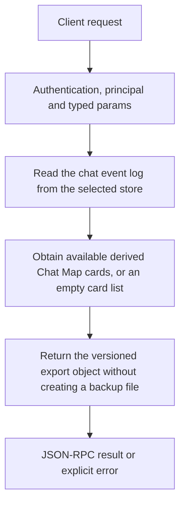

# memory.export

Export a conversation for client-owned backup or storage. The result combines full events and derived message cards, whereas memory.events is a paginated read. The export is data for your client to save, not a server-created backup file.

## Endpoint, execution and permissions

| Property | Contract |
|---|---|
| Wire endpoint | `POST /v1/cep`; logical method `memory.export` |
| Execution | Synchronous domain result in the JSON-RPC result field |
| Required scope | `read` |
| MCP facade | Eligible for the current read-only MCP facade |
| Side effects | Read/control behavior described below; this scope alone is not a promise of zero side effects |

Send a Bearer token when API authentication is enabled. Authentication failures are HTTP 401; ordinary CEP method errors are JSON-RPC error objects, normally with HTTP 200. A successful HTTP status alone does not prove the operation succeeded. See [the common CEP contract](../../README.md).

## How it works

1. Read the chat event log from the selected store
2. Obtain available derived Chat Map cards, or an empty card list
3. Return the versioned export object without creating a backup file



## Parameters, defaults and value effects

| Parameter | Type | Required | Meaning, default and constraints |
|---|---|---|---|
| `chat_id` | string | Yes | The chat: the same value as `session_id` in chat completions Use the same chat_id that the client sends as session_id to chat completions. A stream id, note id or title is not a chat id. |

Unknown top-level method parameters are rejected. `params._meta` is protocol metadata, not a domain option; approval retries must preserve the same method and domain parameters. Where a parameter is optional, omission follows the method-specific rules above rather than implying a universal zero or empty-string default.

## Request examples

Examples describe contracts, not measured execution. Replace IDs, paths and installed-package names with real values from your Engine. Do not execute write/delete/process examples against valuable data merely to read the documentation.

### 1. Basic request

This request uses the documented selection. Read the result semantics below before acting on it.

```json
{
  "jsonrpc": "2.0",
  "id": 1,
  "method": "memory.export",
  "params": {
    "chat_id": "c1"
  }
}
```

### 2. Export another explicitly selected chat

Select a real chat and retain its event records unchanged for a later import.

```json
{
  "jsonrpc": "2.0",
  "id": 2,
  "method": "memory.export",
  "params": {
    "chat_id": "conversation-to-back-up"
  }
}
```

## Response and field meanings

format is cluaiz-chat-export and version is 1. chat_id identifies the conversation. events contains replayable event records, not only plain strings. cards is a derived view and can differ from raw event count. This export does NOT include skipped_lines; use memory.events to inspect that diagnostic before treating an export as complete. Save the result securely if it includes conversation/tool content.

The following response is an illustrative shape. IDs, byte counts, timings and array contents depend on the actual request and machine; shortened nested objects are not a second schema or a measured result.

```json
{
  "id": 1,
  "jsonrpc": "2.0",
  "result": {
    "cards": [],
    "chat_id": "c1",
    "events": [],
    "format": "cluaiz-chat-export",
    "version": 1
  }
}
```

## Errors and recovery

| Code / boundary | Meaning | Recovery |
|---|---|---|
| HTTP 401 | Missing/invalid token while authentication is enabled | Supply the configured token; a CEP params change cannot repair authentication |
| `-32602` / typed params | Missing required fields, wrong JSON types or unknown fields | Correct the request against this page; do not retry the same invalid payload |
| `-32002` / principal | Required scope/owner/root authorization is absent | Inspect `error.data.needs`; use an authorized caller or permitted target |
| `-32010` / `event_log_unreadable` | The chat's event log could not be read | Read the error message, correct the backend/filesystem/configuration condition, then retry deliberately |

### Invalid-field example

This is deliberately invalid. The extra field must be removed; it is not an alternate feature toggle.

```text
{
  "jsonrpc": "2.0",
  "id": 90,
  "method": "memory.export",
  "params": {
    "chat_id": "c1",
    "__unknown_option": true
  }
}
```

The error envelope is `{"jsonrpc":"2.0","id":90,"error":{"code":-32602,"message":"...","data":{"type":"invalid_params", "errors":[...]}}}`. Exact message and field diagnostics are generated by typed deserialization; callers should use codes and structured data, not match a sentence.

## cURL

Save one valid request above as `request.json`:

```bash
curl --fail-with-body http://127.0.0.1:8000/v1/cep \
  -H "Content-Type: application/json" \
  -H "Authorization: Bearer $CLUAIZ_TOKEN" \
  --data-binary @request.json
```

## Python

Install `requests` in your client environment. This executes the basic request; edit `params` for a different valid case.

```python
import json
import os
import requests

payload = json.loads(r'''{
  "id": 1,
  "jsonrpc": "2.0",
  "method": "memory.export",
  "params": {
    "chat_id": "c1"
  }
}''')
response = requests.post(
    "http://127.0.0.1:8000/v1/cep",
    headers={"Authorization": "Bearer " + os.environ["CLUAIZ_TOKEN"]},
    json=payload, timeout=60,
)
response.raise_for_status()
reply = response.json()
if "error" in reply:
    raise RuntimeError(json.dumps(reply["error"], ensure_ascii=False))
print(reply["result"])
```

## JavaScript / Node.js

Use an owner token only in a trusted client. Do not ship it inside a public web page.

```javascript
const payload = {
  "id": 1,
  "jsonrpc": "2.0",
  "method": "memory.export",
  "params": {
    "chat_id": "c1"
  }
};
const response = await fetch("http://127.0.0.1:8000/v1/cep", {
  method: "POST",
  headers: { "content-type": "application/json", authorization: `Bearer ${process.env.CLUAIZ_TOKEN}` },
  body: JSON.stringify(payload),
});
const raw = await response.text();
if (!response.ok) throw new Error(`HTTP ${response.status}: ${raw}`);
const reply = JSON.parse(raw);
if (reply.error) throw new Error(JSON.stringify(reply.error));
console.log(reply.result);
```

## Limits, state and related operations

There is no export filename, compression option or pagination parameter. The client owns persistence of the result. memory.import accepts events and intentionally uses external in-memory storage; it is not a disk restore promise. Export is not proof that every original log line parsed.

- [`memory.import`](memory.import.md): use its separate documented contract.
- [`memory.events`](memory.events.md): use its separate documented contract.
- [`memory.delete`](memory.delete.md): use its separate documented contract.

## Implementation reference

- [api/src/cep/methods/memory.rs](../../../../../api/src/cep/methods/memory.rs)
