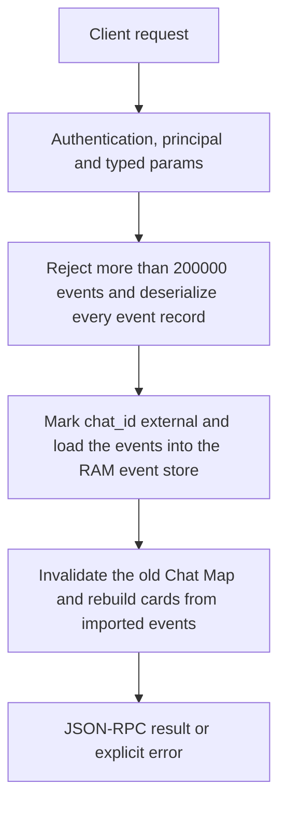

# memory.import

Make events held by an App available to Engine recall without creating a second permanent history copy. This marks the chat as external and replaces the in-memory external log with the supplied event list.

## Endpoint, execution and permissions

| Property | Contract |
|---|---|
| Wire endpoint | `POST /v1/cep`; logical method `memory.import` |
| Execution | Synchronous domain result in the JSON-RPC result field |
| Required scope | `write` |
| MCP facade | Not exposed by the current read-only MCP facade |
| Side effects | Updates the state described below |

Send a Bearer token when API authentication is enabled. Authentication failures are HTTP 401; ordinary CEP method errors are JSON-RPC error objects, normally with HTTP 200. A successful HTTP status alone does not prove the operation succeeded. See [the common CEP contract](../../README.md).

## How it works

1. Reject more than 200000 events and deserialize every event record
2. Mark chat_id external and load the events into the RAM event store
3. Invalidate the old Chat Map and rebuild cards from imported events



## Parameters, defaults and value effects

| Parameter | Type | Required | Meaning, default and constraints |
|---|---|---|---|
| `chat_id` | string | Yes | The chat: the same value as `session_id` in chat completions Use the same chat_id that the client sends as session_id to chat completions. A stream id, note id or title is not a chat id. |
| `events` | any[] | Yes | The events of `memory.export` (or the `memory_events` an app collected) Required array in memory.export event shape; at most 200000 entries. [] is accepted and represents an empty external log. |

Unknown top-level method parameters are rejected. `params._meta` is protocol metadata, not a domain option; approval retries must preserve the same method and domain parameters. Where a parameter is optional, omission follows the method-specific rules above rather than implying a universal zero or empty-string default.

## Request examples

Examples describe contracts, not measured execution. Replace IDs, paths and installed-package names with real values from your Engine. Do not execute write/delete/process examples against valuable data merely to read the documentation.

### 1. Basic request

This request uses the documented selection. Read the result semantics below before acting on it.

```json
{
  "jsonrpc": "2.0",
  "id": 1,
  "method": "memory.import",
  "params": {
    "chat_id": "c1",
    "events": []
  }
}
```

### 2. Register an empty external chat

Valid empty-state example. For a populated chat, copy the actual events array returned by memory.export without removing required event fields.

```json
{
  "jsonrpc": "2.0",
  "id": 2,
  "method": "memory.import",
  "params": {
    "chat_id": "external-chat",
    "events": []
  }
}
```

## Response and field meanings

storage:"external" identifies the storage contract. events is the number loaded; cards is the resulting derived visible-card count. The two counts need not match because tool and internal events are not visible message cards.

The following response is an illustrative shape. IDs, byte counts, timings and array contents depend on the actual request and machine; shortened nested objects are not a second schema or a measured result.

```json
{
  "id": 1,
  "jsonrpc": "2.0",
  "result": {
    "cards": 0,
    "chat_id": "c1",
    "events": 0,
    "storage": "external"
  }
}
```

## Errors and recovery

| Code / boundary | Meaning | Recovery |
|---|---|---|
| HTTP 401 | Missing/invalid token while authentication is enabled | Supply the configured token; a CEP params change cannot repair authentication |
| `-32602` / typed params | Missing required fields, wrong JSON types or unknown fields | Correct the request against this page; do not retry the same invalid payload |
| `-32002` / principal | Required scope/owner/root authorization is absent | Inspect `error.data.needs`; use an authorized caller or permitted target |
| `-32006` / `too_large` | More than 200 000 events | Reduce the input to the reported limit |
| `-32602` / `invalid_params` | An event does not have the event shape of `memory.export` | Correct the option/value combination; install required assets where relevant |

### Invalid-field example

This is deliberately invalid. The extra field must be removed; it is not an alternate feature toggle.

```text
{
  "jsonrpc": "2.0",
  "id": 90,
  "method": "memory.import",
  "params": {
    "chat_id": "c1",
    "events": [],
    "__unknown_option": true
  }
}
```

The error envelope is `{"jsonrpc":"2.0","id":90,"error":{"code":-32602,"message":"...","data":{"type":"invalid_params", "errors":[...]}}}`. Exact message and field diagnostics are generated by typed deserialization; callers should use codes and structured data, not match a sentence.

## cURL

Save one valid request above as `request.json`:

```bash
curl --fail-with-body http://127.0.0.1:8000/v1/cep \
  -H "Content-Type: application/json" \
  -H "Authorization: Bearer $CLUAIZ_TOKEN" \
  --data-binary @request.json
```

## Python

Install `requests` in your client environment. This executes the basic request; edit `params` for a different valid case.

```python
import json
import os
import requests

payload = json.loads(r'''{
  "id": 1,
  "jsonrpc": "2.0",
  "method": "memory.import",
  "params": {
    "chat_id": "c1",
    "events": []
  }
}''')
response = requests.post(
    "http://127.0.0.1:8000/v1/cep",
    headers={"Authorization": "Bearer " + os.environ["CLUAIZ_TOKEN"]},
    json=payload, timeout=60,
)
response.raise_for_status()
reply = response.json()
if "error" in reply:
    raise RuntimeError(json.dumps(reply["error"], ensure_ascii=False))
print(reply["result"])
```

## JavaScript / Node.js

Use an owner token only in a trusted client. Do not ship it inside a public web page.

```javascript
const payload = {
  "id": 1,
  "jsonrpc": "2.0",
  "method": "memory.import",
  "params": {
    "chat_id": "c1",
    "events": []
  }
};
const response = await fetch("http://127.0.0.1:8000/v1/cep", {
  method: "POST",
  headers: { "content-type": "application/json", authorization: `Bearer ${process.env.CLUAIZ_TOKEN}` },
  body: JSON.stringify(payload),
});
const raw = await response.text();
if (!response.ok) throw new Error(`HTTP ${response.status}: ${raw}`);
const reply = JSON.parse(raw);
if (reply.error) throw new Error(JSON.stringify(reply.error));
console.log(reply.result);
```

## Limits, state and related operations

External events live in RAM until restart or replacement. The App must retain its own durable copy and import again when necessary. This is not append/merge: pass the desired complete event sequence. Invalid event fields fail typed event deserialization; fabricated role/text-only objects are not export event records.

- [`memory.export`](memory.export.md): use its separate documented contract.
- [`memory.events`](memory.events.md): use its separate documented contract.
- [`memory.index`](memory.index.md): use its separate documented contract.

## Implementation reference

- [api/src/cep/methods/memory.rs](../../../../../api/src/cep/methods/memory.rs)
