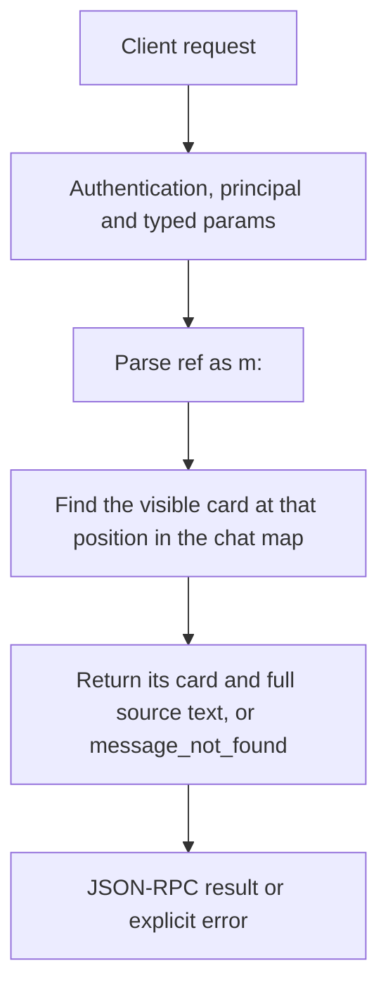

# memory.item

Resolve a recall reference to the exact visible message behind it. Use this after memory.search when a compact search card is insufficient for a grounded answer.

## Endpoint, execution and permissions

| Property | Contract |
|---|---|
| Wire endpoint | `POST /v1/cep`; logical method `memory.item` |
| Execution | Synchronous domain result in the JSON-RPC result field |
| Required scope | `read` |
| MCP facade | Eligible for the current read-only MCP facade |
| Side effects | Read/control behavior described below; this scope alone is not a promise of zero side effects |

Send a Bearer token when API authentication is enabled. Authentication failures are HTTP 401; ordinary CEP method errors are JSON-RPC error objects, normally with HTTP 200. A successful HTTP status alone does not prove the operation succeeded. See [the common CEP contract](../../README.md).

## How it works

1. Parse ref as m:<position>
2. Find the visible card at that position in the chat map
3. Return its card and full source text, or message_not_found



## Parameters, defaults and value effects

| Parameter | Type | Required | Meaning, default and constraints |
|---|---|---|---|
| `chat_id` | string | Yes | The chat: the same value as `session_id` in chat completions Use the same chat_id that the client sends as session_id to chat completions. A stream id, note id or title is not a chat id. |
| `ref` | string | Yes | A reference from a search result, `m:<position>` Required string m:<position>. Position is the card/message position, not event seq, an array index from a paginated result or a stream id. |

Unknown top-level method parameters are rejected. `params._meta` is protocol metadata, not a domain option; approval retries must preserve the same method and domain parameters. Where a parameter is optional, omission follows the method-specific rules above rather than implying a universal zero or empty-string default.

## Request examples

Examples describe contracts, not measured execution. Replace IDs, paths and installed-package names with real values from your Engine. Do not execute write/delete/process examples against valuable data merely to read the documentation.

### 1. Basic request

This request uses the documented selection. Read the result semantics below before acting on it.

```json
{
  "jsonrpc": "2.0",
  "id": 1,
  "method": "memory.item",
  "params": {
    "chat_id": "c1",
    "ref": "m:12"
  }
}
```

### 2. Resolve a reference returned by search

Replace m:0 with a reference actually returned for the selected chat.

```json
{
  "jsonrpc": "2.0",
  "id": 2,
  "method": "memory.item",
  "params": {
    "chat_id": "c1",
    "ref": "m:0"
  }
}
```

## Response and field meanings

result.ref preserves the reference. card gives navigation context and text gives the exact recalled message body. Message position and event sequence are distinct numbering systems.

The following response is an illustrative shape. IDs, byte counts, timings and array contents depend on the actual request and machine; shortened nested objects are not a second schema or a measured result.

```json
{
  "id": 1,
  "jsonrpc": "2.0",
  "result": {
    "card": {},
    "chat_id": "c1",
    "ref": "m:12",
    "text": "The deploy server listens on port 8443."
  }
}
```

## Errors and recovery

| Code / boundary | Meaning | Recovery |
|---|---|---|
| HTTP 401 | Missing/invalid token while authentication is enabled | Supply the configured token; a CEP params change cannot repair authentication |
| `-32602` / typed params | Missing required fields, wrong JSON types or unknown fields | Correct the request against this page; do not retry the same invalid payload |
| `-32002` / principal | Required scope/owner/root authorization is absent | Inspect `error.data.needs`; use an authorized caller or permitted target |
| `-32602` / `invalid_params` | `ref` does not look like m:<position> | Correct the option/value combination; install required assets where relevant |
| `-32004` / `message_not_found` | No visible message at that position | Refresh the relevant inventory/IDs and check whether the resource expired |
| `-32010` / `event_log_unreadable` | The chat's event log could not be read | Read the error message, correct the backend/filesystem/configuration condition, then retry deliberately |

### Invalid-field example

This is deliberately invalid. The extra field must be removed; it is not an alternate feature toggle.

```text
{
  "jsonrpc": "2.0",
  "id": 90,
  "method": "memory.item",
  "params": {
    "chat_id": "c1",
    "ref": "m:12",
    "__unknown_option": true
  }
}
```

The error envelope is `{"jsonrpc":"2.0","id":90,"error":{"code":-32602,"message":"...","data":{"type":"invalid_params", "errors":[...]}}}`. Exact message and field diagnostics are generated by typed deserialization; callers should use codes and structured data, not match a sentence.

## cURL

Save one valid request above as `request.json`:

```bash
curl --fail-with-body http://127.0.0.1:8000/v1/cep \
  -H "Content-Type: application/json" \
  -H "Authorization: Bearer $CLUAIZ_TOKEN" \
  --data-binary @request.json
```

## Python

Install `requests` in your client environment. This executes the basic request; edit `params` for a different valid case.

```python
import json
import os
import requests

payload = json.loads(r'''{
  "id": 1,
  "jsonrpc": "2.0",
  "method": "memory.item",
  "params": {
    "chat_id": "c1",
    "ref": "m:12"
  }
}''')
response = requests.post(
    "http://127.0.0.1:8000/v1/cep",
    headers={"Authorization": "Bearer " + os.environ["CLUAIZ_TOKEN"]},
    json=payload, timeout=60,
)
response.raise_for_status()
reply = response.json()
if "error" in reply:
    raise RuntimeError(json.dumps(reply["error"], ensure_ascii=False))
print(reply["result"])
```

## JavaScript / Node.js

Use an owner token only in a trusted client. Do not ship it inside a public web page.

```javascript
const payload = {
  "id": 1,
  "jsonrpc": "2.0",
  "method": "memory.item",
  "params": {
    "chat_id": "c1",
    "ref": "m:12"
  }
};
const response = await fetch("http://127.0.0.1:8000/v1/cep", {
  method: "POST",
  headers: { "content-type": "application/json", authorization: `Bearer ${process.env.CLUAIZ_TOKEN}` },
  body: JSON.stringify(payload),
});
const raw = await response.text();
if (!response.ok) throw new Error(`HTTP ${response.status}: ${raw}`);
const reply = JSON.parse(raw);
if (reply.error) throw new Error(JSON.stringify(reply.error));
console.log(reply.result);
```

## Limits, state and related operations

Malformed references return invalid_params; a well-formed missing position returns message_not_found. Obtain references from memory.search rather than inventing positions. This method returns one message, not an entire thread or a vector-nearest-neighbor list.

- [`memory.search`](memory.search.md): use its separate documented contract.
- [`memory.index`](memory.index.md): use its separate documented contract.
- [`memory.events`](memory.events.md): use its separate documented contract.

## Implementation reference

- [api/src/cep/methods/memory.rs](../../../../../api/src/cep/methods/memory.rs)
