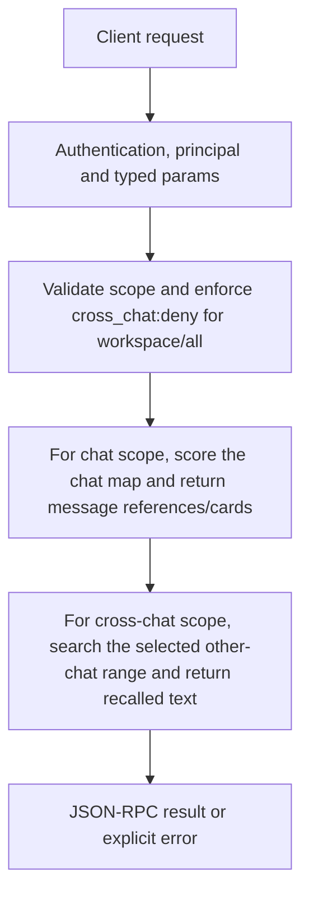

# memory.search

Search a chat’s message cards, or request text recalled from other chats. Search is performed by the existing recall owners; this is not the embeddings API and does not create vectors or a persistent collection.

## Endpoint, execution and permissions

| Property | Contract |
|---|---|
| Wire endpoint | `POST /v1/cep`; logical method `memory.search` |
| Execution | Synchronous domain result in the JSON-RPC result field |
| Required scope | `read` |
| MCP facade | Eligible for the current read-only MCP facade |
| Side effects | Read/control behavior described below; this scope alone is not a promise of zero side effects |

Send a Bearer token when API authentication is enabled. Authentication failures are HTTP 401; ordinary CEP method errors are JSON-RPC error objects, normally with HTTP 200. A successful HTTP status alone does not prove the operation succeeded. See [the common CEP contract](../../README.md).

## How it works

1. Validate scope and enforce cross_chat:deny for workspace/all
2. For chat scope, score the chat map and return message references/cards
3. For cross-chat scope, search the selected other-chat range and return recalled text



## Parameters, defaults and value effects

| Parameter | Type | Required | Meaning, default and constraints |
|---|---|---|---|
| `chat_id` | string | Yes | The chat: the same value as `session_id` in chat completions Use the same chat_id that the client sends as session_id to chat completions. A stream id, note id or title is not a chat id. For cross-chat search this is the current chat excluded from other-chat results. |
| `limit` | integer \| null | No | Most results (default 5; at most 50 in a chat, 20 across chats) Defaults to 5. Same-chat path caps at 50; cross-chat path caps at 20. |
| `query` | string | Yes | Words to look for (matched against the cards' titles, keywords and text) Required words matched through existing title/keyword/text recall. |
| `scope` | string \| null | No | `chat` (default), or `workspace` / `all` to search the other chats (not with cross_chat: deny) Omitted or chat: same-chat structured results. workspace or all: other chats. Other strings are rejected. The CEP handler blocks deny, but does not itself request approval for ask. |

Unknown top-level method parameters are rejected. `params._meta` is protocol metadata, not a domain option; approval retries must preserve the same method and domain parameters. Where a parameter is optional, omission follows the method-specific rules above rather than implying a universal zero or empty-string default.

## Request examples

Examples describe contracts, not measured execution. Replace IDs, paths and installed-package names with real values from your Engine. Do not execute write/delete/process examples against valuable data merely to read the documentation.

### 1. Basic request

This request uses the documented selection. Read the result semantics below before acting on it.

```json
{
  "jsonrpc": "2.0",
  "id": 1,
  "method": "memory.search",
  "params": {
    "chat_id": "c1",
    "query": "deploy port"
  }
}
```

### 2. Search one conversation

Returns references/cards from this conversation.

```json
{
  "jsonrpc": "2.0",
  "id": 2,
  "method": "memory.search",
  "params": {
    "chat_id": "c1",
    "query": "deployment port",
    "scope": "chat",
    "limit": 10
  }
}
```

### 3. Search other chats in this workspace

Requires cross-chat access not set to deny; returns recalled text rather than the same-chat result array.

```json
{
  "jsonrpc": "2.0",
  "id": 3,
  "method": "memory.search",
  "params": {
    "chat_id": "c1",
    "query": "deployment port",
    "scope": "workspace",
    "limit": 5
  }
}
```

## Response and field meanings

Same-chat result contains results[] with ref, score, why and card. score is a ranking value, not a calibrated probability. Cross-chat result instead includes scope and text; clients must not assume results[] exists for every scope. Resolve a same-chat ref using memory.item.

The following response is an illustrative shape. IDs, byte counts, timings and array contents depend on the actual request and machine; shortened nested objects are not a second schema or a measured result.

```json
{
  "id": 1,
  "jsonrpc": "2.0",
  "result": {
    "chat_id": "c1",
    "query": "deploy port",
    "results": [
      {
        "card": {},
        "ref": "m:12",
        "score": 3.2,
        "why": [
          "port"
        ]
      }
    ]
  }
}
```

## Errors and recovery

| Code / boundary | Meaning | Recovery |
|---|---|---|
| HTTP 401 | Missing/invalid token while authentication is enabled | Supply the configured token; a CEP params change cannot repair authentication |
| `-32602` / typed params | Missing required fields, wrong JSON types or unknown fields | Correct the request against this page; do not retry the same invalid payload |
| `-32002` / principal | Required scope/owner/root authorization is absent | Inspect `error.data.needs`; use an authorized caller or permitted target |
| `-32002` / `forbidden` | `scope` workspace / all while `config` context `cross_chat` is deny (`data.needs: "cross_chat"`) | Read the error message, correct the backend/filesystem/configuration condition, then retry deliberately |
| `-32602` / `invalid_params` | `scope` is not chat, workspace or all | Correct the option/value combination; install required assets where relevant |
| `-32010` / `event_log_unreadable` | The chat's event log could not be read | Read the error message, correct the backend/filesystem/configuration condition, then retry deliberately |

### Invalid-field example

This is deliberately invalid. The extra field must be removed; it is not an alternate feature toggle.

```text
{
  "jsonrpc": "2.0",
  "id": 90,
  "method": "memory.search",
  "params": {
    "chat_id": "c1",
    "query": "deploy port",
    "__unknown_option": true
  }
}
```

The error envelope is `{"jsonrpc":"2.0","id":90,"error":{"code":-32602,"message":"...","data":{"type":"invalid_params", "errors":[...]}}}`. Exact message and field diagnostics are generated by typed deserialization; callers should use codes and structured data, not match a sentence.

## cURL

Save one valid request above as `request.json`:

```bash
curl --fail-with-body http://127.0.0.1:8000/v1/cep \
  -H "Content-Type: application/json" \
  -H "Authorization: Bearer $CLUAIZ_TOKEN" \
  --data-binary @request.json
```

## Python

Install `requests` in your client environment. This executes the basic request; edit `params` for a different valid case.

```python
import json
import os
import requests

payload = json.loads(r'''{
  "id": 1,
  "jsonrpc": "2.0",
  "method": "memory.search",
  "params": {
    "chat_id": "c1",
    "query": "deploy port"
  }
}''')
response = requests.post(
    "http://127.0.0.1:8000/v1/cep",
    headers={"Authorization": "Bearer " + os.environ["CLUAIZ_TOKEN"]},
    json=payload, timeout=60,
)
response.raise_for_status()
reply = response.json()
if "error" in reply:
    raise RuntimeError(json.dumps(reply["error"], ensure_ascii=False))
print(reply["result"])
```

## JavaScript / Node.js

Use an owner token only in a trusted client. Do not ship it inside a public web page.

```javascript
const payload = {
  "id": 1,
  "jsonrpc": "2.0",
  "method": "memory.search",
  "params": {
    "chat_id": "c1",
    "query": "deploy port"
  }
};
const response = await fetch("http://127.0.0.1:8000/v1/cep", {
  method: "POST",
  headers: { "content-type": "application/json", authorization: `Bearer ${process.env.CLUAIZ_TOKEN}` },
  body: JSON.stringify(payload),
});
const raw = await response.text();
if (!response.ok) throw new Error(`HTTP ${response.status}: ${raw}`);
const reply = JSON.parse(raw);
if (reply.error) throw new Error(JSON.stringify(reply.error));
console.log(reply.result);
```

## Limits, state and related operations

Scope changes both the privacy boundary and the response shape. The CEP implementation only explicitly blocks cross-chat when configuration is deny; do not promise the chat agent’s approval UI is also invoked by this method. A zero/short result is not proof that no relevant message exists.

- [`memory.item`](memory.item.md): use its separate documented contract.
- [`config.get`](../../system/config/config.get.md): use its separate documented contract.
- [`memory.index`](memory.index.md): use its separate documented contract.

## Implementation reference

- [api/src/cep/methods/memory.rs](../../../../../api/src/cep/methods/memory.rs)
