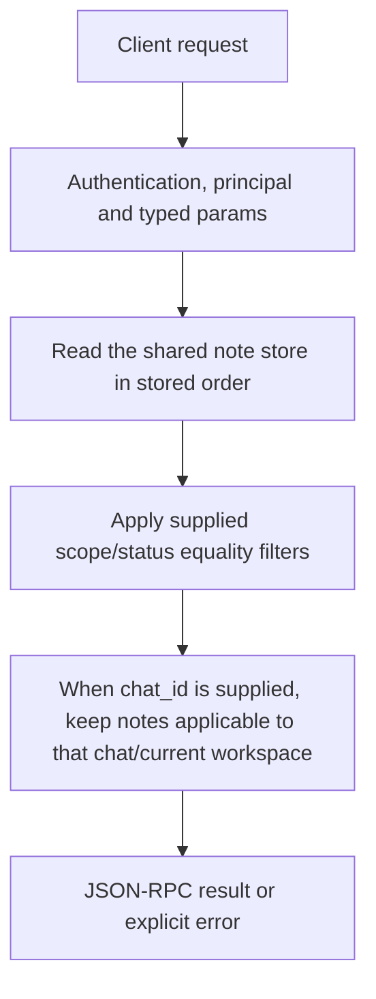

# notes.list

Read persisted note records, optionally filtered by scope, status and applicability to a conversation. This is the place to obtain actual note ids before updating them.

## Endpoint, execution and permissions

| Property | Contract |
|---|---|
| Wire endpoint | `POST /v1/cep`; logical method `notes.list` |
| Execution | Synchronous domain result in the JSON-RPC result field |
| Required scope | `read` |
| MCP facade | Eligible for the current read-only MCP facade |
| Side effects | Read/control behavior described below; this scope alone is not a promise of zero side effects |

Send a Bearer token when API authentication is enabled. Authentication failures are HTTP 401; ordinary CEP method errors are JSON-RPC error objects, normally with HTTP 200. A successful HTTP status alone does not prove the operation succeeded. See [the common CEP contract](../../README.md).

## How it works

1. Read the shared note store in stored order
2. Apply supplied scope/status equality filters
3. When chat_id is supplied, keep notes applicable to that chat/current workspace



## Parameters, defaults and value effects

| Parameter | Type | Required | Meaning, default and constraints |
|---|---|---|---|
| `chat_id` | string \| null | No | Only notes that apply to this chat (with the current workspace) Omitted: no applicability filter; present: apply note scope rules with the current workspace. |
| `scope` | string \| null | No | chat, workspace or global Omitted: no scope filter. Conventional values are chat, workspace, global; this handler applies a string equality filter. |
| `status` | string \| null | No | proposed, confirmed, superseded or invalidated Omitted: no status filter. Stored states include proposed, confirmed, superseded, invalidated; unknown strings simply match no notes here. |

Unknown top-level method parameters are rejected. `params._meta` is protocol metadata, not a domain option; approval retries must preserve the same method and domain parameters. Where a parameter is optional, omission follows the method-specific rules above rather than implying a universal zero or empty-string default.

## Request examples

Examples describe contracts, not measured execution. Replace IDs, paths and installed-package names with real values from your Engine. Do not execute write/delete/process examples against valuable data merely to read the documentation.

### 1. Basic request

This request uses the documented selection. Read the result semantics below before acting on it.

```json
{
  "jsonrpc": "2.0",
  "id": 1,
  "method": "notes.list",
  "params": {
    "status": "confirmed"
  }
}
```

### 2. Show active confirmed notes for a chat

Scope applicability is evaluated against the current workspace.

```json
{
  "jsonrpc": "2.0",
  "id": 2,
  "method": "notes.list",
  "params": {
    "chat_id": "c1",
    "status": "confirmed"
  }
}
```

### 3. Inspect invalidated history

Retained historical records can still be listed.

```json
{
  "jsonrpc": "2.0",
  "id": 3,
  "method": "notes.list",
  "params": {
    "status": "invalidated"
  }
}
```

## Response and field meanings

workspace reports the current workspace used for applicability. notes is newest-last; it may include historical invalidated/superseded records unless filtered. An empty list is a valid match result.

The following response is an illustrative shape. IDs, byte counts, timings and array contents depend on the actual request and machine; shortened nested objects are not a second schema or a measured result.

```json
{
  "id": 1,
  "jsonrpc": "2.0",
  "result": {
    "notes": [
      {
        "id": "n7",
        "pinned": false,
        "scope": "workspace",
        "status": "confirmed",
        "text": "Prefers tabs over spaces"
      }
    ],
    "workspace": "D:/work"
  }
}
```

## Errors and recovery

| Code / boundary | Meaning | Recovery |
|---|---|---|
| HTTP 401 | Missing/invalid token while authentication is enabled | Supply the configured token; a CEP params change cannot repair authentication |
| `-32602` / typed params | Missing required fields, wrong JSON types or unknown fields | Correct the request against this page; do not retry the same invalid payload |
| `-32002` / principal | Required scope/owner/root authorization is absent | Inspect `error.data.needs`; use an authorized caller or permitted target |

### Invalid-field example

This is deliberately invalid. The extra field must be removed; it is not an alternate feature toggle.

```text
{
  "jsonrpc": "2.0",
  "id": 90,
  "method": "notes.list",
  "params": {
    "status": "confirmed",
    "__unknown_option": true
  }
}
```

The error envelope is `{"jsonrpc":"2.0","id":90,"error":{"code":-32602,"message":"...","data":{"type":"invalid_params", "errors":[...]}}}`. Exact message and field diagnostics are generated by typed deserialization; callers should use codes and structured data, not match a sentence.

## cURL

Save one valid request above as `request.json`:

```bash
curl --fail-with-body http://127.0.0.1:8000/v1/cep \
  -H "Content-Type: application/json" \
  -H "Authorization: Bearer $CLUAIZ_TOKEN" \
  --data-binary @request.json
```

## Python

Install `requests` in your client environment. This executes the basic request; edit `params` for a different valid case.

```python
import json
import os
import requests

payload = json.loads(r'''{
  "id": 1,
  "jsonrpc": "2.0",
  "method": "notes.list",
  "params": {
    "status": "confirmed"
  }
}''')
response = requests.post(
    "http://127.0.0.1:8000/v1/cep",
    headers={"Authorization": "Bearer " + os.environ["CLUAIZ_TOKEN"]},
    json=payload, timeout=60,
)
response.raise_for_status()
reply = response.json()
if "error" in reply:
    raise RuntimeError(json.dumps(reply["error"], ensure_ascii=False))
print(reply["result"])
```

## JavaScript / Node.js

Use an owner token only in a trusted client. Do not ship it inside a public web page.

```javascript
const payload = {
  "id": 1,
  "jsonrpc": "2.0",
  "method": "notes.list",
  "params": {
    "status": "confirmed"
  }
};
const response = await fetch("http://127.0.0.1:8000/v1/cep", {
  method: "POST",
  headers: { "content-type": "application/json", authorization: `Bearer ${process.env.CLUAIZ_TOKEN}` },
  body: JSON.stringify(payload),
});
const raw = await response.text();
if (!response.ok) throw new Error(`HTTP ${response.status}: ${raw}`);
const reply = JSON.parse(raw);
if (reply.error) throw new Error(JSON.stringify(reply.error));
console.log(reply.result);
```

## Limits, state and related operations

Listing all notes without chat_id is not equivalent to notes inserted in one prompt. Pinned state, confirmation and scope influence prompt use separately. This endpoint has no pagination, arbitrary owner-path override or text-search parameter.

- [`notes.create`](notes.create.md): use its separate documented contract.
- [`notes.confirm`](notes.confirm.md): use its separate documented contract.
- [`notes.invalidate`](notes.invalidate.md): use its separate documented contract.

## Implementation reference

- [api/src/cep/methods/notes.rs](../../../../../api/src/cep/methods/notes.rs)
