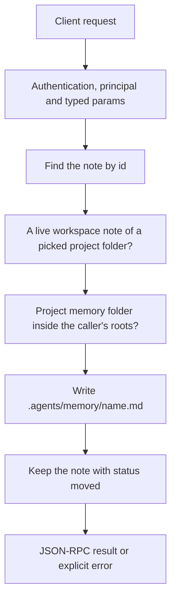

# notes.move

Turn one confirmed `workspace` note into a fact of its project's memory (`.agents/memory/`). Notes
of a project that are confirmed now move on their own ([`notes.confirm`](notes.confirm.md),
[`notes.create`](notes.create.md)); this method is for the notes saved before that, one at a time,
when the user asks. Nothing moves without a call: the Engine does not write into project folders on
its own.

## Endpoint, execution and permissions

| Property | Contract |
|---|---|
| Wire endpoint | `POST /v1/cep`; logical method `notes.move` |
| Execution | Synchronous domain result in the JSON-RPC result field |
| Required scope | `write` |
| MCP facade | Not exposed: it writes into the user's project |
| Side effects | Writes one file in the project's `.agents/memory/`, may mark older facts superseded (their files stay), and keeps the note with status `moved` |

Send a Bearer token when API authentication is enabled. Authentication failures are HTTP 401; ordinary CEP method errors are JSON-RPC error objects, normally with HTTP 200. See [the common CEP contract](../../README.md).

## How it works

1. Find the note by id
2. Check it is a live `workspace` note whose workspace is a folder the user picked (not the Cluaiz home), with `context.project_files` on
3. Check the project's `.agents/memory/` is inside the caller's roots
4. Write `.agents/memory/<name>.md` (the name is the note's first words) as `workspace.remember` does
5. Keep the note with `status: "moved"` and `moved_to`



## Parameters

| Parameter | Type | Required | Meaning, default and constraints |
|---|---|---|---|
| `id` | string | Yes | The note's `id` (from `notes.list`, e.g. `n:7`) |

Unknown parameters are rejected.

## Request examples

### 1. Move one note

```json
{
  "jsonrpc": "2.0",
  "id": 1,
  "method": "notes.move",
  "params": {
    "id": "n:7"
  }
}
```

### 2. Find the notes that can move

`notes.list` with `scope: "workspace"` and `status: "confirmed"`; a note whose `owner` is the
project folder can move.

```json
{
  "jsonrpc": "2.0",
  "id": 2,
  "method": "notes.list",
  "params": {
    "scope": "workspace",
    "status": "confirmed"
  }
}
```

## Response

- `note`: the note as kept now, with `status: "moved"` and `moved_to` (the file). A moved note is no
  longer sent to the model: the file is the fact.
- `project_fact`: `name` (the file name without `.md`), `path`, and `replaced` (the names of the
  project facts it superseded).

## Errors and recovery

| Code / boundary | Meaning | Recovery |
|---|---|---|
| HTTP 401 | Missing/invalid token while authentication is enabled | Supply the configured token |
| `-32004` / `note_not_found` | No note with this id | Refresh the ids with `notes.list` |
| `-32602` / `invalid_params` | The note is not a live `workspace` note of a project folder (a chat or global note, a note of the Cluaiz home, one already moved, superseded or invalidated, or `project_files` is off) | Only project notes move; the others stay in the Cluaiz home |
| `-32002` / `forbidden` | The project's memory folder is outside the caller's roots | Use a caller whose roots include the project |
| `-32010` / `memory_not_saved` | The fact file could not be written | Check the folder's permissions and free space; the note is unchanged |

## cURL

Save the request above as `request.json`:

```bash
curl --fail-with-body http://127.0.0.1:8000/v1/cep \
  -H "Content-Type: application/json" \
  -H "Authorization: Bearer $CLUAIZ_TOKEN" \
  --data-binary @request.json
```

## Related operations

- [`notes.confirm`](notes.confirm.md)
- [`notes.list`](notes.list.md)
- [`workspace.memory`](../../filesystem/workspace/workspace.memory.md)
- [`workspace.remember`](../../filesystem/workspace/workspace.remember.md)

## Implementation reference

- [api/src/cep/methods/notes.rs](../../../../../api/src/cep/methods/notes.rs)
- [api/src/handlers/chat/project.rs](../../../../../api/src/handlers/chat/project.rs)
