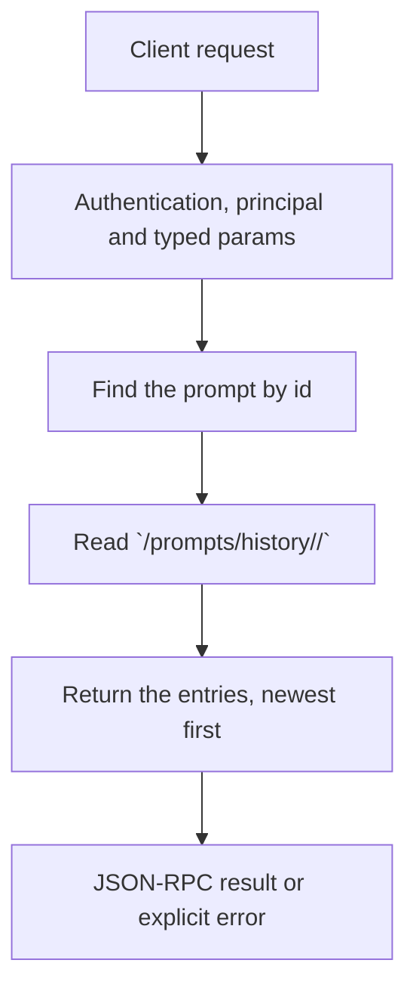

# prompts.history

List the texts a prompt had before they were replaced or reset, newest first. Use it to bring an earlier text back with `prompts.set`.

## Endpoint, execution and permissions

| Property | Contract |
|---|---|
| Wire endpoint | `POST /v1/cep`; logical method `prompts.history` |
| Execution | Synchronous domain result in the JSON-RPC result field |
| Required scope | `read` |
| Side effects | Read only |

Send a Bearer token when API authentication is enabled. Authentication failures are HTTP 401; ordinary CEP method errors are JSON-RPC error objects, normally with HTTP 200. See [the common CEP contract](../../README.md).

## How it works

1. Find the prompt by id
2. Read `<CLUAIZ_HOME>/prompts/history/<id>/`
3. Return the entries, newest first



## Parameters

| Parameter | Type | Required | Meaning and constraints |
|---|---|---|---|
| `id` | string | Yes | The prompt's id from `prompts.list`. |

Unknown parameters are rejected.

## Request examples

### 1. Basic request

The earlier texts of the tools folder line.

```json
{
  "jsonrpc": "2.0",
  "id": 1,
  "method": "prompts.history",
  "params": {
    "id": "tools.workspace"
  }
}
```

## Response

`history` holds `{replaced_at, text}` entries, newest first. `replaced_at` is the UTC time the text stopped being used (`YYYYMMDDTHHMMSS.mmmZ`). An empty list means the prompt was never changed.

## Errors and recovery

| Code / boundary | Meaning | Recovery |
|---|---|---|
| HTTP 401 | Missing/invalid token while authentication is enabled | Supply the configured token; a CEP params change cannot repair authentication |
| `-32602` / typed params | Missing required fields, wrong JSON types or unknown fields | Correct the request against this page; do not retry the same invalid payload |
| `-32002` / principal | Required scope/owner/root authorization is absent | Inspect `error.data.needs`; use an authorized caller or permitted target |
| `-32004` / `prompt_not_found` | No prompt with this id | Correct the request or the condition named in the message, then retry |

## cURL

Save one valid request above as `request.json`:

```bash
curl --fail-with-body http://127.0.0.1:8000/v1/cep \
  -H "Content-Type: application/json" \
  -H "Authorization: Bearer $CLUAIZ_TOKEN" \
  --data-binary @request.json
```

## Limits and related operations

The last 20 texts per prompt are kept; older ones are deleted when a new one is added. Defaults are not in the history: `prompts.reset` brings the default back.

- [`prompts.set`](prompts.set.md)
- [`prompts.reset`](prompts.reset.md)

## Implementation reference

- [api/src/cep/methods/prompts.rs](../../../../../api/src/cep/methods/prompts.rs)
- [engine/core/src/prompts.rs](../../../../../engine/core/src/prompts.rs)
- [engine/core/prompts/](../../../../../engine/core/prompts/)
