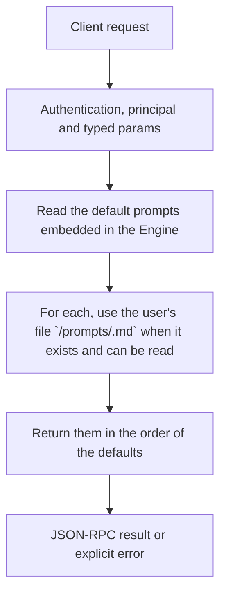

# prompts.list

List every instruction the Engine itself sends to a model, with the text in use now. Use it to show the prompts in a settings screen, or to check whether a user's text replaced a default.

## Endpoint, execution and permissions

| Property | Contract |
|---|---|
| Wire endpoint | `POST /v1/cep`; logical method `prompts.list` |
| Execution | Synchronous domain result in the JSON-RPC result field |
| Required scope | `read` |
| Side effects | Read only |

Send a Bearer token when API authentication is enabled. Authentication failures are HTTP 401; ordinary CEP method errors are JSON-RPC error objects, normally with HTTP 200. See [the common CEP contract](../../README.md).

## How it works

1. Read the default prompts embedded in the Engine
2. For each, use the user's file `<CLUAIZ_HOME>/prompts/<id>.md` when it exists and can be read
3. Return them in the order of the defaults



## Parameters

None. Send `params: {}`; unknown parameters are rejected.

## Request examples

### 1. Basic request

Lists every prompt.

```json
{
  "jsonrpc": "2.0",
  "id": 1,
  "method": "prompts.list",
  "params": {}
}
```

## The prompts

| Id | What it is | Variables |
|---|---|---|
| `agent.system` | The terminal agent's own instructions, at the start of its system prompt (AGENTS.md files and skills follow it) | `folder`, `os`, `arch`, `shell` |
| `agent.init` | What `/init` asks the agent to do: write the project's `.agents/AGENTS.md`, for code or for documents | `path` |
| `agent.compact` | What `/compact` asks the model for (the conversation follows it) | none |
| `agent.compact_system` | The system prompt of the `/compact` request | none |
| `workspace.instructions` | Heading of the project's AGENTS.md files in the agent's system prompt | none |
| `workspace.rules` | Heading of the project's always-on rules | none |
| `workspace.index` | Heading of the index of rules, workflows and skills read on demand, and of the project's memory facts | none |
| `workspace.cut` | Note after an instruction file that did not fit whole | `name` |
| `workspace.read_item` | Description of the `read_item` tool | none |
| `workspace.remember` | Description of the `remember` tool, which proposes a fact for the project's memory (`.agents/memory/`) | none |
| `workspace.remember_refused` | The `remember` tool result in a headless run, where nobody can confirm a fact | none |
| `workspace.matched` | Heading of the `<context>` block of project items that fit the user's message | none |
| `workspace.matched_read` | In that block, the line for an item too long to add | `name` |
| `workspace.glob_rule` | Added to a tool result when a glob rule is for the file read or changed | `name`, `path` |
| `workflow.run` | What `/<workflow>` sends: run the workflow's steps in order | `name`, `steps`, `arguments` |
| `chat.notes_pinned` | Heading of the pinned notes in a chat's system prompt | none |
| `chat.notes_record` | Heading of the notes that travel with the current message | none |
| `chat.card` | The background request for a message's search card (its JSON keys are fixed by a grammar) | none |
| `chat.episode_summary` | The background request for the title and summary of an earlier part of a chat (its JSON keys are fixed by a grammar) | none |
| `chat.recall` | Heading of recalled messages of the chat (the `recall` result and the `<recall>` block) | none |
| `chat.recall_outline` | In the `<recall>` block, heading of the earlier topics not shown | none |
| `chat.recall_other_chats` | Heading of messages `recall` found in the user's other chats | none |
| `chat.recall_none` | The `recall` result when nothing earlier in the chat matches | `query` |
| `chat.recall_try_other_chats` | Added after `chat.recall_none` when other chats may be searched | none |
| `chat.recall_cross_chat_off` | The `recall` result for other chats when `cross_chat` is `deny` | none |
| `chat.task` | First line of the `<task>` block of the chat's open task | `stage`, `title` |
| `chat.task_files` | The line of the task's files in the `<task>` block | `files` |
| `chat.task_saved` | The `task_update` result after the task was saved | `goal`, `stage` |
| `chat.noted` | The chat `remember` result after a confirmed note was saved | `id` |
| `chat.noted_proposed` | The chat `remember` result after a proposed note was saved | `id` |
| `chat.noted_by_app` | The chat `remember` result when the App keeps the chat | `status` |
| `tools.header` | Heading before the inline `<tools>` block | none |
| `tools.call_format` | How a model writes a `<tool_call>` block | none |
| `tools.workspace` | Which folder tools run in | `folder` |
| `tools.hint` | Heading of the suggested tools sent with a message | none |
| `tools.hint_titles` | The line naming more installed tools | `titles` |

The Engine adds no other instruction of its own. A chat request's own system prompt comes from the client and is not one of these.

## Response

`prompts` holds one object per prompt: `id`, `description` (what it is for and what to keep when changing it), `variables` (the `{{name}}` values the Engine fills in), `text` (in use now) and `overridden` (true: the user's text, false: the default).

## Errors and recovery

| Code / boundary | Meaning | Recovery |
|---|---|---|
| HTTP 401 | Missing/invalid token while authentication is enabled | Supply the configured token; a CEP params change cannot repair authentication |
| `-32602` / typed params | Missing required fields, wrong JSON types or unknown fields | Correct the request against this page; do not retry the same invalid payload |
| `-32002` / principal | Required scope/owner/root authorization is absent | Inspect `error.data.needs`; use an authorized caller or permitted target |

## cURL

Save one valid request above as `request.json`:

```bash
curl --fail-with-body http://127.0.0.1:8000/v1/cep \
  -H "Content-Type: application/json" \
  -H "Authorization: Bearer $CLUAIZ_TOKEN" \
  --data-binary @request.json
```

## Limits and related operations

The list of ids is fixed by the Engine build; a client cannot add an id. A project folder cannot replace a prompt: only the user's Cluaiz home can, so a cloned repository cannot change the agent's own instructions.

- [`prompts.get`](prompts.get.md)
- [`prompts.set`](prompts.set.md)
- [`prompts.reset`](prompts.reset.md)

## Implementation reference

- [api/src/cep/methods/prompts.rs](../../../../../api/src/cep/methods/prompts.rs)
- [engine/core/src/prompts.rs](../../../../../engine/core/src/prompts.rs)
- [engine/core/prompts/](../../../../../engine/core/prompts/)
