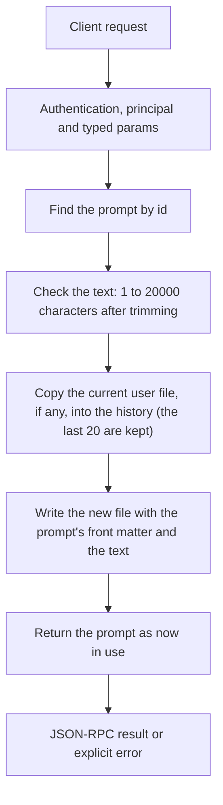

# prompts.set

Replace a prompt's text. Every later request that uses the prompt sends the new text; a running request keeps the text it started with. The text it replaces is kept in the prompt's history.

## Endpoint, execution and permissions

| Property | Contract |
|---|---|
| Wire endpoint | `POST /v1/cep`; logical method `prompts.set` |
| Execution | Synchronous domain result in the JSON-RPC result field |
| Required scope | `write` |
| Side effects | Writes `<CLUAIZ_HOME>/prompts/<id>.md`; the previous user text goes to `<CLUAIZ_HOME>/prompts/history/<id>/` |

Send a Bearer token when API authentication is enabled. Authentication failures are HTTP 401; ordinary CEP method errors are JSON-RPC error objects, normally with HTTP 200. See [the common CEP contract](../../README.md).

## How it works

1. Find the prompt by id
2. Check the text: 1 to 20000 characters after trimming
3. Copy the current user file, if any, into the history (the last 20 are kept)
4. Write the new file with the prompt's front matter and the text
5. Return the prompt as now in use



## Parameters

| Parameter | Type | Required | Meaning and constraints |
|---|---|---|---|
| `id` | string | Yes | The prompt's id from `prompts.list`. |
| `text` | string | Yes | The new text, 1 to 20000 characters after trimming. `{{name}}` is filled in for the prompt's declared `variables`; any other `{{...}}` stays as written. Line ends are stored as `\n`. |

Unknown parameters are rejected.

## Request examples

### 1. Basic request

Changes the tools folder line.

```json
{
  "jsonrpc": "2.0",
  "id": 1,
  "method": "prompts.set",
  "params": {
    "id": "tools.workspace",
    "text": "Work only inside {{folder}}."
  }
}
```

### 2. Agent instructions in another language

The terminal agent answers in Hindi from its next start.

```json
{
  "jsonrpc": "2.0",
  "id": 2,
  "method": "prompts.set",
  "params": {
    "id": "agent.system",
    "text": "You are Cluaiz Agent working in {{folder}} on {{os}}. Answer in Hindi. Use the tools instead of guessing."
  }
}
```

## What to keep when changing a prompt

- `tools.call_format`: the Engine reads `<tool_call>` blocks with `name` and `arguments`; a text that asks for another form breaks tool calls for models that use the inline format.
- `chat.card`: the answer is held to a grammar with the keys `title`, `motive`, `summary`, `keywords`; change the wording, not the keys.
- A prompt with variables should keep them: a missing `{{folder}}` means the model is not told the folder.

To undo a change, use `prompts.reset` (back to the default) or `prompts.history` and send the old text again.

## Response

`prompt` is the prompt as now in use, with `overridden: true`.

## Errors and recovery

| Code / boundary | Meaning | Recovery |
|---|---|---|
| HTTP 401 | Missing/invalid token while authentication is enabled | Supply the configured token; a CEP params change cannot repair authentication |
| `-32602` / typed params | Missing required fields, wrong JSON types or unknown fields | Correct the request against this page; do not retry the same invalid payload |
| `-32002` / principal | Required scope/owner/root authorization is absent | Inspect `error.data.needs`; use an authorized caller or permitted target |
| `-32602` / `invalid_params` | `text` is empty or over 20000 characters | Correct the request or the condition named in the message, then retry |
| `-32004` / `prompt_not_found` | No prompt with this id | Correct the request or the condition named in the message, then retry |
| `-32010` / `prompt_not_saved` | The prompt file could not be written | Correct the request or the condition named in the message, then retry |

## cURL

Save one valid request above as `request.json`:

```bash
curl --fail-with-body http://127.0.0.1:8000/v1/cep \
  -H "Content-Type: application/json" \
  -H "Authorization: Bearer $CLUAIZ_TOKEN" \
  --data-binary @request.json
```

## Limits and related operations

The terminal agent reads its prompts when it starts and when it builds a request; an agent already running keeps the system prompt it started with. Writing needs the `write` scope.

- [`prompts.reset`](prompts.reset.md)
- [`prompts.history`](prompts.history.md)
- [`prompts.get`](prompts.get.md)

## Implementation reference

- [api/src/cep/methods/prompts.rs](../../../../../api/src/cep/methods/prompts.rs)
- [engine/core/src/prompts.rs](../../../../../engine/core/src/prompts.rs)
- [engine/core/prompts/](../../../../../engine/core/prompts/)
