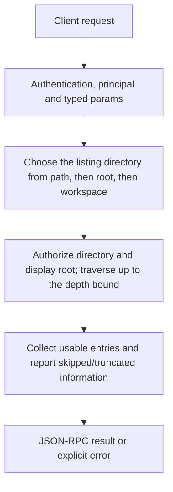

# fs.list

List filesystem entries for an explorer without reading their contents. Recursive listing is bounded and can return partial information rather than failing the entire listing on a deep or inaccessible child.

## Endpoint, execution and permissions

| Property | Contract |
|---|---|
| Wire endpoint | `POST /v1/cep`; logical method `fs.list` |
| Execution | Synchronous domain result in the JSON-RPC result field |
| Required scope | `read` |
| MCP facade | Eligible for the current read-only MCP facade |
| Side effects | Read/control behavior described below; this scope alone is not a promise of zero side effects |

Send a Bearer token when API authentication is enabled. Authentication failures are HTTP 401; ordinary CEP method errors are JSON-RPC error objects, normally with HTTP 200. A successful HTTP status alone does not prove the operation succeeded. See [the common CEP contract](../../README.md).

## How it works

1. Choose the listing directory from path, then root, then workspace
2. Authorize directory and display root; traverse up to the depth bound
3. Collect usable entries and report skipped/truncated information



## Parameters, defaults and value effects

| Parameter | Type | Required | Meaning, default and constraints |
|---|---|---|---|
| `path` | string \| null | No | The folder to list (default: `root`, else the workspace) Paths are on the Engine host, not the browser. Absolute paths or paths relative to the selected workspace are accepted after canonicalization and caller-root checks. Empty, drive-relative and root-relative ambiguous paths are invalid. Defaults to root when supplied, otherwise the workspace. |
| `recursive` | boolean | No | Also list sub-folders, at most 12 levels deep Defaults to false. true explores subfolders with a maximum recursion depth of 12. |
| `root` | string \| null | No | The folder the answered `path` values are relative to (default: the workspace) Display-relative root, default workspace. This is not a permission grant or a substitute for caller roots. |

Unknown top-level method parameters are rejected. `params._meta` is protocol metadata, not a domain option; approval retries must preserve the same method and domain parameters. Where a parameter is optional, omission follows the method-specific rules above rather than implying a universal zero or empty-string default.

## Request examples

Examples describe contracts, not measured execution. Replace IDs, paths and installed-package names with real values from your Engine. Do not execute write/delete/process examples against valuable data merely to read the documentation.

### 1. Basic request

This request uses the documented selection. Read the result semantics below before acting on it.

```json
{
  "jsonrpc": "2.0",
  "id": 1,
  "method": "fs.list",
  "params": {
    "path": ".",
    "recursive": false
  }
}
```

### 2. Recursive workspace listing

Inspect truncated and skipped; no automatic second request resumes beyond depth12.

```json
{
  "jsonrpc": "2.0",
  "id": 2,
  "method": "fs.list",
  "params": {
    "path": ".",
    "recursive": true
  }
}
```

### 3. Choose a display root

Both locations still require authorization; root only affects path presentation.

```json
{
  "jsonrpc": "2.0",
  "id": 3,
  "method": "fs.list",
  "params": {
    "path": "src",
    "root": ".",
    "recursive": false
  }
}
```

## Response and field meanings

items[] includes path relative to the display root where possible, name, is_folder, size and RFC3339 UTC modified text. Folder size is 0, not a recursively computed byte total. truncated/skipped indicate unusable entries or depth-limited traversal.

The following response is an illustrative shape. IDs, byte counts, timings and array contents depend on the actual request and machine; shortened nested objects are not a second schema or a measured result.

```json
{
  "id": 1,
  "jsonrpc": "2.0",
  "result": {
    "items": [
      {
        "is_folder": false,
        "modified": "2026-10-25T00:00:00.000Z",
        "name": "notes.txt",
        "path": "notes.txt",
        "size": 5
      }
    ],
    "skipped": 0,
    "truncated": false
  }
}
```

## Errors and recovery

| Code / boundary | Meaning | Recovery |
|---|---|---|
| HTTP 401 | Missing/invalid token while authentication is enabled | Supply the configured token; a CEP params change cannot repair authentication |
| `-32602` / typed params | Missing required fields, wrong JSON types or unknown fields | Correct the request against this page; do not retry the same invalid payload |
| `-32002` / principal | Required scope/owner/root authorization is absent | Inspect `error.data.needs`; use an authorized caller or permitted target |
| `-32602` / `invalid_params` | The path is not a folder, or is drive-relative / root-relative | Correct the option/value combination; install required assets where relevant |
| `-32004` / `file_not_found` | The folder does not exist | Refresh the relevant inventory/IDs and check whether the resource expired |
| `-32002` / `forbidden` | The folder is outside the caller's roots (`data.needs: "roots"`) | Read the error message, correct the backend/filesystem/configuration condition, then retry deliberately |

### Invalid-field example

This is deliberately invalid. The extra field must be removed; it is not an alternate feature toggle.

```text
{
  "jsonrpc": "2.0",
  "id": 90,
  "method": "fs.list",
  "params": {
    "path": ".",
    "recursive": false,
    "__unknown_option": true
  }
}
```

The error envelope is `{"jsonrpc":"2.0","id":90,"error":{"code":-32602,"message":"...","data":{"type":"invalid_params", "errors":[...]}}}`. Exact message and field diagnostics are generated by typed deserialization; callers should use codes and structured data, not match a sentence.

## cURL

Save one valid request above as `request.json`:

```bash
curl --fail-with-body http://127.0.0.1:8000/v1/cep \
  -H "Content-Type: application/json" \
  -H "Authorization: Bearer $CLUAIZ_TOKEN" \
  --data-binary @request.json
```

## Python

Install `requests` in your client environment. This executes the basic request; edit `params` for a different valid case.

```python
import json
import os
import requests

payload = json.loads(r'''{
  "id": 1,
  "jsonrpc": "2.0",
  "method": "fs.list",
  "params": {
    "path": ".",
    "recursive": false
  }
}''')
response = requests.post(
    "http://127.0.0.1:8000/v1/cep",
    headers={"Authorization": "Bearer " + os.environ["CLUAIZ_TOKEN"]},
    json=payload, timeout=60,
)
response.raise_for_status()
reply = response.json()
if "error" in reply:
    raise RuntimeError(json.dumps(reply["error"], ensure_ascii=False))
print(reply["result"])
```

## JavaScript / Node.js

Use an owner token only in a trusted client. Do not ship it inside a public web page.

```javascript
const payload = {
  "id": 1,
  "jsonrpc": "2.0",
  "method": "fs.list",
  "params": {
    "path": ".",
    "recursive": false
  }
};
const response = await fetch("http://127.0.0.1:8000/v1/cep", {
  method: "POST",
  headers: { "content-type": "application/json", authorization: `Bearer ${process.env.CLUAIZ_TOKEN}` },
  body: JSON.stringify(payload),
});
const raw = await response.text();
if (!response.ok) throw new Error(`HTTP ${response.status}: ${raw}`);
const reply = JSON.parse(raw);
if (reply.error) throw new Error(JSON.stringify(reply.error));
console.log(reply.result);
```

## Limits, state and related operations

Do not assume ordering or completeness from a nonempty items array. Child problems are skipped and counted; the initial missing/non-directory or unauthorized target still errors. Directory symlinks are not recursively followed. No glob, extension filter, offset or unlimited-depth flag exists.

- [`fs.read`](fs.read.md): use its separate documented contract.
- [`workspace.set`](../workspace/workspace.set.md): use its separate documented contract.
- [`fs.copy`](fs.copy.md): use its separate documented contract.

## Implementation reference

- [api/src/cep/methods/fs.rs](../../../../../api/src/cep/methods/fs.rs)
