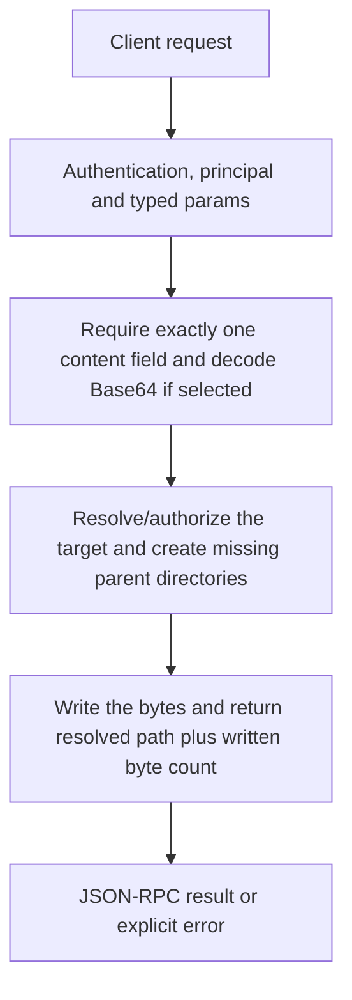

# fs.write

Write text or decoded binary content to one host file. This is an overwrite-style file operation, not append, patch, editing by line number or a safe transaction with automatic backup.

## Endpoint, execution and permissions

| Property | Contract |
|---|---|
| Wire endpoint | `POST /v1/cep`; logical method `fs.write` |
| Execution | Synchronous domain result in the JSON-RPC result field |
| Required scope | `write` |
| MCP facade | Not exposed by the current read-only MCP facade |
| Side effects | Creates or overwrites a file; parent directories may also be created |

Send a Bearer token when API authentication is enabled. Authentication failures are HTTP 401; ordinary CEP method errors are JSON-RPC error objects, normally with HTTP 200. A successful HTTP status alone does not prove the operation succeeded. See [the common CEP contract](../../README.md).

## How it works

1. Require exactly one content field and decode Base64 if selected
2. Resolve/authorize the target and create missing parent directories
3. Write the bytes and return resolved path plus written byte count



## Parameters, defaults and value effects

| Parameter | Type | Required | Meaning, default and constraints |
|---|---|---|---|
| `data_base64` | string \| null | No | The file's content as standard base64 (send this or `text`) Standard Base64 file bytes, without a data: URI prefix. Malformed Base64 is invalid_params. |
| `path` | string | Yes | Absolute, or relative to the workspace; missing parent folders are created Paths are on the Engine host, not the browser. Absolute paths or paths relative to the selected workspace are accepted after canonicalization and caller-root checks. Empty, drive-relative and root-relative ambiguous paths are invalid. The target may be new; missing parents are created. |
| `text` | string \| null | No | The file's content as UTF-8 text (send this or `data_base64`) Send this OR data_base64, never both/neither. Empty string is a valid zero-byte file. |

Unknown top-level method parameters are rejected. `params._meta` is protocol metadata, not a domain option; approval retries must preserve the same method and domain parameters. Where a parameter is optional, omission follows the method-specific rules above rather than implying a universal zero or empty-string default.

## Request examples

Examples describe contracts, not measured execution. Replace IDs, paths and installed-package names with real values from your Engine. Do not execute write/delete/process examples against valuable data merely to read the documentation.

### 1. Basic request

This request uses the documented selection. Read the result semantics below before acting on it.

```json
{
  "jsonrpc": "2.0",
  "id": 1,
  "method": "fs.write",
  "params": {
    "path": "notes.txt",
    "text": "hello"
  }
}
```

### 2. Write binary bytes

Writes five bytes, Hello. This uses plain Base64, unlike media data-URI inputs.

```json
{
  "jsonrpc": "2.0",
  "id": 2,
  "method": "fs.write",
  "params": {
    "path": "generated/hello.bin",
    "data_base64": "SGVsbG8="
  }
}
```

### 3. Create an empty file

Empty text is content; omitting both content fields is an error.

```json
{
  "jsonrpc": "2.0",
  "id": 3,
  "method": "fs.write",
  "params": {
    "path": "generated/empty.txt",
    "text": ""
  }
}
```

## Response and field meanings

bytes is the written byte count, so non-ASCII text can have more bytes than characters. path is the resolved destination. There is no saved version id or implied backup location.

The following response is an illustrative shape. IDs, byte counts, timings and array contents depend on the actual request and machine; shortened nested objects are not a second schema or a measured result.

```json
{
  "id": 1,
  "jsonrpc": "2.0",
  "result": {
    "bytes": 5,
    "path": "/project/notes.txt"
  }
}
```

## Errors and recovery

| Code / boundary | Meaning | Recovery |
|---|---|---|
| HTTP 401 | Missing/invalid token while authentication is enabled | Supply the configured token; a CEP params change cannot repair authentication |
| `-32602` / typed params | Missing required fields, wrong JSON types or unknown fields | Correct the request against this page; do not retry the same invalid payload |
| `-32002` / principal | Required scope/owner/root authorization is absent | Inspect `error.data.needs`; use an authorized caller or permitted target |
| `-32602` / `invalid_params` | Both or neither of `text` / `data_base64`, invalid base64, or a bad path | Correct the option/value combination; install required assets where relevant |
| `-32002` / `forbidden` | The path is outside the caller's roots (`data.needs: "roots"`), or the OS refused access (`os_permission_denied`) | Read the error message, correct the backend/filesystem/configuration condition, then retry deliberately |

### Invalid-field example

This is deliberately invalid. The extra field must be removed; it is not an alternate feature toggle.

```text
{
  "jsonrpc": "2.0",
  "id": 90,
  "method": "fs.write",
  "params": {
    "path": "notes.txt",
    "text": "hello",
    "__unknown_option": true
  }
}
```

The error envelope is `{"jsonrpc":"2.0","id":90,"error":{"code":-32602,"message":"...","data":{"type":"invalid_params", "errors":[...]}}}`. Exact message and field diagnostics are generated by typed deserialization; callers should use codes and structured data, not match a sentence.

## cURL

Save one valid request above as `request.json`:

```bash
curl --fail-with-body http://127.0.0.1:8000/v1/cep \
  -H "Content-Type: application/json" \
  -H "Authorization: Bearer $CLUAIZ_TOKEN" \
  --data-binary @request.json
```

## Python

Install `requests` in your client environment. This executes the basic request; edit `params` for a different valid case.

```python
import json
import os
import requests

payload = json.loads(r'''{
  "id": 1,
  "jsonrpc": "2.0",
  "method": "fs.write",
  "params": {
    "path": "notes.txt",
    "text": "hello"
  }
}''')
response = requests.post(
    "http://127.0.0.1:8000/v1/cep",
    headers={"Authorization": "Bearer " + os.environ["CLUAIZ_TOKEN"]},
    json=payload, timeout=60,
)
response.raise_for_status()
reply = response.json()
if "error" in reply:
    raise RuntimeError(json.dumps(reply["error"], ensure_ascii=False))
print(reply["result"])
```

## JavaScript / Node.js

Use an owner token only in a trusted client. Do not ship it inside a public web page.

```javascript
const payload = {
  "id": 1,
  "jsonrpc": "2.0",
  "method": "fs.write",
  "params": {
    "path": "notes.txt",
    "text": "hello"
  }
};
const response = await fetch("http://127.0.0.1:8000/v1/cep", {
  method: "POST",
  headers: { "content-type": "application/json", authorization: `Bearer ${process.env.CLUAIZ_TOKEN}` },
  body: JSON.stringify(payload),
});
const raw = await response.text();
if (!response.ok) throw new Error(`HTTP ${response.status}: ${raw}`);
const reply = JSON.parse(raw);
if (reply.error) throw new Error(JSON.stringify(reply.error));
console.log(reply.result);
```

## Limits, state and related operations

Existing content is replaced. Filesystem failure may leave earlier directories or partial side effects; no rollback/atomic-write promise is made. There is no append, encoding, overwrite:false or model parameter.

- [`fs.read`](fs.read.md): use its separate documented contract.
- [`fs.mkdir`](fs.mkdir.md): use its separate documented contract.
- [`fs.copy`](fs.copy.md): use its separate documented contract.

## Implementation reference

- [api/src/cep/methods/fs.rs](../../../../../api/src/cep/methods/fs.rs)
