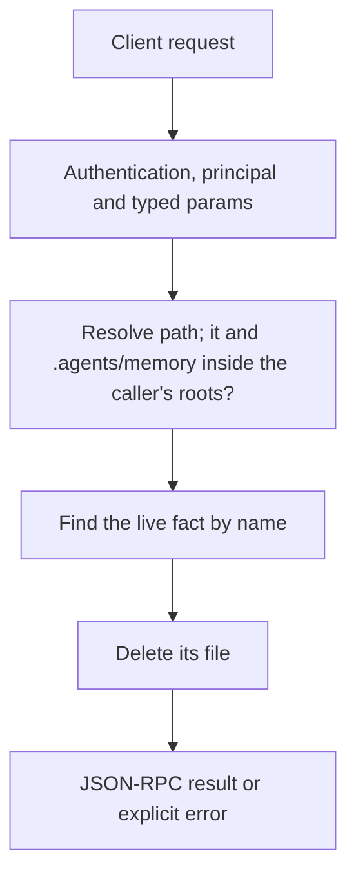

# workspace.forget

Delete a fact from a project's memory, for example when the user marks it wrong in the App. Call it only for a fact the user chose: the terminal agent's `forget` tool asks the same question before it deletes.

## Endpoint, execution and permissions

| Property | Contract |
|---|---|
| Wire endpoint | `POST /v1/cep`; logical method `workspace.forget` |
| Execution | Synchronous domain result in the JSON-RPC result field |
| Required scope | `write` |
| Side effects | Deletes `.agents/memory/<name>.md` |

Send a Bearer token when API authentication is enabled. Authentication failures are HTTP 401; ordinary CEP method errors are JSON-RPC error objects, normally with HTTP 200. See [the common CEP contract](../../README.md).

## How it works

1. Resolve `path` (default: the workspace) and check it and its `.agents/memory/` folder are inside the caller's roots
2. Find the live fact named `name` (the name as listed by `workspace.memory`)
3. Delete its file



## Parameters, defaults and value effects

| Parameter | Type | Required | Meaning, default and constraints |
|---|---|---|---|
| `name` | string | Yes | The fact's name, e.g. `deploy-port` |
| `path` | string | No | The project folder (default: the workspace) |

Unknown parameters are rejected.

## Request examples

```json
{
  "jsonrpc": "2.0",
  "id": 1,
  "method": "workspace.forget",
  "params": { "name": "test-command" }
}
```

## Response and field meanings

`forgotten`: the name; `path`: the deleted file.

## Errors and recovery

| Code / boundary | Meaning | Recovery |
|---|---|---|
| HTTP 401 | Missing/invalid token while authentication is enabled | Supply the configured token |
| `-32002` / principal | The folder is outside the caller's roots | Use an authorized caller or a folder inside its roots |
| `-32004` / `fact_not_found` | No live fact of this name | Read the names with `workspace.memory` |

## cURL

Save one valid request above as `request.json`:

```bash
curl --fail-with-body http://127.0.0.1:8000/v1/cep \
  -H "Content-Type: application/json" \
  -H "Authorization: Bearer $CLUAIZ_TOKEN" \
  --data-binary @request.json
```

## Python

Install `requests` in your client environment. This sends the first request above.

```python
import json
import os
import requests

payload = {"jsonrpc": "2.0", "id": 1, "method": "workspace.forget", "params": {"name": "test-command"}}
response = requests.post(
    "http://127.0.0.1:8000/v1/cep",
    headers={"Authorization": "Bearer " + os.environ["CLUAIZ_TOKEN"]},
    json=payload, timeout=60,
)
response.raise_for_status()
reply = response.json()
if "error" in reply:
    raise RuntimeError(json.dumps(reply["error"], ensure_ascii=False))
print(reply["result"])
```

## JavaScript / Node.js

Use an owner token only in a trusted client. Do not ship it inside a public web page.

```javascript
const payload = { jsonrpc: "2.0", id: 1, method: "workspace.forget", params: { name: "test-command" } };
const response = await fetch("http://127.0.0.1:8000/v1/cep", {
  method: "POST",
  headers: { "content-type": "application/json", authorization: `Bearer ${process.env.CLUAIZ_TOKEN}` },
  body: JSON.stringify(payload),
});
const raw = await response.text();
if (!response.ok) throw new Error(`HTTP ${response.status}: ${raw}`);
const reply = JSON.parse(raw);
if (reply.error) throw new Error(JSON.stringify(reply.error));
console.log(reply.result);
```

## Limits, state and related operations

There is no undo in the Engine; in a git project the file's history is in git.

- [`workspace.remember`](workspace.remember.md)
- [`workspace.memory`](workspace.memory.md)

## Implementation reference

- [api/src/cep/methods/workspace.rs](../../../../../api/src/cep/methods/workspace.rs)
- [agents/src/workspace/memory.rs](../../../../../agents/src/workspace/memory.rs)
