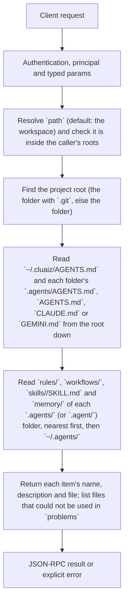

# workspace.index

List a project's agent files, as the terminal agent finds them: the AGENTS.md instructions, the rules (with their trigger), workflows and skills of its `.agents/` folders and of `~/.agents/`, and the facts of its memory (`.agents/memory/`). Use it to show a project's agent setup in a settings screen. The index is built from the files on every call; nothing is cached or written.

## Endpoint, execution and permissions

| Property | Contract |
|---|---|
| Wire endpoint | `POST /v1/cep`; logical method `workspace.index` |
| Execution | Synchronous domain result in the JSON-RPC result field |
| Required scope | `read` |
| Side effects | Read only |

Send a Bearer token when API authentication is enabled. Authentication failures are HTTP 401; ordinary CEP method errors are JSON-RPC error objects, normally with HTTP 200. See [the common CEP contract](../../README.md).

## How it works

1. Resolve `path` (default: the workspace) and check it is inside the caller's roots
2. Find the project root (the folder with `.git`, else the folder)
3. Read `~/.cluaiz/AGENTS.md` and each folder's `.agents/AGENTS.md`, `AGENTS.md`, `CLAUDE.md` or `GEMINI.md` from the root down
4. Read `rules/`, `workflows/`, `skills/<name>/SKILL.md` and `memory/` of each `.agents/` (or `.agent/`) folder, nearest first, then `~/.agents/`
5. Return each item's name, description and file; list files that could not be used in `problems`



## Parameters

| Parameter | Type | Required | Meaning, default and constraints |
|---|---|---|---|
| `path` | string | No | The project folder: absolute, or relative to the workspace (default: the workspace, `workspace.get`). The project root is the folder with `.git` above it, else this folder. |

Unknown parameters are rejected.

## Request examples

### 1. The workspace

The project the Engine works in now.

```json
{
  "jsonrpc": "2.0",
  "id": 1,
  "method": "workspace.index",
  "params": {}
}
```

### 2. Another folder

Any folder inside the caller's roots.

```json
{
  "jsonrpc": "2.0",
  "id": 1,
  "method": "workspace.index",
  "params": {
    "path": "D:/projects/site"
  }
}
```

## Response

- `root`: the project root.
- `instructions`: `label` (as the model sees it, e.g. `.agents/AGENTS.md`), `path`, `chars` (size of the file without front matter). Farthest first; the user's `~/.cluaiz/AGENTS.md` comes first.
- `rules`, `workflows`, `skills`, `memory`: one object per item: `kind`, `name`, `description` (front matter, else the first heading), `path` (the file; a skill's `SKILL.md`), `found_in` (the folder it was found in, e.g. `.agents/rules`, `web/.agents/skills`, `~/.agents/workflows`). A nearer item hides a farther one of the same name.
  - rules also have `trigger` (`always_on`, `model_decision`, `glob`, `manual`) and `globs`;
  - memory facts also have `status` (`confirmed`, or `superseded` for a file an older Engine marked when a newer fact replaced it) and `superseded_by` (the newer fact's name, or null). A fact replaced now is rewritten in place. Memory is read only from the project's folders, never from `~/.agents/`.
- `problems`: files that could not be used as they are, and why (an unknown `trigger`, a glob rule without `globs`, a file that cannot be read).

## Errors and recovery

| Code / boundary | Meaning | Recovery |
|---|---|---|
| HTTP 401 | Missing/invalid token while authentication is enabled | Supply the configured token; a CEP params change cannot repair authentication |
| `-32602` / typed params | Missing required fields, wrong JSON types, unknown fields, or a `path` that is not a folder | Correct the request against this page; do not retry the same invalid payload |
| `-32002` / principal | The folder (or the item's file) is outside the caller's roots | Inspect `error.data.needs`; use an authorized caller or a folder inside its roots |


## cURL

Save one valid request above as `request.json`:

```bash
curl --fail-with-body http://127.0.0.1:8000/v1/cep \
  -H "Content-Type: application/json" \
  -H "Authorization: Bearer $CLUAIZ_TOKEN" \
  --data-binary @request.json
```

## Limits and related operations

The agent's system prompt is built from these files within a share of the model's context; this method returns every item, not what fits. Installed skills of `~/.cluaiz/tools/skills` are listed too.

- [`workspace.item`](workspace.item.md)
- [`workspace.memory`](workspace.memory.md)
- [`workspace.remember`](workspace.remember.md)
- [`workspace.get`](workspace.get.md)

## Implementation reference

- [api/src/cep/methods/workspace.rs](../../../../../api/src/cep/methods/workspace.rs)
- [agents/src/workspace/](../../../../../agents/src/workspace/)
