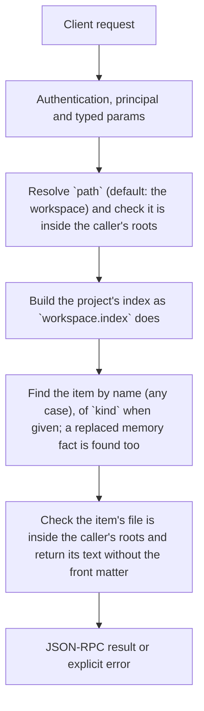

# workspace.item

Read the text of one item of a project's index: a rule, workflow, skill, memory fact, or an instruction file by its label. This is what the agent's `read_item` tool returns to the model, for a client that shows or edits the item.

## Endpoint, execution and permissions

| Property | Contract |
|---|---|
| Wire endpoint | `POST /v1/cep`; logical method `workspace.item` |
| Execution | Synchronous domain result in the JSON-RPC result field |
| Required scope | `read` |
| Side effects | Read only |

Send a Bearer token when API authentication is enabled. Authentication failures are HTTP 401; ordinary CEP method errors are JSON-RPC error objects, normally with HTTP 200. See [the common CEP contract](../../README.md).

## How it works

1. Resolve `path` (default: the workspace) and check it is inside the caller's roots
2. Build the project's index as `workspace.index` does
3. Find the item by name (any case), of `kind` when given; a replaced memory fact is found too
4. Check the item's file is inside the caller's roots and return its text without the front matter



## Parameters

| Parameter | Type | Required | Meaning, default and constraints |
|---|---|---|---|
| `name` | string | Yes | The name as `workspace.index` lists it (a leading `/` is ignored), or an instruction file's label such as `.agents/AGENTS.md` |
| `kind` | string | No | `rule`, `workflow`, `skill` or `memory`, when two items share a name; without it the first match wins (rules, then workflows, skills, memory) |
| `path` | string | No | The project folder: absolute, or relative to the workspace (default: the workspace, `workspace.get`). The project root is the folder with `.git` above it, else this folder. |

Unknown parameters are rejected.

## Request examples

### 1. A workflow

Its steps, as `/release` sends them to the model.

```json
{
  "jsonrpc": "2.0",
  "id": 1,
  "method": "workspace.item",
  "params": {
    "name": "release",
    "kind": "workflow"
  }
}
```

### 2. An instruction file

By its label.

```json
{
  "jsonrpc": "2.0",
  "id": 1,
  "method": "workspace.item",
  "params": {
    "name": ".agents/AGENTS.md"
  }
}
```

## Response

The item's fields as in `workspace.index`, plus `text`. An instruction file comes back as `kind: "instructions"` with `name` (its label), `path` and `text`.

## Errors and recovery

| Code / boundary | Meaning | Recovery |
|---|---|---|
| HTTP 401 | Missing/invalid token while authentication is enabled | Supply the configured token; a CEP params change cannot repair authentication |
| `-32602` / typed params | Missing required fields, wrong JSON types, unknown fields, or a `path` that is not a folder | Correct the request against this page; do not retry the same invalid payload |
| `-32002` / principal | The folder (or the item's file) is outside the caller's roots | Inspect `error.data.needs`; use an authorized caller or a folder inside its roots |
| `-32004` / `item_not_found` | Nothing of that name | `error.message` lists the names; call `workspace.index` |
| `-32010` / `item_unreadable` | The item's file could not be read | Check the file; the index is built from the files each time |

## cURL

Save one valid request above as `request.json`:

```bash
curl --fail-with-body http://127.0.0.1:8000/v1/cep \
  -H "Content-Type: application/json" \
  -H "Authorization: Bearer $CLUAIZ_TOKEN" \
  --data-binary @request.json
```

## Limits and related operations

A skill's other files (references, scripts) are not returned; read them with `fs.read` in the skill's folder.

- [`workspace.index`](workspace.index.md)
- [`workspace.memory`](workspace.memory.md)

## Implementation reference

- [api/src/cep/methods/workspace.rs](../../../../../api/src/cep/methods/workspace.rs)
- [agents/src/workspace/](../../../../../agents/src/workspace/)
