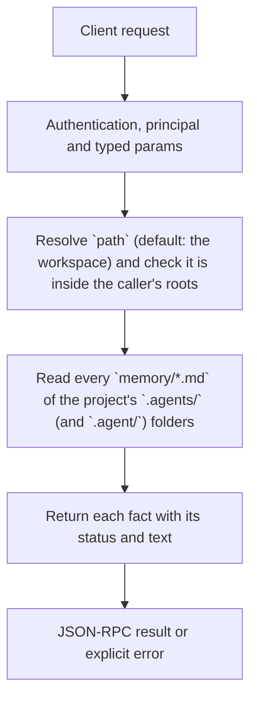

# workspace.memory

List the facts of a project's memory (`.agents/memory/*.md`), live and replaced, with their text. The memory belongs to the project, not to a chat: a new chat, another computer or another AI reads the same files.

## Endpoint, execution and permissions

| Property | Contract |
|---|---|
| Wire endpoint | `POST /v1/cep`; logical method `workspace.memory` |
| Execution | Synchronous domain result in the JSON-RPC result field |
| Required scope | `read` |
| Side effects | Read only |

Send a Bearer token when API authentication is enabled. Authentication failures are HTTP 401; ordinary CEP method errors are JSON-RPC error objects, normally with HTTP 200. See [the common CEP contract](../../README.md).

## How it works

1. Resolve `path` (default: the workspace) and check it is inside the caller's roots
2. Read every `memory/*.md` of the project's `.agents/` (and `.agent/`) folders
3. Return each fact with its status and text



## Parameters

| Parameter | Type | Required | Meaning, default and constraints |
|---|---|---|---|
| `path` | string | No | The project folder: absolute, or relative to the workspace (default: the workspace, `workspace.get`). The project root is the folder with `.git` above it, else this folder. |

Unknown parameters are rejected.

## Request examples

### 1. The workspace

Every fact of the current project.

```json
{
  "jsonrpc": "2.0",
  "id": 1,
  "method": "workspace.memory",
  "params": {}
}
```

## Response

`facts`: one object per fact, as in `workspace.index` (`kind`, `name`, `description`, `path`, `found_in`, `status`, `superseded_by`) plus `text`. A replaced fact is rewritten in place (`workspace.remember` with `replaces`), so there is one file per subject. A fact with `status: "superseded"` was marked by an older Engine and is no longer sent to the model; its file stays until someone deletes it (`workspace.forget`). Each file's front matter also records `source` (who saved it) and `created`.

## Errors and recovery

| Code / boundary | Meaning | Recovery |
|---|---|---|
| HTTP 401 | Missing/invalid token while authentication is enabled | Supply the configured token; a CEP params change cannot repair authentication |
| `-32602` / typed params | Missing required fields, wrong JSON types, unknown fields, or a `path` that is not a folder | Correct the request against this page; do not retry the same invalid payload |
| `-32002` / principal | The folder (or the item's file) is outside the caller's roots | Inspect `error.data.needs`; use an authorized caller or a folder inside its roots |


## cURL

Save one valid request above as `request.json`:

```bash
curl --fail-with-body http://127.0.0.1:8000/v1/cep \
  -H "Content-Type: application/json" \
  -H "Authorization: Bearer $CLUAIZ_TOKEN" \
  --data-binary @request.json
```

## Limits and related operations

Facts are plain Markdown files: a user may edit or delete them, or commit them with the project.

- [`workspace.remember`](workspace.remember.md)
- [`workspace.index`](workspace.index.md)
- [`workspace.item`](workspace.item.md)

## Implementation reference

- [api/src/cep/methods/workspace.rs](../../../../../api/src/cep/methods/workspace.rs)
- [agents/src/workspace/](../../../../../agents/src/workspace/)
