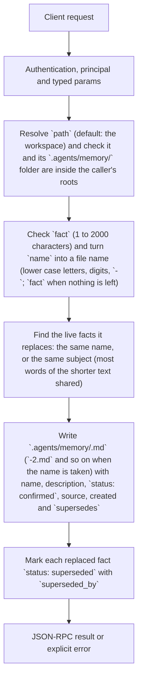

# workspace.remember

Save a fact in a project's memory. Call it only for a fact the user confirmed, for example after the App showed the model's proposal and the user said yes: the terminal agent's `remember` tool asks the same question before it saves. Nothing from a file, web page or tool result should become memory without that confirmation.

## Endpoint, execution and permissions

| Property | Contract |
|---|---|
| Wire endpoint | `POST /v1/cep`; logical method `workspace.remember` |
| Execution | Synchronous domain result in the JSON-RPC result field |
| Required scope | `write` |
| Side effects | Writes one new file in `.agents/memory/` and may mark older facts as superseded (their files stay) |

Send a Bearer token when API authentication is enabled. Authentication failures are HTTP 401; ordinary CEP method errors are JSON-RPC error objects, normally with HTTP 200. See [the common CEP contract](../../README.md).

## How it works

1. Resolve `path` (default: the workspace) and check it and its `.agents/memory/` folder are inside the caller's roots
2. Check `fact` (1 to 2000 characters) and turn `name` into a file name (lower case letters, digits, `-`; `fact` when nothing is left)
3. Find the live facts it replaces: the same name, or the same subject (most words of the shorter text shared)
4. Write `.agents/memory/<name>.md` (`<name>-2.md` and so on when the name is taken) with name, description, `status: confirmed`, source, created and `supersedes`
5. Mark each replaced fact `status: superseded` with `superseded_by`



## Parameters

| Parameter | Type | Required | Meaning, default and constraints |
|---|---|---|---|
| `name` | string | Yes | A short name for the subject, e.g. `deploy-port`; it becomes the file name |
| `fact` | string | Yes | The fact, 1 to 2000 characters, in sentences that make sense on their own later |
| `source` | string | No | Who saved it, kept in the file (default `cep`), e.g. `Cluaiz App, chat 12` |
| `path` | string | No | The project folder: absolute, or relative to the workspace (default: the workspace, `workspace.get`). The project root is the folder with `.git` above it, else this folder. |

Unknown parameters are rejected.

## Request examples

### 1. A confirmed fact

Saved after the user said yes.

```json
{
  "jsonrpc": "2.0",
  "id": 1,
  "method": "workspace.remember",
  "params": {
    "name": "test-command",
    "fact": "The tests run with npm run check.",
    "source": "Cluaiz App, chat 12"
  }
}
```

## Response

`saved`: the fact's name (its file name without `.md`); `path`: the new file; `replaced`: the names of the facts it superseded (empty when none).

## Errors and recovery

| Code / boundary | Meaning | Recovery |
|---|---|---|
| HTTP 401 | Missing/invalid token while authentication is enabled | Supply the configured token; a CEP params change cannot repair authentication |
| `-32602` / typed params | Missing required fields, wrong JSON types, unknown fields, or a `path` that is not a folder | Correct the request against this page; do not retry the same invalid payload |
| `-32002` / principal | The folder (or the item's file) is outside the caller's roots | Inspect `error.data.needs`; use an authorized caller or a folder inside its roots |
| `-32602` / `invalid_params` | `fact` is empty or over 2000 characters | Shorten the fact; memory keeps points, not conversations |
| `-32010` / `memory_not_saved` | The file could not be written | Check the folder's permissions and free space |

## cURL

Save one valid request above as `request.json`:

```bash
curl --fail-with-body http://127.0.0.1:8000/v1/cep \
  -H "Content-Type: application/json" \
  -H "Authorization: Bearer $CLUAIZ_TOKEN" \
  --data-binary @request.json
```

## Limits and related operations

Every call writes a new file, also for the same text; a repeated fact supersedes the earlier one. The `.agents/` folder is created when it is missing.

- [`workspace.memory`](workspace.memory.md)
- [`workspace.index`](workspace.index.md)

## Implementation reference

- [api/src/cep/methods/workspace.rs](../../../../../api/src/cep/methods/workspace.rs)
- [agents/src/workspace/](../../../../../agents/src/workspace/)
