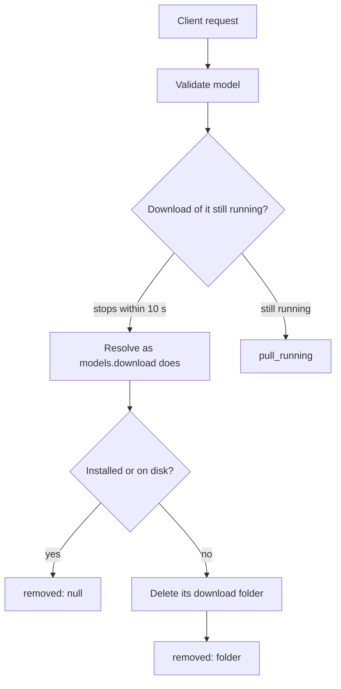

# models.discard

Deletes what a stopped `models.download` left on disk: the `.part` file and any finished files of that download. Use it to cancel a paused download; downloading the same `model` again then starts from the beginning.

## Endpoint, execution and permissions

| Property | Contract |
|---|---|
| Wire endpoint | `POST /v1/cep`; logical method `models.discard` |
| Execution | Immediate |
| Required scope | `write` |
| Side effects | Deletes the model's download folder in the vault |

Send a Bearer token when API authentication is enabled. See [the common CEP contract](../../README.md).

## How it works

1. Validate `model` and refuse a provider model.
2. Wait up to 10 seconds for a download of the same `model` that is still stopping; one still running is refused with `pull_running`.
3. Resolve `model` as `models.download` does. An installed model, or one already on disk, is never touched: the answer is `"removed": null`.
4. Delete the vault folder the download used, unless an installed model is registered in it.



## Parameters

| Parameter | Type | Required | Meaning |
|---|---|---|---|
| `model` | string | Yes | The same reference given to `models.download` (catalog id, or `owner/name[:QUANT]`) |

## Request example

```json
{
  "jsonrpc": "2.0",
  "id": 1,
  "method": "models.discard",
  "params": {
    "model": "owner/name-GGUF:Q4_K_M"
  }
}
```

## Response

`removed` is the folder deleted, or `null` when nothing was left or the model is installed.

```json
{
  "jsonrpc": "2.0",
  "id": 1,
  "result": {
    "model": "owner/name-GGUF:Q4_K_M",
    "removed": "models/chat/name-GGUF-Q4_K_M"
  }
}
```

## Errors and recovery

| Code / type | Meaning | Recovery |
|---|---|---|
| `-32602` / `invalid_params` | `model` is empty, too long or has control characters | Send the reference used for `models.download` |
| `-32005` / `provider_model` | The model is a provider's | Providers have nothing to download |
| `-32005` / `pull_running` | The download is still running | Stop it with `tasks.cancel`, then call again |
| `-32010` / `discard_failed` | Resolving failed, the folder holds an installed model, or a file is in use | Read the message; use `models.remove` for an installed model |

