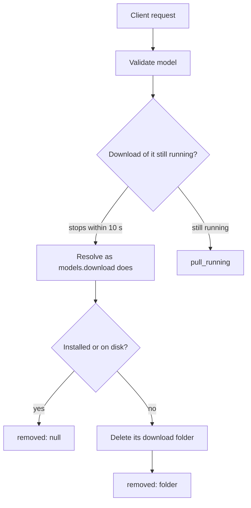

# models.discard

Deletes what a stopped `models.download` left on disk: the `.part` file and any finished files of that download. Use it to cancel a paused download; downloading the same `model` again then starts from the beginning.

## Endpoint, execution and permissions

| Property | Contract |
|---|---|
| Wire endpoint | `POST /v1/cep`; logical method `models.discard` |
| Execution | Immediate |
| Required scope | `write` |
| Side effects | Deletes the model's download folder in the vault |

Send a Bearer token when API authentication is enabled. See [the common CEP contract](../../README.md).

## How it works

1. Validate `model` and refuse a provider model.
2. Wait up to 10 seconds for a download of the same `model` that is still stopping; one still running is refused with `pull_running`.
3. Resolve `model` as `models.download` does. An installed model, or one already on disk, is never touched: the answer is `"removed": null`.
4. Delete the vault folder the download used, unless an installed model is registered in it.



## Parameters, defaults and value effects

| Parameter | Type | Required | Meaning, default and constraints |
|---|---|---|---|
| `model` | string | Yes | The same reference given to `models.download` (catalog id, or `owner/name[:QUANT]`). Leading and trailing spaces are removed; at most 512 characters |

Unknown parameters are rejected.

## Request examples

```json
{
  "jsonrpc": "2.0",
  "id": 1,
  "method": "models.discard",
  "params": {
    "model": "owner/name-GGUF:Q4_K_M"
  }
}
```

## Response and field meanings

`model` is the reference as sent (trimmed). `removed` is the path of the folder deleted, or `null` when nothing was left or the model is installed or already on disk.

```json
{
  "jsonrpc": "2.0",
  "id": 1,
  "result": {
    "model": "owner/name-GGUF:Q4_K_M",
    "removed": "models/chat/name-GGUF-Q4_K_M"
  }
}
```

## Errors and recovery

| Code / boundary | Meaning | Recovery |
|---|---|---|
| HTTP 401 | Missing/invalid token while authentication is enabled | Supply the configured token |
| `-32002` / principal | The caller has no `write` scope | Use a caller with `write` |
| `-32602` / `invalid_params` | `model` is empty, too long or has control characters | Send the reference used for `models.download` |
| `-32005` / `provider_model` | The model is a provider's | Providers have nothing to download |
| `-32005` / `pull_running` | The download is still running | Stop it with `tasks.cancel`, then call again |
| `-32010` / `discard_failed` | Resolving failed, the folder holds an installed model, or a file is in use | Read the message; use `models.remove` for an installed model |

## cURL

Save one valid request above as `request.json`:

```bash
curl --fail-with-body http://127.0.0.1:8000/v1/cep \
  -H "Content-Type: application/json" \
  -H "Authorization: Bearer $CLUAIZ_TOKEN" \
  --data-binary @request.json
```

## Python

Install `requests` in your client environment. This sends the first request above.

```python
import json
import os
import requests

payload = {"jsonrpc": "2.0", "id": 1, "method": "models.discard", "params": {"model": "owner/name-GGUF:Q4_K_M"}}
response = requests.post(
    "http://127.0.0.1:8000/v1/cep",
    headers={"Authorization": "Bearer " + os.environ["CLUAIZ_TOKEN"]},
    json=payload, timeout=60,
)
response.raise_for_status()
reply = response.json()
if "error" in reply:
    raise RuntimeError(json.dumps(reply["error"], ensure_ascii=False))
print(reply["result"])
```

## JavaScript / Node.js

Use an owner token only in a trusted client. Do not ship it inside a public web page.

```javascript
const payload = { jsonrpc: "2.0", id: 1, method: "models.discard", params: { model: "owner/name-GGUF:Q4_K_M" } };
const response = await fetch("http://127.0.0.1:8000/v1/cep", {
  method: "POST",
  headers: { "content-type": "application/json", authorization: `Bearer ${process.env.CLUAIZ_TOKEN}` },
  body: JSON.stringify(payload),
});
const raw = await response.text();
if (!response.ok) throw new Error(`HTTP ${response.status}: ${raw}`);
const reply = JSON.parse(raw);
if (reply.error) throw new Error(JSON.stringify(reply.error));
console.log(reply.result);
```

## Limits, state and related operations

Deleting cannot be undone; calling it again when nothing is left answers `"removed": null`. Resolving the reference works as in `models.download`, so a Hugging Face reference may need the network to find its files.

- [`models.download`](models.download.md): start or continue a download.
- [`models.remove`](models.remove.md): delete an installed model.
- [`tasks.cancel`](../../system/tasks/tasks.cancel.md): stop a running download first.

## Implementation reference

- [api/src/cep/methods/models.rs](../../../../../api/src/cep/methods/models.rs)
- [api/src/handlers/models.rs](../../../../../api/src/handlers/models.rs)
- [engine/models/src/fetcher/resolve.rs](../../../../../engine/models/src/fetcher/resolve.rs)
- [engine/models/src/fetcher/mod.rs](../../../../../engine/models/src/fetcher/mod.rs)
