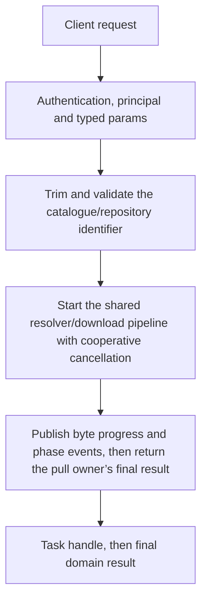

# models.download

Download and register a model using the same resolver/pull owner as the CLI. This is a task with actual resolution/download progress; accepting the task is not a completed installation.

## Endpoint, execution and permissions

| Property | Contract |
|---|---|
| Wire endpoint | `POST /v1/cep`; logical method `models.download` |
| Execution | Task: the first result is a handle; use tasks.get / tasks.result for output |
| Required scope | `write` |
| MCP facade | Not exposed by the current read-only MCP facade |
| Side effects | Updates the state described below |

Send a Bearer token when API authentication is enabled. Authentication failures are HTTP 401; ordinary CEP method errors are JSON-RPC error objects, normally with HTTP 200. A successful HTTP status alone does not prove the operation succeeded. See [the common CEP contract](../../README.md).

## How it works

1. Trim and validate the catalogue/repository identifier
2. Start the shared resolver/download pipeline with cooperative cancellation
3. Publish byte progress and phase events, then return the pull owner’s final result



## Parameters, defaults and value effects

| Parameter | Type | Required | Meaning, default and constraints |
|---|---|---|---|
| `model` | string | Yes | A catalog id, or a Hugging Face repo `owner/name` (optionally `:QUANT`, an `hf://` or https URL) Required catalogue id or supported owner/name[:QUANT], hf:// or HTTPS reference. Trimmed input must be non-empty, at most512 bytes in validation, and have no control characters. :QUANT selects a variant; otherwise resolver ordering determines its default. |

Unknown top-level method parameters are rejected. `params._meta` is protocol metadata, not a domain option; approval retries must preserve the same method and domain parameters. Where a parameter is optional, omission follows the method-specific rules above rather than implying a universal zero or empty-string default.

## Request examples

Examples describe contracts, not measured execution. Replace IDs, paths and installed-package names with real values from your Engine. Do not execute write/delete/process examples against valuable data merely to read the documentation.

### 1. Basic request

This request uses the documented selection. Read the result semantics below before acting on it.

```json
{
  "jsonrpc": "2.0",
  "id": 1,
  "method": "models.download",
  "params": {
    "model": "owner/name-GGUF:Q4_K_M"
  }
}
```

### 2. Select a repository quantization

Illustrative repository name: replace it with a real compatible package and variant.

```json
{
  "jsonrpc": "2.0",
  "id": 2,
  "method": "models.download",
  "params": {
    "model": "owner/model-GGUF:Q4_K_M"
  }
}
```

### 3. Use an explicit Hugging Face reference

The resolver must recognize the repository and quantization; this is not an installed runtime id yet.

```json
{
  "jsonrpc": "2.0",
  "id": 3,
  "method": "models.download",
  "params": {
    "model": "hf://owner/model-GGUF:Q8_0"
  }
}
```

## Response and field meanings

Initial result is a task handle. tasks.get progress uses bytes when the downloader reports counts; phase/status updates appear as task events. The final result is the existing pull result, after download/registration, rather than the original request identifier echoed as fake success.

The following response is an illustrative shape. IDs, byte counts, timings and array contents depend on the actual request and machine; shortened nested objects are not a second schema or a measured result.

```json
{
  "id": 1,
  "jsonrpc": "2.0",
  "result": {
    "task": {
      "method": "models.download",
      "status": "working",
      "task_id": "t_5f0c…"
    }
  }
}
```

### Read the task result

Copy the returned `result.task.task_id`. Task state is in memory and is caller-owned; it is not a durable job queue. Poll for events with the returned cursor, or wait for the final result. A timeout means the task is still running, not that it failed. Cancellation is cooperative and does not undo completed writes/downloads.

```json
{
  "jsonrpc": "2.0",
  "id": 20,
  "method": "tasks.get",
  "params": {
    "task_id": "<returned-task-id>",
    "after": 0
  }
}
```

```json
{
  "jsonrpc": "2.0",
  "id": 21,
  "method": "tasks.result",
  "params": {
    "task_id": "<returned-task-id>",
    "wait_ms": 30000
  }
}
```

Inspect tasks.result for the shared pull pipeline’s final object or its pull_running/download_failed/cancelled error. Verify the resulting runtime id through models.list before using inference.

## Errors and recovery

| Code / boundary | Meaning | Recovery |
|---|---|---|
| HTTP 401 | Missing/invalid token while authentication is enabled | Supply the configured token; a CEP params change cannot repair authentication |
| `-32602` / typed params | Missing required fields, wrong JSON types or unknown fields | Correct the request against this page; do not retry the same invalid payload |
| `-32002` / principal | Required scope/owner/root authorization is absent | Inspect `error.data.needs`; use an authorized caller or permitted target |
| `-32602` / `invalid_params` | `model` is empty, over 512 characters, or has control characters | Correct the option/value combination; install required assets where relevant |
| `-32005` / `pull_running` | This model is being downloaded already (from the task's result) | Inspect current state before retrying; avoid a tight retry loop |
| `-32010` / `download_failed` | Resolving or downloading failed: no such repo or variant, network, disk (from the task's result) | Read the error message, correct the backend/filesystem/configuration condition, then retry deliberately |
| `-32008` / `cancelled` | `tasks.cancel` stopped the download (from the task's result) | Treat as cancelled; review partial side effects before starting new work |

### Invalid-field example

This is deliberately invalid. The extra field must be removed; it is not an alternate feature toggle.

```text
{
  "jsonrpc": "2.0",
  "id": 90,
  "method": "models.download",
  "params": {
    "model": "owner/name-GGUF:Q4_K_M",
    "__unknown_option": true
  }
}
```

The error envelope is `{"jsonrpc":"2.0","id":90,"error":{"code":-32602,"message":"...","data":{"type":"invalid_params", "errors":[...]}}}`. Exact message and field diagnostics are generated by typed deserialization; callers should use codes and structured data, not match a sentence.

## cURL

Save one valid request above as `request.json`:

```bash
curl --fail-with-body http://127.0.0.1:8000/v1/cep \
  -H "Content-Type: application/json" \
  -H "Authorization: Bearer $CLUAIZ_TOKEN" \
  --data-binary @request.json
```

## Python

Install `requests` in your client environment. This executes the basic request; edit `params` for a different valid case.

```python
import json
import os
import requests

payload = json.loads(r'''{
  "id": 1,
  "jsonrpc": "2.0",
  "method": "models.download",
  "params": {
    "model": "owner/name-GGUF:Q4_K_M"
  }
}''')
response = requests.post(
    "http://127.0.0.1:8000/v1/cep",
    headers={"Authorization": "Bearer " + os.environ["CLUAIZ_TOKEN"]},
    json=payload, timeout=60,
)
response.raise_for_status()
reply = response.json()
if "error" in reply:
    raise RuntimeError(json.dumps(reply["error"], ensure_ascii=False))
print(reply["result"])
```

## JavaScript / Node.js

Use an owner token only in a trusted client. Do not ship it inside a public web page.

```javascript
const payload = {
  "id": 1,
  "jsonrpc": "2.0",
  "method": "models.download",
  "params": {
    "model": "owner/name-GGUF:Q4_K_M"
  }
};
const response = await fetch("http://127.0.0.1:8000/v1/cep", {
  method: "POST",
  headers: { "content-type": "application/json", authorization: `Bearer ${process.env.CLUAIZ_TOKEN}` },
  body: JSON.stringify(payload),
});
const raw = await response.text();
if (!response.ok) throw new Error(`HTTP ${response.status}: ${raw}`);
const reply = JSON.parse(raw);
if (reply.error) throw new Error(JSON.stringify(reply.error));
console.log(reply.result);
```

## Limits, state and related operations

Network/catalogue/repository failure, unavailable quantization, disk limits and duplicate active pulls are explicit errors. Models are downloaded from their resolved source; the website supplies registry metadata rather than every weight byte. Cancellation does not promise that already transferred files are rolled back. Installation does not establish runtime architecture compatibility.

- [`tasks.get`](../../system/tasks/tasks.get.md): use its separate documented contract.
- [`tasks.result`](../../system/tasks/tasks.result.md): use its separate documented contract.
- [`models.list`](models.list.md): use its separate documented contract.

## Implementation reference

- [api/src/cep/methods/models.rs](../../../../../api/src/cep/methods/models.rs)
