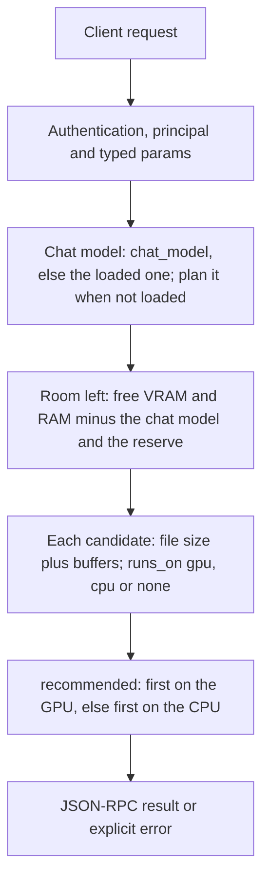

# models.embedding_room

Answer, before anything is downloaded, which embedding model fits beside the user's chat model and
where it would run. An install screen calls it when the user installs a chat model: the App (or the
website catalog) sends the embedding models it offers, in its own order of preference, and shows
the one marked `recommended`. Notes are matched by meaning with the embedding model that is
installed (policy `notes_match`); without one, by words.

## Endpoint, execution and permissions

| Property | Contract |
|---|---|
| Wire endpoint | `POST /v1/cep`; logical method `models.embedding_room` |
| Execution | Synchronous; reads live free memory, loads nothing |
| Required scope | `read` |
| Side effects | None |

Send a Bearer token when API authentication is enabled. Authentication failures are HTTP 401; ordinary CEP method errors are JSON-RPC error objects, normally with HTTP 200. See [the common CEP contract](../../README.md).

## How it works

1. The chat model: `chat_model`, else the chat model loaded now. When it is not loaded yet, the planner plans it on today's free memory and its VRAM and RAM are counted as taken.
2. Room left: free VRAM of the first GPU minus the chat model's plan and the VRAM that plan keeps free (at least the desktop reserve: 5% of the GPU, 0.15 to 1 GB; 0.15 GB on a GPU used by nothing else); RAM the Engine may use minus the chat model's RAM. A loaded chat model is already in the free memory; its own plan is reported.
3. Each candidate needs its file size plus 0.15 GB of buffers (a note is a sentence or two). `runs_on`: `gpu` when that fits in the VRAM left, else `cpu` when it fits in the RAM left, else `none`. A split chat model leaves no VRAM, so the embedding model runs on the CPU: a note embeds in milliseconds there.
4. `recommended`: the first candidate (in the caller's order) that runs on the GPU, else the first that runs on the CPU.

The embedding model never pushes the chat model off the GPU: when the chat model needs the room, the idle embedding model is freed and loads again on its next use.



## Parameters, defaults and value effects

| Parameter | Type | Required | Meaning, default and constraints |
|---|---|---|---|
| `candidates` | array of `{id, bytes}` | No | Embedding models to place, in order of preference; `bytes` is the weight file's size. Without it: the installed embedding models |
| `chat_model` | string | No | An installed chat model the embedding model has to run beside; without it, the loaded one (or none) |

Unknown parameters are rejected.

## Request examples

### 1. The App's own list of embedding models

```json
{
  "jsonrpc": "2.0",
  "id": 1,
  "method": "models.embedding_room",
  "params": {
    "candidates": [
      { "id": "embeddinggemma-300m-gguf-Q8_0", "bytes": 333590944 },
      { "id": "qwen3-embedding-0.6b-gguf-Q8_0", "bytes": 639150592 }
    ]
  }
}
```

### 2. The installed embedding models beside a chat model that is not loaded

```json
{
  "jsonrpc": "2.0",
  "id": 2,
  "method": "models.embedding_room",
  "params": {
    "chat_model": "qwen3.8-4b-distill-gguf-Q4_K_M"
  }
}
```

## Response and field meanings

`chat_model`: `id`, `loaded`, `placement`, `vram_gb`, `ram_gb` (null without a chat model); `gpu_left_gb`, `ram_left_gb`; `candidates`: `id`, `bytes`, `installed`, `needs_gb`, `runs_on`, and `recommended: true` on one of them (none when nothing fits).

## Errors and recovery

| Code / boundary | Meaning | Recovery |
|---|---|---|
| HTTP 401 | Missing/invalid token while authentication is enabled | Supply the configured token |
| `-32602` / typed params | Wrong JSON types or unknown fields | Correct the request against this page |
| `-32004` / `model_not_found` | `chat_model` is not an installed model | Use an id from `models.list` |

## cURL

Save one valid request above as `request.json`:

```bash
curl --fail-with-body http://127.0.0.1:8000/v1/cep \
  -H "Content-Type: application/json" \
  -H "Authorization: Bearer $CLUAIZ_TOKEN" \
  --data-binary @request.json
```

## Python

Install `requests` in your client environment. This sends the first request above.

```python
import json
import os
import requests

payload = {"jsonrpc": "2.0", "id": 1, "method": "models.embedding_room", "params": {"candidates": [{"bytes": 333590944, "id": "embeddinggemma-300m-gguf-Q8_0"}, {"bytes": 639150592, "id": "qwen3-embedding-0.6b-gguf-Q8_0"}]}}
response = requests.post(
    "http://127.0.0.1:8000/v1/cep",
    headers={"Authorization": "Bearer " + os.environ["CLUAIZ_TOKEN"]},
    json=payload, timeout=60,
)
response.raise_for_status()
reply = response.json()
if "error" in reply:
    raise RuntimeError(json.dumps(reply["error"], ensure_ascii=False))
print(reply["result"])
```

## JavaScript / Node.js

Use an owner token only in a trusted client. Do not ship it inside a public web page.

```javascript
const payload = { jsonrpc: "2.0", id: 1, method: "models.embedding_room", params: { candidates: [{ bytes: 333590944, id: "embeddinggemma-300m-gguf-Q8_0" }, { bytes: 639150592, id: "qwen3-embedding-0.6b-gguf-Q8_0" }] } };
const response = await fetch("http://127.0.0.1:8000/v1/cep", {
  method: "POST",
  headers: { "content-type": "application/json", authorization: `Bearer ${process.env.CLUAIZ_TOKEN}` },
  body: JSON.stringify(payload),
});
const raw = await response.text();
if (!response.ok) throw new Error(`HTTP ${response.status}: ${raw}`);
const reply = JSON.parse(raw);
if (reply.error) throw new Error(JSON.stringify(reply.error));
console.log(reply.result);
```

## Limits, state and related operations

An estimate from file sizes, not a load: the planner decides again when the model loads. Only the
first GPU is counted. Checked on a 4 GB laptop GPU with Qwen3.8-4B (split between GPU and RAM)
and EmbeddingGemma-300M Q8_0 (333 MB): the embedding model is placed on the CPU.

- [`models.list`](models.list.md)
- [`models.download`](models.download.md)

## Implementation reference

- [api/src/cep/methods/models.rs](../../../../../api/src/cep/methods/models.rs)
