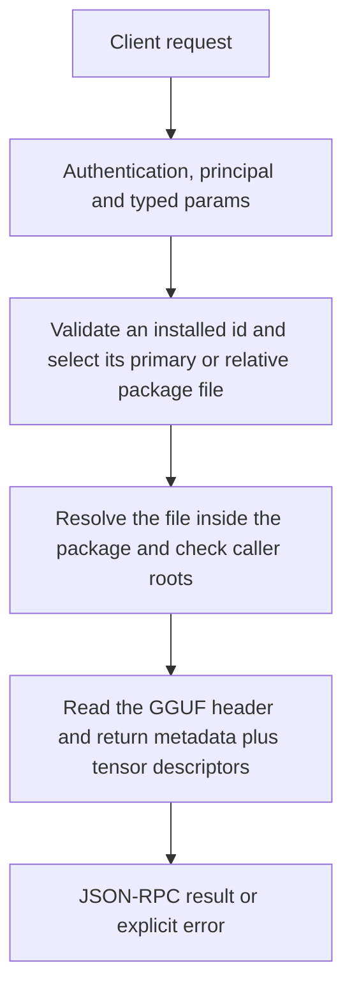

# models.inspect

Inspect a selected installed GGUF file’s actual header/tensors without loading it for generation. Use this to examine architecture, quantization geometry and package metadata rather than inferring capabilities from an install folder name.

## Endpoint, execution and permissions

| Property | Contract |
|---|---|
| Wire endpoint | `POST /v1/cep`; logical method `models.inspect` |
| Execution | Synchronous domain result in the JSON-RPC result field |
| Required scope | `read` |
| MCP facade | Eligible for the current read-only MCP facade |
| Side effects | Read/control behavior described below; this scope alone is not a promise of zero side effects |

Send a Bearer token when API authentication is enabled. Authentication failures are HTTP 401; ordinary CEP method errors are JSON-RPC error objects, normally with HTTP 200. A successful HTTP status alone does not prove the operation succeeded. See [the common CEP contract](../../README.md).

## How it works

1. Validate an installed id and select its primary or relative package file
2. Resolve the file inside the package and check caller roots
3. Read the GGUF header and return metadata plus tensor descriptors



## Parameters, defaults and value effects

| Parameter | Type | Required | Meaning, default and constraints |
|---|---|---|---|
| `file` | string \| null | No | A file inside the model's folder, relative to it (default: the primary weight file) Omitted: primary weight file. Present: relative file within the same package; absolute paths, .. components and escaping symlinks are rejected. |
| `model` | string | Yes | An installed model id (from `models.list`) Exact installed id; empty values or values resembling paths are rejected. |

Unknown top-level method parameters are rejected. `params._meta` is protocol metadata, not a domain option; approval retries must preserve the same method and domain parameters. Where a parameter is optional, omission follows the method-specific rules above rather than implying a universal zero or empty-string default.

## Request examples

Examples describe contracts, not measured execution. Replace IDs, paths and installed-package names with real values from your Engine. Do not execute write/delete/process examples against valuable data merely to read the documentation.

### 1. Basic request

This request uses the documented selection. Read the result semantics below before acting on it.

```json
{
  "jsonrpc": "2.0",
  "id": 1,
  "method": "models.inspect",
  "params": {
    "model": "bonsai-27b-gguf-q1_0"
  }
}
```

### 2. Inspect a relative weight inside the selected package

The file must actually be inside this installed package; this does not let the owner bypass the package-relative file contract.

```json
{
  "jsonrpc": "2.0",
  "id": 2,
  "method": "models.inspect",
  "params": {
    "model": "<installed-gguf-id>",
    "file": "weights/model.gguf"
  }
}
```

## Response and field meanings

metadata contains scalar GGUF metadata, int_arrays contains integer-array metadata, speech_languages is the probe’s declared language data, and tensors[] includes name, dims, ggml_type, offset and size_bytes. Numeric tensor type ids are backend metadata, not a text quantization choice accepted by this method.

The following response is an illustrative shape. IDs, byte counts, timings and array contents depend on the actual request and machine; shortened nested objects are not a second schema or a measured result.

```json
{
  "id": 1,
  "jsonrpc": "2.0",
  "result": {
    "file": "C:/Users/me/.cluaiz/models/chat/bonsai-27b-gguf-q1_0/Bonsai-27B-Q1_0.gguf",
    "int_arrays": {
      "qwen35.rope.dimension_sections": [
        11,
        11,
        10,
        0
      ]
    },
    "metadata": {
      "general.architecture": "qwen35",
      "general.name": "Bonsai 27B",
      "qwen35.block_count": 64,
      "qwen35.context_length": 262144
    },
    "model": "bonsai-27b-gguf-q1_0",
    "speech_languages": [],
    "tensors": [
      {
        "dims": [
          5120,
          248320
        ],
        "ggml_type": 41,
        "name": "output.weight",
        "offset": 0,
        "size_bytes": 178790400
      }
    ]
  }
}
```

## Errors and recovery

| Code / boundary | Meaning | Recovery |
|---|---|---|
| HTTP 401 | Missing/invalid token while authentication is enabled | Supply the configured token; a CEP params change cannot repair authentication |
| `-32602` / typed params | Missing required fields, wrong JSON types or unknown fields | Correct the request against this page; do not retry the same invalid payload |
| `-32002` / principal | Required scope/owner/root authorization is absent | Inspect `error.data.needs`; use an authorized caller or permitted target |
| `-32004` / `model_not_found` | No installed model with this id, or its weight file is missing | Refresh the relevant inventory/IDs and check whether the resource expired |
| `-32602` / `invalid_params` | `model` is empty or looks like a path | Correct the option/value combination; install required assets where relevant |
| `-32002` / `forbidden` | The model's folder is outside the caller's roots (`data.needs: "roots"`) | Read the error message, correct the backend/filesystem/configuration condition, then retry deliberately |
| `-32602` / `invalid_params` | `file` leaves the model's folder | Correct the option/value combination; install required assets where relevant |
| `-32010` / `gguf_probe_failed` | The file is not a readable GGUF | Read the error message, correct the backend/filesystem/configuration condition, then retry deliberately |

### Invalid-field example

This is deliberately invalid. The extra field must be removed; it is not an alternate feature toggle.

```text
{
  "jsonrpc": "2.0",
  "id": 90,
  "method": "models.inspect",
  "params": {
    "model": "bonsai-27b-gguf-q1_0",
    "__unknown_option": true
  }
}
```

The error envelope is `{"jsonrpc":"2.0","id":90,"error":{"code":-32602,"message":"...","data":{"type":"invalid_params", "errors":[...]}}}`. Exact message and field diagnostics are generated by typed deserialization; callers should use codes and structured data, not match a sentence.

## cURL

Save one valid request above as `request.json`:

```bash
curl --fail-with-body http://127.0.0.1:8000/v1/cep \
  -H "Content-Type: application/json" \
  -H "Authorization: Bearer $CLUAIZ_TOKEN" \
  --data-binary @request.json
```

## Python

Install `requests` in your client environment. This executes the basic request; edit `params` for a different valid case.

```python
import json
import os
import requests

payload = json.loads(r'''{
  "id": 1,
  "jsonrpc": "2.0",
  "method": "models.inspect",
  "params": {
    "model": "bonsai-27b-gguf-q1_0"
  }
}''')
response = requests.post(
    "http://127.0.0.1:8000/v1/cep",
    headers={"Authorization": "Bearer " + os.environ["CLUAIZ_TOKEN"]},
    json=payload, timeout=60,
)
response.raise_for_status()
reply = response.json()
if "error" in reply:
    raise RuntimeError(json.dumps(reply["error"], ensure_ascii=False))
print(reply["result"])
```

## JavaScript / Node.js

Use an owner token only in a trusted client. Do not ship it inside a public web page.

```javascript
const payload = {
  "id": 1,
  "jsonrpc": "2.0",
  "method": "models.inspect",
  "params": {
    "model": "bonsai-27b-gguf-q1_0"
  }
};
const response = await fetch("http://127.0.0.1:8000/v1/cep", {
  method: "POST",
  headers: { "content-type": "application/json", authorization: `Bearer ${process.env.CLUAIZ_TOKEN}` },
  body: JSON.stringify(payload),
});
const raw = await response.text();
if (!response.ok) throw new Error(`HTTP ${response.status}: ${raw}`);
const reply = JSON.parse(raw);
if (reply.error) throw new Error(JSON.stringify(reply.error));
console.log(reply.result);
```

## Limits, state and related operations

An ONNX protobuf is not readable by this GGUF inspector; expect gguf_probe_failed. The call does not infer performance or establish live memory fit. A tensor table can be large; there is no pagination or tensor-name filter.

- [`models.list`](models.list.md): use its separate documented contract.
- [`system.plan`](../../system/system/system.plan.md): use its separate documented contract.
- [`models.load`](models.load.md): use its separate documented contract.

## Implementation reference

- [api/src/cep/methods/models.rs](../../../../../api/src/cep/methods/models.rs)
