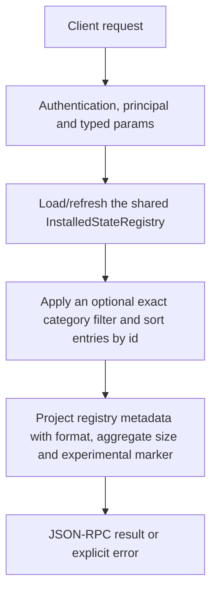

# models.list

List installed registry entries for model selection. This is the local installed inventory, not the website/Hugging Face catalogue, a downloader request or proof that every listed architecture can execute.

## Endpoint, execution and permissions

| Property | Contract |
|---|---|
| Wire endpoint | `POST /v1/cep`; logical method `models.list` |
| Execution | Synchronous domain result in the JSON-RPC result field |
| Required scope | `read` |
| MCP facade | Eligible for the current read-only MCP facade |
| Side effects | Read/control behavior described below; this scope alone is not a promise of zero side effects |

Send a Bearer token when API authentication is enabled. Authentication failures are HTTP 401; ordinary CEP method errors are JSON-RPC error objects, normally with HTTP 200. A successful HTTP status alone does not prove the operation succeeded. See [the common CEP contract](../../README.md).

## How it works

1. Load/refresh the shared InstalledStateRegistry
2. Apply an optional exact category filter and sort entries by id
3. Project registry metadata with format, aggregate size and experimental marker



## Parameters, defaults and value effects

| Parameter | Type | Required | Meaning, default and constraints |
|---|---|---|---|
| `category` | "chat" \| "embedding" \| "vision-embedding" \| "vision" \| "tts" \| "stt" \| null | No | Only models of this category; all when absent Omitted: all categories. Enum accepts chat, embedding, vision-embedding, vision, tts, stt. It is not an arbitrary folder name; unsupported strings are rejected. |

Unknown top-level method parameters are rejected. `params._meta` is protocol metadata, not a domain option; approval retries must preserve the same method and domain parameters. Where a parameter is optional, omission follows the method-specific rules above rather than implying a universal zero or empty-string default.

## Request examples

Examples describe contracts, not measured execution. Replace IDs, paths and installed-package names with real values from your Engine. Do not execute write/delete/process examples against valuable data merely to read the documentation.

### 1. Basic request

This request uses the documented selection. Read the result semantics below before acting on it.

```json
{
  "jsonrpc": "2.0",
  "id": 1,
  "method": "models.list",
  "params": {
    "category": "stt"
  }
}
```

### 2. List every installed entry

Use when category labels are not known or a package belongs to a legacy category.

```json
{
  "jsonrpc": "2.0",
  "id": 2,
  "method": "models.list",
  "params": {}
}
```

### 3. List embedding entries

Image-vector packages can use another accepted category; inspect supported_tasks too.

```json
{
  "jsonrpc": "2.0",
  "id": 3,
  "method": "models.list",
  "params": {
    "category": "embedding"
  }
}
```

## Response and field meanings

result is an ARRAY, not {models:[...]} or OpenAI {data:[...]}. Entries expose id/category/files/extra_files/tasks/metadata and local paths. format replaces format_type in this CEP projection; size is aggregate package bytes. experimental is currently derived from the known TTS-family flag, not a complete certification status for all tasks.

The following response is an illustrative shape. IDs, byte counts, timings and array contents depend on the actual request and machine; shortened nested objects are not a second schema or a measured result.

```json
{
  "id": 1,
  "jsonrpc": "2.0",
  "result": [
    {
      "category": "stt",
      "experimental": false,
      "extra_files": [
        "config.json",
        "tokenizer.json"
      ],
      "files": [
        {
          "is_primary": true,
          "name": "decoder_model_int8.onnx",
          "size_bytes": 439684851
        },
        {
          "is_primary": false,
          "name": "encoder_model_int8.onnx",
          "size_bytes": 644822094
        }
      ],
      "format": "onnx",
      "huggingface_repo": "onnx-community/whisper-large-v3-turbo",
      "id": "whisper-large-v3-turbo-INT8",
      "local_dir": "C:/Users/me/.cluaiz/models/stt/whisper-large-v3-turbo-INT8",
      "metadata": {
        "architecture": "onnx-generic",
        "backend_type": "onnx"
      },
      "size": 1950984246,
      "supported_tasks": [
        "speech_to_text",
        "automatic-speech-recognition"
      ]
    }
  ]
}
```

## Errors and recovery

| Code / boundary | Meaning | Recovery |
|---|---|---|
| HTTP 401 | Missing/invalid token while authentication is enabled | Supply the configured token; a CEP params change cannot repair authentication |
| `-32602` / typed params | Missing required fields, wrong JSON types or unknown fields | Correct the request against this page; do not retry the same invalid payload |
| `-32002` / principal | Required scope/owner/root authorization is absent | Inspect `error.data.needs`; use an authorized caller or permitted target |

### Invalid-field example

This is deliberately invalid. The extra field must be removed; it is not an alternate feature toggle.

```text
{
  "jsonrpc": "2.0",
  "id": 90,
  "method": "models.list",
  "params": {
    "category": "stt",
    "__unknown_option": true
  }
}
```

The error envelope is `{"jsonrpc":"2.0","id":90,"error":{"code":-32602,"message":"...","data":{"type":"invalid_params", "errors":[...]}}}`. Exact message and field diagnostics are generated by typed deserialization; callers should use codes and structured data, not match a sentence.

## cURL

Save one valid request above as `request.json`:

```bash
curl --fail-with-body http://127.0.0.1:8000/v1/cep \
  -H "Content-Type: application/json" \
  -H "Authorization: Bearer $CLUAIZ_TOKEN" \
  --data-binary @request.json
```

## Python

Install `requests` in your client environment. This executes the basic request; edit `params` for a different valid case.

```python
import json
import os
import requests

payload = json.loads(r'''{
  "id": 1,
  "jsonrpc": "2.0",
  "method": "models.list",
  "params": {
    "category": "stt"
  }
}''')
response = requests.post(
    "http://127.0.0.1:8000/v1/cep",
    headers={"Authorization": "Bearer " + os.environ["CLUAIZ_TOKEN"]},
    json=payload, timeout=60,
)
response.raise_for_status()
reply = response.json()
if "error" in reply:
    raise RuntimeError(json.dumps(reply["error"], ensure_ascii=False))
print(reply["result"])
```

## JavaScript / Node.js

Use an owner token only in a trusted client. Do not ship it inside a public web page.

```javascript
const payload = {
  "id": 1,
  "jsonrpc": "2.0",
  "method": "models.list",
  "params": {
    "category": "stt"
  }
};
const response = await fetch("http://127.0.0.1:8000/v1/cep", {
  method: "POST",
  headers: { "content-type": "application/json", authorization: `Bearer ${process.env.CLUAIZ_TOKEN}` },
  body: JSON.stringify(payload),
});
const raw = await response.text();
if (!response.ok) throw new Error(`HTTP ${response.status}: ${raw}`);
const reply = JSON.parse(raw);
if (reply.error) throw new Error(JSON.stringify(reply.error));
console.log(reply.result);
```

## Limits, state and related operations

A present registry entry may still have missing or incompatible assets. Use actual id values for inference; huggingface_repo is provenance, not necessarily the runtime id. Listing does not load weights. Category/task declarations identify candidates, not universal export support.

- [`models.inspect`](models.inspect.md): use its separate documented contract.
- [`models.download`](models.download.md): use its separate documented contract.
- [`audio.voices`](../../ai-inference/audio/audio.voices.md): use its separate documented contract.

## Implementation reference

- [api/src/cep/methods/models.rs](../../../../../api/src/cep/methods/models.rs)
