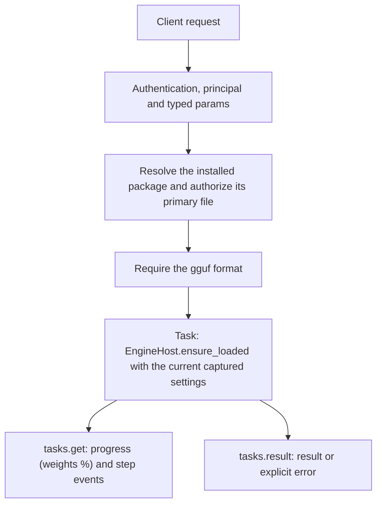

# models.load

Explicitly load an installed GGUF package through the existing Engine host. It is a task: the answer is a task handle at once, and `tasks.get` shows the load as it runs (the share of the weights read, then each step). It is not the ONNX warmup endpoint: ONNX task runtimes load their packages on the first compatible inference request.

## Endpoint, execution and permissions

| Property | Contract |
|---|---|
| Wire endpoint | `POST /v1/cep`; logical method `models.load` |
| Execution | Task: the first result is a handle; use tasks.get / tasks.result for progress and output |
| Required scope | `write` |
| MCP facade | Not exposed by the current read-only MCP facade |
| Side effects | Updates the state described below |

Send a Bearer token when API authentication is enabled. Authentication failures are HTTP 401; ordinary CEP method errors are JSON-RPC error objects, normally with HTTP 200. A successful HTTP status alone does not prove the operation succeeded. See [the common CEP contract](../../README.md).

## How it works

1. Resolve the installed package and authorize its primary file
2. Require the gguf format
3. Start a task and call EngineHost.ensure_loaded with the current captured settings
4. While it loads, the share of the weights read becomes the task's `progress` (`unit: "percent"`) and every other step is a task event (below)
5. The result is the model and the load time; the action is also kept in [`models.load_history`](models.load_history.md)



## Parameters, defaults and value effects

| Parameter | Type | Required | Meaning, default and constraints |
|---|---|---|---|
| `model` | string | Yes | An installed model id (from `models.list`) Required installed model id, not a Hugging Face repository, arbitrary filesystem path or format name. |

Unknown top-level method parameters are rejected. `params._meta` is protocol metadata, not a domain option; approval retries must preserve the same method and domain parameters. Where a parameter is optional, omission follows the method-specific rules above rather than implying a universal zero or empty-string default.

## Request examples

Examples describe contracts, not measured execution. Replace IDs, paths and installed-package names with real values from your Engine. Do not execute write/delete/process examples against valuable data merely to read the documentation.

### 1. Basic request

This request uses the documented selection. Read the result semantics below before acting on it.

```json
{
  "jsonrpc": "2.0",
  "id": 1,
  "method": "models.load",
  "params": {
    "model": "installed-model"
  }
}
```

### 2. Load a selected registered GGUF

Use models.list and system.plan first when you need a specific selection or memory estimate.

```json
{
  "jsonrpc": "2.0",
  "id": 2,
  "method": "models.load",
  "params": {
    "model": "<installed-gguf-id>"
  }
}
```

## Response and field meanings

The call answers at once with `{"task": {"task_id", "method": "models.load", "status": "working", …}}`.

While the task runs, `tasks.get {task_id, after}` returns:

- `progress`: `{"done": 37, "total": 100, "unit": "percent", "message": "reading weights 37%"}`, the share of the weights llama.cpp has read
- `events` after the cursor `after`, each with `kind`, `model`, the placement fields where they apply, and `message` (one readable line):

| `kind` | When | Fields besides `model` and `message` |
|---|---|---|
| `started` | The planned placement starts to load | `attempt` 1, `placement`, `n_gpu_layers`, `n_cpu_moe`, `n_ctx`, `vram_planned_gb` |
| `step` | `step` is `fallback` (llama.cpp tried again another way: `detail` says which), `context` (KV cache and compute buffers) or `warmup` | `attempt`, `step`, `detail` |
| `retry` | The planned placement did not load; one placement smaller is tried | `attempt` 2, the new placement fields, `detail` (why the first failed) |
| `loaded` | Loaded | `attempt`, placement fields, `vram_taken_gb` when measured, `ms` |
| `failed`, `refused` | Not loaded (`refused`: no placement fits) | `detail`, `ms` |
| `unloaded` | The model loaded before was freed to make room | `ms` |

One request can load more than once: after the first load of a model measures it, a better placement may be loaded (`started` again), or a smaller one when too little VRAM was left.

`tasks.result` then gives what the direct call gave before: `model` and `loaded_ms`, the elapsed time for this request. It is not a guaranteed cold-load benchmark: a model already resident with the same settings is not loaded again, and a weight file the system has cached reads much faster than one read from disk.

The following response is an illustrative shape, not a measured result.

```json
{
  "id": 1,
  "jsonrpc": "2.0",
  "result": {
    "loaded_ms": 125,
    "model": "installed-model"
  }
}
```

The same notices go to the Engine's event bus as `model.load_started`, `model.load_step`, `model.load_retry`, `model.loaded`, `model.load_failed`, `model.load_refused` and `model.unloaded`, for loads started anywhere (a chat request, the CLI, a flow).

## Errors and recovery

| Code / boundary | Meaning | Recovery |
|---|---|---|
| HTTP 401 | Missing/invalid token while authentication is enabled | Supply the configured token; a CEP params change cannot repair authentication |
| `-32602` / typed params | Missing required fields, wrong JSON types or unknown fields | Correct the request against this page; do not retry the same invalid payload |
| `-32002` / principal | Required scope/owner/root authorization is absent | Inspect `error.data.needs`; use an authorized caller or permitted target |
| `-32004` / `model_not_found` | No installed model with this id, or its weight file is missing | Refresh the relevant inventory/IDs and check whether the resource expired |
| `-32602` / `invalid_params` | `model` is empty or looks like a path | Correct the option/value combination; install required assets where relevant |
| `-32002` / `forbidden` | The model's folder is outside the caller's roots (`data.needs: "roots"`) | Read the error message, correct the backend/filesystem/configuration condition, then retry deliberately |
| `-32007` / `not_implemented` | The model is not a GGUF (ONNX models load on their first request) | Read the error message, correct the backend/filesystem/configuration condition, then retry deliberately |
| `-32010` / `model_load_failed` | llama.cpp could not load it, the retry included (memory, a broken file, an unsupported architecture), from the task's result | Read the error message, correct the backend/filesystem/configuration condition, then retry deliberately |
| `-32010` / `placement_refused` | No placement fits this machine's free memory; nothing was loaded (from the task's result) | Free memory, choose a smaller quantization or context, or check `system.plan` |

### Invalid-field example

This is deliberately invalid. The extra field must be removed; it is not an alternate feature toggle.

```text
{
  "jsonrpc": "2.0",
  "id": 90,
  "method": "models.load",
  "params": {
    "model": "installed-model",
    "__unknown_option": true
  }
}
```

The error envelope is `{"jsonrpc":"2.0","id":90,"error":{"code":-32602,"message":"...","data":{"type":"invalid_params", "errors":[...]}}}`. Exact message and field diagnostics are generated by typed deserialization; callers should use codes and structured data, not match a sentence.

## cURL

Save one valid request above as `request.json`:

```bash
curl --fail-with-body http://127.0.0.1:8000/v1/cep \
  -H "Content-Type: application/json" \
  -H "Authorization: Bearer $CLUAIZ_TOKEN" \
  --data-binary @request.json
```

## Python

Install `requests` in your client environment. This executes the basic request; edit `params` for a different valid case.

```python
import json
import os
import requests

payload = json.loads(r'''{
  "id": 1,
  "jsonrpc": "2.0",
  "method": "models.load",
  "params": {
    "model": "installed-model"
  }
}''')
response = requests.post(
    "http://127.0.0.1:8000/v1/cep",
    headers={"Authorization": "Bearer " + os.environ["CLUAIZ_TOKEN"]},
    json=payload, timeout=60,
)
response.raise_for_status()
reply = response.json()
if "error" in reply:
    raise RuntimeError(json.dumps(reply["error"], ensure_ascii=False))
print(reply["result"])
```

## JavaScript / Node.js

Use an owner token only in a trusted client. Do not ship it inside a public web page.

```javascript
const payload = {
  "id": 1,
  "jsonrpc": "2.0",
  "method": "models.load",
  "params": {
    "model": "installed-model"
  }
};
const response = await fetch("http://127.0.0.1:8000/v1/cep", {
  method: "POST",
  headers: { "content-type": "application/json", authorization: `Bearer ${process.env.CLUAIZ_TOKEN}` },
  body: JSON.stringify(payload),
});
const raw = await response.text();
if (!response.ok) throw new Error(`HTTP ${response.status}: ${raw}`);
const reply = JSON.parse(raw);
if (reply.error) throw new Error(JSON.stringify(reply.error));
console.log(reply.result);
```

## Limits, state and related operations

Resource admission, unsupported architectures, corrupt weights and native backend problems remain load errors. Model selection does not guarantee every modality/projector is present. A loaded model retains captured load-time settings until replacement/reload. Use task inference endpoints for ONNX rather than repeatedly retrying not_implemented.

- [`models.list`](models.list.md): use its separate documented contract.
- [`system.plan`](../../system/system/system.plan.md): use its separate documented contract.
- [`system.ps`](../../system/system/system.ps.md): use its separate documented contract.

## Implementation reference

- [api/src/cep/methods/models.rs](../../../../../api/src/cep/methods/models.rs)
