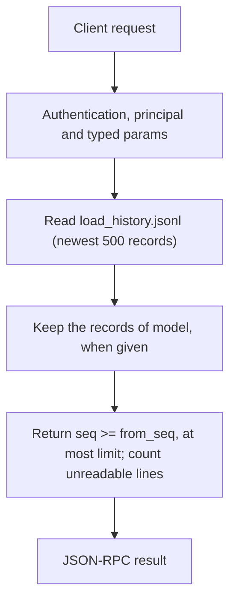

# models.load_history

Read what the Engine did with chat models on this machine: every load, refused load, failed load and unload, with the placement it chose, the VRAM it planned and took, how many llama.cpp loads it needed and how long the action took. Use it to show load times and failures in an app or the CLI, or to see why a model ran in a smaller placement than expected.

## Endpoint, execution and permissions

| Property | Contract |
|---|---|
| Wire endpoint | `POST /v1/cep`; logical method `models.load_history` |
| Execution | Synchronous domain result in the JSON-RPC result field |
| Required scope | `read` |
| MCP facade | Eligible for the current read-only MCP facade |
| Side effects | None; reads `load_history.jsonl` in the Engine's config folder |

Send a Bearer token when API authentication is enabled. Authentication failures are HTTP 401; ordinary CEP method errors are JSON-RPC error objects, normally with HTTP 200. See [the common CEP contract](../../README.md).

## How it works

1. Each chat-model load, refusal, failure and unload appends one JSON line to `load_history.jsonl` (beside `vram_margins.json`). Only the newest 500 records are kept; `seq` keeps counting across the trim.
2. The method reads the file, keeps the records of `model` when given, and returns those with `seq >= from_seq`, at most `limit`.
3. A line that cannot be read is skipped and counted in `skipped_lines`; it never fails the call.



A model that is already loaded with the same settings is not loaded again and writes no record. Records hold ids, numbers and error text, never chat content.

## Parameters, defaults and value effects

| Parameter | Type | Required | Meaning, default and constraints |
|---|---|---|---|
| `model` | string \| null | No | Only this model id. It may be a model removed since; no install check is made. Omitted: every model. |
| `from_seq` | integer \| null | No | First `seq` to return. Omitted: 1. |
| `limit` | integer \| null | No | Most records to return. Omitted: 100; values are kept between 1 and 500. |

Unknown top-level method parameters are rejected.

## Request examples

### 1. One model's loads

```json
{
  "jsonrpc": "2.0",
  "id": 1,
  "method": "models.load_history",
  "params": {
    "model": "qwen3-30b-a3b-instruct-2507-gguf-Q4_K_M",
    "from_seq": 1,
    "limit": 20
  }
}
```

### 2. Every model, the next page

Send the `next_from_seq` of the previous page as `from_seq`.

```json
{
  "jsonrpc": "2.0",
  "id": 2,
  "method": "models.load_history",
  "params": {
    "from_seq": 101
  }
}
```

## Response and field meanings

| Field | Meaning |
|---|---|
| `records` | The records, oldest first |
| `total` | Records kept for this filter |
| `skipped_lines` | Lines of the file that could not be read |
| `next_from_seq` | `from_seq` for the next page: one past the last `seq` when the page is full (`limit` records; the next page may be empty), `null` when it has fewer |

Each record:

| Field | Meaning |
|---|---|
| `seq`, `at` | Position in the history; RFC 3339 time the action ended |
| `action` | `load` or `unload` |
| `outcome` | `ok`; `failed` (llama.cpp could not load it, the retries included); `refused` (no placement fits, nothing was loaded) |
| `cause` | Loads only. `requested`; `remeasured` (the first load measured the model and a better placement fits); `step_down` (too little VRAM was left after the load, loaded one placement smaller) |
| `model`, `file`, `file_bytes` | Installed model id, weight file, its size |
| `attempts` | llama.cpp loads for this action: more than 1 when the planned placement failed and smaller ones were tried (at most 3) |
| `placement`, `n_gpu_layers`, `n_cpu_moe`, `n_ctx` | The placement as loaded (for `failed` and `refused`, as planned) |
| `vram_planned_gb`, `vram_taken_gb` | VRAM the plan counted; free VRAM before the load minus after it. `vram_taken_gb` is absent when it could not be measured (no GPU, a load fallback, shared GPU memory) |
| `ms` | Wall time of the action. A first load reads the weights from disk and is much slower than a load of a file the system has cached |
| `error` | Why the first attempt failed (the retry may still have loaded it), or why the action failed |

Optional fields are left out when they do not apply. Readers should ignore fields they do not know.

## Errors and recovery

| Code / boundary | Meaning | Recovery |
|---|---|---|
| HTTP 401 | Missing/invalid token while authentication is enabled | Supply the configured token |
| `-32602` / typed params | Wrong JSON types (such as a negative `from_seq`) or unknown fields | Correct the request against this page |
| `-32002` / principal | The caller has no `read` scope | Use an authorized caller |

A missing or unreadable history file is not an error: the result has no records.

## cURL

Save one valid request above as `request.json`:

```bash
curl --fail-with-body http://127.0.0.1:8000/v1/cep \
  -H "Content-Type: application/json" \
  -H "Authorization: Bearer $CLUAIZ_TOKEN" \
  --data-binary @request.json
```

## Python

Install `requests` in your client environment. This sends the first request above.

```python
import json
import os
import requests

payload = {"jsonrpc": "2.0", "id": 1, "method": "models.load_history", "params": {"from_seq": 1, "limit": 20, "model": "qwen3-30b-a3b-instruct-2507-gguf-Q4_K_M"}}
response = requests.post(
    "http://127.0.0.1:8000/v1/cep",
    headers={"Authorization": "Bearer " + os.environ["CLUAIZ_TOKEN"]},
    json=payload, timeout=60,
)
response.raise_for_status()
reply = response.json()
if "error" in reply:
    raise RuntimeError(json.dumps(reply["error"], ensure_ascii=False))
print(reply["result"])
```

## JavaScript / Node.js

Use an owner token only in a trusted client. Do not ship it inside a public web page.

```javascript
const payload = { jsonrpc: "2.0", id: 1, method: "models.load_history", params: { from_seq: 1, limit: 20, model: "qwen3-30b-a3b-instruct-2507-gguf-Q4_K_M" } };
const response = await fetch("http://127.0.0.1:8000/v1/cep", {
  method: "POST",
  headers: { "content-type": "application/json", authorization: `Bearer ${process.env.CLUAIZ_TOKEN}` },
  body: JSON.stringify(payload),
});
const raw = await response.text();
if (!response.ok) throw new Error(`HTTP ${response.status}: ${raw}`);
const reply = JSON.parse(raw);
if (reply.error) throw new Error(JSON.stringify(reply.error));
console.log(reply.result);
```

## Limits, state and related operations

The history lives in one file per Engine home and survives restarts; only the newest 500 records are kept. It records finished actions. To watch a load while it runs (started, each step, retry, loaded or failed), read [`system.events`](../../system/system/system.events.md).

- [`models.load`](models.load.md): start a load.
- [`system.ps`](../../system/system/system.ps.md): the model loaded now.

## Implementation reference

- [api/src/cep/methods/models.rs](../../../../../api/src/cep/methods/models.rs)
- [engine/runtime/src/load_history.rs](../../../../../engine/runtime/src/load_history.rs)
- [engine/runtime/src/host.rs](../../../../../engine/runtime/src/host.rs)
