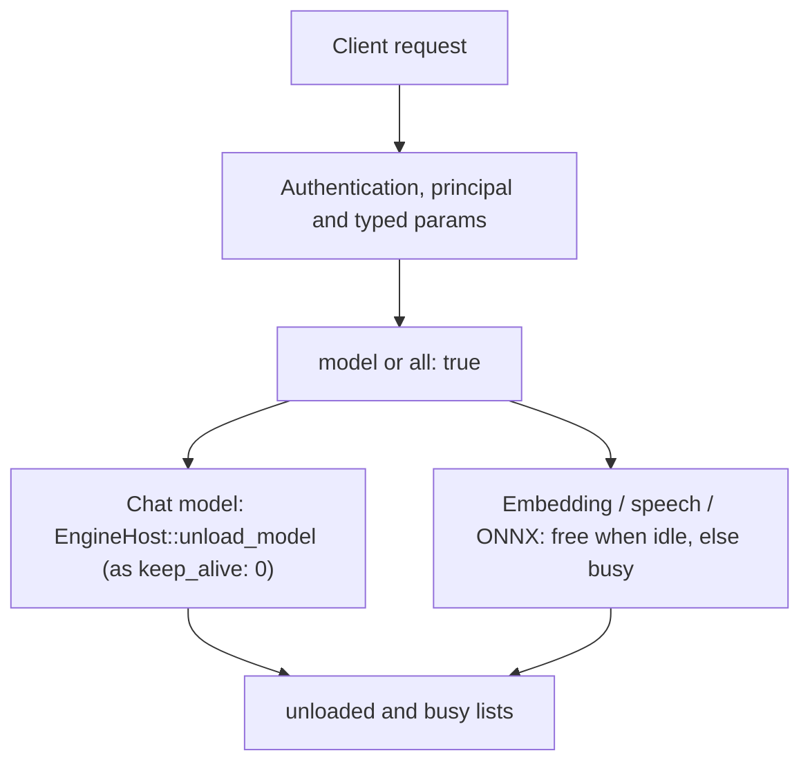

# models.unload

Free a loaded model's memory now, without sending a chat request with `keep_alive: 0` and without uninstalling anything. Use it when an app or script wants the GPU or RAM back for something else, or before a benchmark that needs a clean start.

## Endpoint, execution and permissions

| Property | Contract |
|---|---|
| Wire endpoint | `POST /v1/cep`; logical method `models.unload` |
| Execution | Synchronous domain result in the JSON-RPC result field |
| Required scope | `write` |
| Side effects | Frees model memory; files on disk and the registry are not touched |
| Idempotent | Yes: calling it again when nothing is loaded returns empty lists |

Send a Bearer token when API authentication is enabled. Authentication failures are HTTP 401; ordinary CEP method errors are JSON-RPC error objects, normally with HTTP 200. See [the common CEP contract](../../README.md).

## How it works

1. Read the target: one model id, or `all: true` (exactly one of them)
2. Chat model: when its id matches, unload it through `EngineHost::unload_model`, the same path as `keep_alive: 0` on a chat request. The unload is written to [`models.load_history`](models.load_history.md) and sent as an `unloaded` load event
3. Embedding, speech and ONNX residents: when the id matches, free it only if no request is using it at that moment; a model in use is listed under `busy` and stays loaded
4. With `all: true`, ONNX models parked for a quick return are freed too



## Parameters, defaults and value effects

| Parameter | Type | Required | Meaning, default and constraints |
|---|---|---|---|
| `model` | string | One of the two | Id of the loaded model, as [`system.ps`](../../system/system/system.ps.md) or [`models.list`](models.list.md) shows it. Surrounding spaces are trimmed; an empty string counts as absent |
| `all` | boolean | One of the two | `true` unloads every loaded model. Absent or `false` means only `model` |

Giving neither, or a non-empty `model` together with `all: true`, is `invalid_params`. Unknown top-level parameters are rejected.

## Request examples

### 1. Unload one model

```json
{
  "jsonrpc": "2.0",
  "id": 1,
  "method": "models.unload",
  "params": {
    "model": "qwen3-4b-instruct-2507-gguf-Q4_K_M"
  }
}
```

### 2. Unload everything

```json
{
  "jsonrpc": "2.0",
  "id": 2,
  "method": "models.unload",
  "params": {
    "all": true
  }
}
```

## Response and field meanings

- `unloaded`: the models freed by this call, each `{"model", "kind"}` with `kind` one of `chat`, `embedding`, `speech`, `onnx`.
- `busy`: matching models that a running request was using, so they stayed loaded. Call again after that request ends, or send `keep_alive: 0` on the request itself.

A model that was not loaded appears in neither list; that is not an error. ONNX models freed only because they were parked (with `all: true`) are not listed, because the host keeps no id for them in this path.

```json
{
  "id": 1,
  "jsonrpc": "2.0",
  "result": {
    "busy": [],
    "unloaded": [
      {
        "kind": "chat",
        "model": "qwen3-4b-instruct-2507-gguf-Q4_K_M"
      }
    ]
  }
}
```

## Errors and recovery

| Code / boundary | Meaning | Recovery |
|---|---|---|
| HTTP 401 | Missing/invalid token while authentication is enabled | Supply the configured token |
| `-32602` / `invalid_params` | Neither `model` nor `all: true` was given, or both were, or an unknown field | Send exactly one of them |
| `-32002` / principal | The caller has no `write` scope | Use a token with `write` |

## cURL

Save one valid request above as `request.json`:

```bash
curl --fail-with-body http://127.0.0.1:8000/v1/cep \
  -H "Content-Type: application/json" \
  -H "Authorization: Bearer $CLUAIZ_TOKEN" \
  --data-binary @request.json
```

## Python

```python
import os
import requests

payload = {"jsonrpc": "2.0", "id": 1, "method": "models.unload", "params": {"all": True}}
response = requests.post(
    "http://127.0.0.1:8000/v1/cep",
    headers={"Authorization": "Bearer " + os.environ["CLUAIZ_TOKEN"]},
    json=payload, timeout=60,
)
response.raise_for_status()
reply = response.json()
if "error" in reply:
    raise RuntimeError(reply["error"])
print(reply["result"])
```

## JavaScript / Node.js

```javascript
const payload = { jsonrpc: "2.0", id: 1, method: "models.unload", params: { all: true } };
const response = await fetch("http://127.0.0.1:8000/v1/cep", {
  method: "POST",
  headers: { "content-type": "application/json", authorization: `Bearer ${process.env.CLUAIZ_TOKEN}` },
  body: JSON.stringify(payload),
});
const reply = await response.json();
if (reply.error) throw new Error(JSON.stringify(reply.error));
console.log(reply.result);
```

## Limits, state and related operations

- The chat unload waits for the host's model transition lock, like `keep_alive: 0`, so a load that is in progress finishes first.
- A media resident (embedding, speech, ONNX) is checked by id and then freed when idle. If another request replaces that resident in the instant between the check and the free, the new one is freed instead; the next request loads it again.
- Unloading one ONNX model also frees the ONNX models parked beside it, because the ONNX host frees its idle state as a whole.
- Ollama does the same with `ollama stop <model>` and with `keep_alive: 0` on a request ([Ollama FAQ](https://docs.ollama.com/faq), read 2026-11-26); LM Studio has `lms unload <model_key>` and `lms unload --all` ([LM Studio docs](https://lmstudio.ai/docs/cli/unload), read 2026-11-26). `all: true` follows LM Studio's `--all`.

- [`models.load`](models.load.md): load a model before the first request.
- [`models.remove`](models.remove.md): unload and uninstall a package.
- [`system.ps`](../../system/system/system.ps.md): what is loaded now.
- [`models.load_history`](models.load_history.md): the unload record.

## Implementation reference

- [api/src/cep/methods/models.rs](../../../../../api/src/cep/methods/models.rs)
