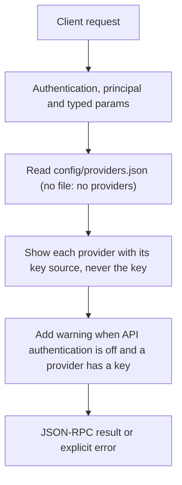

# providers.list

Lists the model providers in `config/providers.json` and the models listed for each. A provider's model is used by its full name, `<provider>/<model>`, in `/v1/chat/completions`, `/v1/embeddings`, `/v1/audio/*`, `cluaiz run` and `cluaiz agent -m`.

## Endpoint, execution and permissions

| Property | Contract |
|---|---|
| Wire endpoint | `POST /v1/cep`; logical method `providers.list` |
| Execution | Synchronous domain result in the JSON-RPC result field |
| Required scope | `admin` |
| MCP facade | Not exposed: it reads or changes the provider settings |
| Side effects | Read only |

Send a Bearer token when API authentication is enabled. Authentication failures are HTTP 401; ordinary CEP method errors are JSON-RPC error objects, normally with HTTP 200. See [the common CEP contract](../../README.md).

## How it works

1. Read config/providers.json (no file: no providers)
2. Show each provider with its key source, never the key
3. Add warning when API authentication is off and a provider has a key



## Parameters, defaults and value effects

None. Send `{}`; unknown parameters are rejected.

## Request examples

### 1. Basic request

```json
{
  "jsonrpc": "2.0",
  "id": 1,
  "method": "providers.list",
  "params": {}
}
```

## Response and field meanings

| Field | Meaning |
|---|---|
| `providers[].name` | The provider's name, the first part of its model names |
| `providers[].type` | Request format: `openai` (the default) or `anthropic` |
| `providers[].base_url` | The provider's base URL |
| `providers[].key` | Where the key comes from (see below) |
| `providers[].models[]` | Listed models: `id` at the provider, `model` as the full name, `kind` (`chat` when none is listed, `embedding`, `tts` or `stt`), `context` in tokens (the Engine's default when none is listed) |
| `warning` | Present only when API authentication is off and a provider has a key |

Replies never contain a key. `key` says only where it comes from: `env MYAPI_KEY` (an environment variable, also read from `config/.env` in the Cluaiz folder; `env MYAPI_KEY (not set)` when it has no value), `file sk-a…a1b2` (kept in providers.json, shown masked), a platform sign-in used instead of a key (`Google Cloud sign-in`, `AWS credentials`, `Microsoft Entra sign-in`) or `none`.

When API authentication is off (`api_auth.required` is false) and a provider has a key, the result also has a `warning`: anyone who can reach the server can then use that key. Authentication stays the owner's setting; this method does not change it. Turn it on with `cluaiz token create` or `tokens.create` plus `api_auth.required`.

## Errors and recovery

| Code / boundary | Meaning | Recovery |
|---|---|---|
| HTTP 401 | Missing/invalid token while authentication is enabled | Supply the configured token |
| `-32602` / typed params | Missing required fields, wrong JSON types or unknown fields | Correct the request against this page |
| `-32002` / principal | The caller has no `admin` scope | Use an owner or admin token |
| `-32010` / `providers_unreadable` | providers.json exists but could not be read or parsed | Fix or move the file in the Cluaiz `config/` folder, then retry |

## cURL

Save one valid request above as `request.json`:

```bash
curl --fail-with-body http://127.0.0.1:8000/v1/cep \
  -H "Content-Type: application/json" \
  -H "Authorization: Bearer $CLUAIZ_TOKEN" \
  --data-binary @request.json
```

## Python

Install `requests` in your client environment. This sends the first request above.

```python
import json
import os
import requests

payload = {"jsonrpc": "2.0", "id": 1, "method": "providers.list", "params": {}}
response = requests.post(
    "http://127.0.0.1:8000/v1/cep",
    headers={"Authorization": "Bearer " + os.environ["CLUAIZ_TOKEN"]},
    json=payload, timeout=60,
)
response.raise_for_status()
reply = response.json()
if "error" in reply:
    raise RuntimeError(json.dumps(reply["error"], ensure_ascii=False))
print(reply["result"])
```

## JavaScript / Node.js

Use an owner token only in a trusted client. Do not ship it inside a public web page.

```javascript
const payload = { jsonrpc: "2.0", id: 1, method: "providers.list", params: {} };
const response = await fetch("http://127.0.0.1:8000/v1/cep", {
  method: "POST",
  headers: { "content-type": "application/json", authorization: `Bearer ${process.env.CLUAIZ_TOKEN}` },
  body: JSON.stringify(payload),
});
const raw = await response.text();
if (!response.ok) throw new Error(`HTTP ${response.status}: ${raw}`);
const reply = JSON.parse(raw);
if (reply.error) throw new Error(JSON.stringify(reply.error));
console.log(reply.result);
```

## Limits, state and related operations

The file is read on each call. A provider's other models can be used too; listing a model records its context size and its kind.

- [`providers.set`](providers.set.md), [`providers.remove`](providers.remove.md), [`providers.models`](providers.models.md), [`providers.test`](providers.test.md)
- Guide: [Model providers](../../../../engine/providers.md)

## Implementation reference

- [api/src/cep/methods/providers.rs](../../../../../api/src/cep/methods/providers.rs)
- [engine/core/src/providers.rs](../../../../../engine/core/src/providers.rs)
