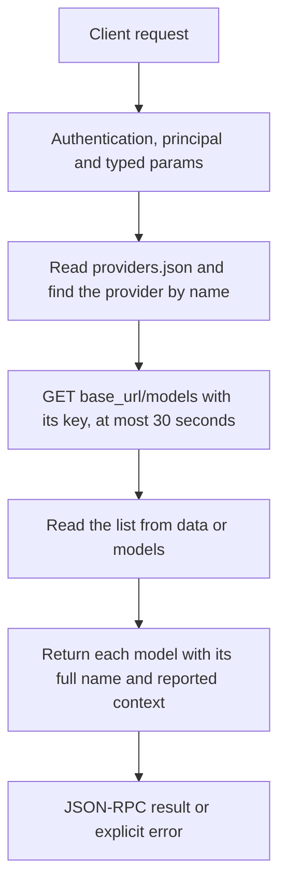

# providers.models

Asks the provider for its models (`GET {base_url}/models`, with its key) and returns each one with its full name. This method does not change providers.json.

## Endpoint, execution and permissions

| Property | Contract |
|---|---|
| Wire endpoint | `POST /v1/cep`; logical method `providers.models` |
| Execution | Synchronous domain result in the JSON-RPC result field |
| Required scope | `admin` |
| MCP facade | Not exposed: it reads or changes the provider settings |
| Side effects | One `GET /models` request to the provider; nothing is saved |

Send a Bearer token when API authentication is enabled. Authentication failures are HTTP 401; ordinary CEP method errors are JSON-RPC error objects, normally with HTTP 200. See [the common CEP contract](../../README.md).

## How it works

1. Read providers.json and find the provider by name
2. GET base_url/models with its key, at most 30 seconds
3. Read the list from data or models
4. Return each model with its full name and reported context



## Parameters, defaults and value effects

| Parameter | Type | Required | Meaning, default and constraints |
|---|---|---|---|
| `name` | string | Yes | The provider's name, as `providers.list` shows it |

Unknown parameters are rejected.

## Request examples

### 1. Basic request

```json
{
  "jsonrpc": "2.0",
  "id": 1,
  "method": "providers.models",
  "params": {
    "name": "myapi"
  }
}
```

## Response and field meanings

`models[]`: `id` (the model id at the provider), `model` (the full name, `<provider>/<id>`) and `context`, the context size the provider reports, read from the field it uses (`context_length`, `context_window` and similar). `context` is `null` when the provider reports none.

## Errors and recovery

| Code / boundary | Meaning | Recovery |
|---|---|---|
| HTTP 401 | Missing/invalid token while authentication is enabled | Supply the configured token |
| `-32602` / typed params | Missing required fields, wrong JSON types or unknown fields | Correct the request against this page |
| `-32002` / principal | The caller has no `admin` scope | Use an owner or admin token |
| `-32004` / `provider_not_found` | No provider has this name | Read the names with `providers.list` |
| `-32010` / `providers_unreadable` | providers.json exists but could not be read or parsed | Fix or move the file in the Cluaiz `config/` folder, then retry |
| `-32010` / `provider_unavailable` | The provider did not answer, refused the key, or its list is not JSON; the message has the provider's own words, never the key | Check `base_url` and the key, then retry |

## cURL

Save one valid request above as `request.json`:

```bash
curl --fail-with-body http://127.0.0.1:8000/v1/cep \
  -H "Content-Type: application/json" \
  -H "Authorization: Bearer $CLUAIZ_TOKEN" \
  --data-binary @request.json
```

## Python

Install `requests` in your client environment. This sends the first request above.

```python
import json
import os
import requests

payload = {"jsonrpc": "2.0", "id": 1, "method": "providers.models", "params": {"name": "myapi"}}
response = requests.post(
    "http://127.0.0.1:8000/v1/cep",
    headers={"Authorization": "Bearer " + os.environ["CLUAIZ_TOKEN"]},
    json=payload, timeout=60,
)
response.raise_for_status()
reply = response.json()
if "error" in reply:
    raise RuntimeError(json.dumps(reply["error"], ensure_ascii=False))
print(reply["result"])
```

## JavaScript / Node.js

Use an owner token only in a trusted client. Do not ship it inside a public web page.

```javascript
const payload = { jsonrpc: "2.0", id: 1, method: "providers.models", params: { name: "myapi" } };
const response = await fetch("http://127.0.0.1:8000/v1/cep", {
  method: "POST",
  headers: { "content-type": "application/json", authorization: `Bearer ${process.env.CLUAIZ_TOKEN}` },
  body: JSON.stringify(payload),
});
const raw = await response.text();
if (!response.ok) throw new Error(`HTTP ${response.status}: ${raw}`);
const reply = JSON.parse(raw);
if (reply.error) throw new Error(JSON.stringify(reply.error));
console.log(reply.result);
```

## Limits, state and related operations

To record a model's context size, send it in `providers.set`. `cluaiz run` and `cluaiz agent` also record it the first time they use a model.

- [`providers.set`](providers.set.md), [`providers.test`](providers.test.md)

## Implementation reference

- [api/src/cep/methods/providers.rs](../../../../../api/src/cep/methods/providers.rs)
- [engine/core/src/providers.rs](../../../../../engine/core/src/providers.rs)
- [api/src/providers/models.rs](../../../../../api/src/providers/models.rs)
