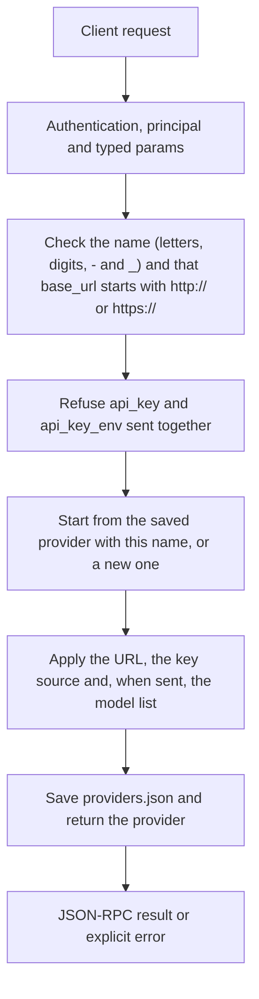

# providers.set

Adds a provider to `config/providers.json`, or changes one with the same `name`.

## Endpoint, execution and permissions

| Property | Contract |
|---|---|
| Wire endpoint | `POST /v1/cep`; logical method `providers.set` |
| Execution | Synchronous domain result in the JSON-RPC result field |
| Required scope | `admin` |
| MCP facade | Not exposed: it reads or changes the provider settings |
| Side effects | Writes `config/providers.json` |

Send a Bearer token when API authentication is enabled. Authentication failures are HTTP 401; ordinary CEP method errors are JSON-RPC error objects, normally with HTTP 200. See [the common CEP contract](../../README.md).

## How it works

1. Check the name (letters, digits, - and _) and that base_url starts with http:// or https://
2. Refuse api_key and api_key_env sent together
3. Start from the saved provider with this name, or a new one
4. Apply the URL, the key source and, when sent, the model list
5. Save providers.json and return the provider



## Parameters, defaults and value effects

| Parameter | Type | Required | Meaning, default and constraints |
|---|---|---|---|
| `name` | string | Yes | Letters, digits, `-` and `_`. It becomes the first part of the model names: `myapi` gives `myapi/<model>` |
| `base_url` | string | Yes | Base URL, such as `https://api.example.com/v1`; a trailing `/` is removed. The Engine adds `/chat/completions` and `/models` |
| `api_key_env` | string \| null | No | Name of the environment variable that holds the key. The key itself stays out of the file. An empty string clears the key source |
| `api_key` | string \| null | No | The key, kept in providers.json. Send this or `api_key_env`, not both. An empty string clears the key source |
| `models` | object \| null | No | Listed models with their context size and kind: `{"model-name": {"context": 32768}, "embed-name": {"kind": "embedding"}}`. `kind` is `chat` (the default), `embedding`, `tts` or `stt`. When sent, it replaces the list; when left out, the list stays |

Unknown parameters are rejected.

A changed provider keeps its `type`, `compat` (how it differs from the OpenAI format, set in providers.json; see [Provider differences](../../../../engine/providers.md#provider-differences)), `auth` and `headers`.

When neither `api_key_env` nor `api_key` is sent, the provider keeps its current key source. A provider that needs no key, such as Ollama on the same computer (`http://localhost:11434/v1`), needs neither.

## Request examples

### 1. A provider with its key in an environment variable

```json
{
  "jsonrpc": "2.0",
  "id": 1,
  "method": "providers.set",
  "params": {
    "name": "myapi",
    "base_url": "https://api.example.com/v1",
    "api_key_env": "MYAPI_KEY",
    "models": {
      "model-name": {
        "context": 32768
      }
    }
  }
}
```

### 2. A local server that needs no key, with a chat and an embedding model

```json
{
  "jsonrpc": "2.0",
  "id": 1,
  "method": "providers.set",
  "params": {
    "name": "ollama",
    "base_url": "http://localhost:11434/v1",
    "models": {
      "qwen3:4b": {
        "context": 8192
      },
      "nomic-embed-text": {
        "kind": "embedding"
      }
    }
  }
}
```

## Response and field meanings

`provider` is the saved provider, in the same shape as one entry of `providers.list` (`name`, `type`, `base_url`, `key`, `models`). `warning` is present as in `providers.list`.

Replies never contain a key. `key` says only where it comes from: `env MYAPI_KEY` (an environment variable, also read from `config/.env` in the Cluaiz folder; `env MYAPI_KEY (not set)` when it has no value), `file sk-a…a1b2` (kept in providers.json, shown masked), a platform sign-in used instead of a key (`Google Cloud sign-in`, `AWS credentials`, `Microsoft Entra sign-in`) or `none`.

## Errors and recovery

| Code / boundary | Meaning | Recovery |
|---|---|---|
| HTTP 401 | Missing/invalid token while authentication is enabled | Supply the configured token |
| `-32602` / typed params | Missing required fields, wrong JSON types or unknown fields | Correct the request against this page |
| `-32002` / principal | The caller has no `admin` scope | Use an owner or admin token |
| `-32602` / `invalid_params` | The name or the URL is not valid, a model's kind is not `chat`, `embedding`, `tts` or `stt`, or both `api_key` and `api_key_env` were sent | Correct the value named in the message |
| `-32010` / `providers_unreadable` | providers.json exists but could not be read or parsed | Fix or move the file in the Cluaiz `config/` folder, then retry |
| `-32010` / `settings_not_saved` | providers.json could not be written | Check the `config/` folder's permissions and free space; the file is unchanged |

## cURL

Save one valid request above as `request.json`:

```bash
curl --fail-with-body http://127.0.0.1:8000/v1/cep \
  -H "Content-Type: application/json" \
  -H "Authorization: Bearer $CLUAIZ_TOKEN" \
  --data-binary @request.json
```

## Python

Install `requests` in your client environment. This sends the first request above.

```python
import json
import os
import requests

payload = {"jsonrpc": "2.0", "id": 1, "method": "providers.set", "params": {"api_key_env": "MYAPI_KEY", "base_url": "https://api.example.com/v1", "models": {"model-name": {"context": 32768}}, "name": "myapi"}}
response = requests.post(
    "http://127.0.0.1:8000/v1/cep",
    headers={"Authorization": "Bearer " + os.environ["CLUAIZ_TOKEN"]},
    json=payload, timeout=60,
)
response.raise_for_status()
reply = response.json()
if "error" in reply:
    raise RuntimeError(json.dumps(reply["error"], ensure_ascii=False))
print(reply["result"])
```

## JavaScript / Node.js

Use an owner token only in a trusted client. Do not ship it inside a public web page.

```javascript
const payload = { jsonrpc: "2.0", id: 1, method: "providers.set", params: { api_key_env: "MYAPI_KEY", base_url: "https://api.example.com/v1", models: { "model-name": { context: 32768 } }, name: "myapi" } };
const response = await fetch("http://127.0.0.1:8000/v1/cep", {
  method: "POST",
  headers: { "content-type": "application/json", authorization: `Bearer ${process.env.CLUAIZ_TOKEN}` },
  body: JSON.stringify(payload),
});
const raw = await response.text();
if (!response.ok) throw new Error(`HTTP ${response.status}: ${raw}`);
const reply = JSON.parse(raw);
if (reply.error) throw new Error(JSON.stringify(reply.error));
console.log(reply.result);
```

## Limits, state and related operations

The new settings apply to the next request that names the provider's models. This method does not try the provider; call `providers.test` for that.

- [`providers.list`](providers.list.md), [`providers.test`](providers.test.md), [`providers.models`](providers.models.md)
- Guide: [Model providers](../../../../engine/providers.md)

## Implementation reference

- [api/src/cep/methods/providers.rs](../../../../../api/src/cep/methods/providers.rs)
- [engine/core/src/providers.rs](../../../../../engine/core/src/providers.rs)
