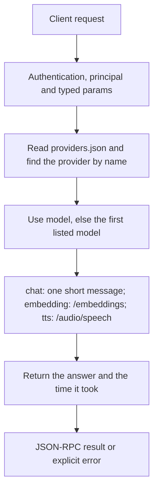

# providers.test

Sends one short request of the model's listed kind to check that the URL, the key and the model work.

## Endpoint, execution and permissions

| Property | Contract |
|---|---|
| Wire endpoint | `POST /v1/cep`; logical method `providers.test` |
| Execution | Synchronous domain result in the JSON-RPC result field |
| Required scope | `admin` |
| MCP facade | Not exposed: it reads or changes the provider settings |
| Side effects | One real request to the provider; it counts toward the provider's usage limits. Nothing is saved |

Send a Bearer token when API authentication is enabled. Authentication failures are HTTP 401; ordinary CEP method errors are JSON-RPC error objects, normally with HTTP 200. See [the common CEP contract](../../README.md).

## How it works

1. Read providers.json and find the provider by name
2. Use model, else the first listed model
3. chat: one short message; embedding: /embeddings; tts: /audio/speech
4. Return the answer and the time it took



A `chat` model (also a model with no listed kind) gets the message "Reply with the single word: ready" with at most 64 tokens. An `embedding` model gets the text `ready` at `/embeddings`; when the provider asks for `input_type`, the request is sent once more with `input_type: "query"` and the answer says so. A `tts` model gets `ready` at `/audio/speech` as `wav`, with `voice` when sent. An `stt` model is not tested here: the reply is `provider_unavailable`, telling you to send audio to `/v1/audio/transcriptions`.

## Parameters, defaults and value effects

| Parameter | Type | Required | Meaning, default and constraints |
|---|---|---|---|
| `name` | string | Yes | The provider's name, as `providers.list` shows it |
| `model` | string \| null | No | The model id at the provider, such as `model-name`. Default: the first listed model |
| `voice` | string \| null | No | For a `tts` model: the voice, for providers that need one. Not used for other kinds |

Unknown parameters are rejected.

## Request examples

### 1. One model

```json
{
  "jsonrpc": "2.0",
  "id": 1,
  "method": "providers.test",
  "params": {
    "name": "myapi",
    "model": "model-name"
  }
}
```

### 2. The first listed model

```json
{
  "jsonrpc": "2.0",
  "id": 1,
  "method": "providers.test",
  "params": {
    "name": "myapi"
  }
}
```

## Response and field meanings

| Field | Meaning |
|---|---|
| `model` | The full name that was tried, `<provider>/<model>` |
| `answer` | The model's reply for `chat`; `a vector of N numbers` for `embedding`; `N bytes of audio` for `tts` |
| `ms` | Time the request took, in milliseconds |

## Errors and recovery

| Code / boundary | Meaning | Recovery |
|---|---|---|
| HTTP 401 | Missing/invalid token while authentication is enabled | Supply the configured token |
| `-32602` / typed params | Missing required fields, wrong JSON types or unknown fields | Correct the request against this page |
| `-32002` / principal | The caller has no `admin` scope | Use an owner or admin token |
| `-32004` / `provider_not_found` | No provider has this name | Read the names with `providers.list` |
| `-32602` / `invalid_params` | No `model` was sent and the provider lists none | Send `model`, or list models with `providers.set` |
| `-32010` / `providers_unreadable` | providers.json exists but could not be read or parsed | Fix or move the file in the Cluaiz `config/` folder, then retry |
| `-32010` / `provider_unavailable` | The provider did not answer or refused the request: a refused key (401 or 403), an unknown model (404) or a rate limit (429), followed by the provider's own message; or the model is `stt` | Fix what the message names; the key is never part of an error |

## cURL

Save one valid request above as `request.json`:

```bash
curl --fail-with-body http://127.0.0.1:8000/v1/cep \
  -H "Content-Type: application/json" \
  -H "Authorization: Bearer $CLUAIZ_TOKEN" \
  --data-binary @request.json
```

## Python

Install `requests` in your client environment. This sends the first request above.

```python
import json
import os
import requests

payload = {"jsonrpc": "2.0", "id": 1, "method": "providers.test", "params": {"model": "model-name", "name": "myapi"}}
response = requests.post(
    "http://127.0.0.1:8000/v1/cep",
    headers={"Authorization": "Bearer " + os.environ["CLUAIZ_TOKEN"]},
    json=payload, timeout=60,
)
response.raise_for_status()
reply = response.json()
if "error" in reply:
    raise RuntimeError(json.dumps(reply["error"], ensure_ascii=False))
print(reply["result"])
```

## JavaScript / Node.js

Use an owner token only in a trusted client. Do not ship it inside a public web page.

```javascript
const payload = { jsonrpc: "2.0", id: 1, method: "providers.test", params: { model: "model-name", name: "myapi" } };
const response = await fetch("http://127.0.0.1:8000/v1/cep", {
  method: "POST",
  headers: { "content-type": "application/json", authorization: `Bearer ${process.env.CLUAIZ_TOKEN}` },
  body: JSON.stringify(payload),
});
const raw = await response.text();
if (!response.ok) throw new Error(`HTTP ${response.status}: ${raw}`);
const reply = JSON.parse(raw);
if (reply.error) throw new Error(JSON.stringify(reply.error));
console.log(reply.result);
```

## Limits, state and related operations

The request is a real request to the provider and counts toward its usage limits.

- [`providers.models`](providers.models.md), [`providers.set`](providers.set.md)

## Implementation reference

- [api/src/cep/methods/providers.rs](../../../../../api/src/cep/methods/providers.rs)
- [engine/core/src/providers.rs](../../../../../engine/core/src/providers.rs)
- [api/src/providers/models.rs](../../../../../api/src/providers/models.rs)
