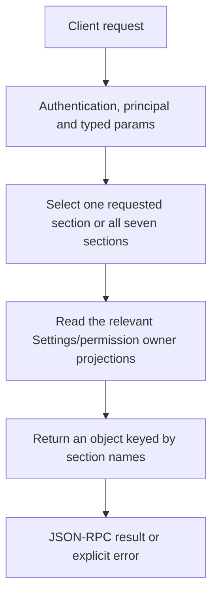

# config.get

Read saved settings by section, preserving automatic/unset controls rather than replacing them with planner choices. Use it before editing a settings page or assembling a targeted patch.

## Endpoint, execution and permissions

| Property | Contract |
|---|---|
| Wire endpoint | `POST /v1/cep`; logical method `config.get` |
| Execution | Synchronous domain result in the JSON-RPC result field |
| Required scope | `read` |
| MCP facade | Not exposed by the current read-only MCP facade |
| Side effects | Read/control behavior described below; this scope alone is not a promise of zero side effects |

Send a Bearer token when API authentication is enabled. Authentication failures are HTTP 401; ordinary CEP method errors are JSON-RPC error objects, normally with HTTP 200. A successful HTTP status alone does not prove the operation succeeded. See [the common CEP contract](../../README.md).

## How it works

1. Select one requested section or all seven sections
2. Read the relevant Settings/permission owner projections
3. Return an object keyed by section names



## Parameters, defaults and value effects

| Parameter | Type | Required | Meaning, default and constraints |
|---|---|---|---|
| `section` | "gguf" \| "onnx" \| "optimization" \| "context" \| "storage" \| "kv" \| "engine" \| null | No | One section; all of them when absent Omitted: gguf,onnx,optimization,context,storage,kv,engine. Exact enum string selects only one section. |

Unknown top-level method parameters are rejected. `params._meta` is protocol metadata, not a domain option; approval retries must preserve the same method and domain parameters. Where a parameter is optional, omission follows the method-specific rules above rather than implying a universal zero or empty-string default.

## Request examples

Examples describe contracts, not measured execution. Replace IDs, paths and installed-package names with real values from your Engine. Do not execute write/delete/process examples against valuable data merely to read the documentation.

### 1. Basic request

This request uses the documented selection. Read the result semantics below before acting on it.

```json
{
  "jsonrpc": "2.0",
  "id": 1,
  "method": "config.get",
  "params": {
    "section": "kv"
  }
}
```

### 2. Read every section

Use only in a trusted client because the engine section can contain security settings.

```json
{
  "jsonrpc": "2.0",
  "id": 2,
  "method": "config.get",
  "params": {}
}
```

### 3. Read only ONNX controls

The returned key is onnx; settings remain in their saved representation.

```json
{
  "jsonrpc": "2.0",
  "id": 3,
  "method": "config.get",
  "params": {
    "section": "onnx"
  }
}
```

## Response and field meanings

Each key maps to that section’s saved contract. GGUF hardware_and_execution/samplers/flags preserve nullable/automatic fields. This is not the same as system.plan’s chosen resolved execution plan. Engine permission data can include sensitive API/auth/model-slot settings.

The following response is an illustrative shape. IDs, byte counts, timings and array contents depend on the actual request and machine; shortened nested objects are not a second schema or a measured result.

```json
{
  "id": 1,
  "jsonrpc": "2.0",
  "result": {
    "kv": {
      "enabled": true,
      "max_age_days": 30,
      "max_disk_gb": 10
    }
  }
}
```

## Errors and recovery

| Code / boundary | Meaning | Recovery |
|---|---|---|
| HTTP 401 | Missing/invalid token while authentication is enabled | Supply the configured token; a CEP params change cannot repair authentication |
| `-32602` / typed params | Missing required fields, wrong JSON types or unknown fields | Correct the request against this page; do not retry the same invalid payload |
| `-32002` / principal | Required scope/owner/root authorization is absent | Inspect `error.data.needs`; use an authorized caller or permitted target |

### Invalid-field example

This is deliberately invalid. The extra field must be removed; it is not an alternate feature toggle.

```text
{
  "jsonrpc": "2.0",
  "id": 90,
  "method": "config.get",
  "params": {
    "section": "kv",
    "__unknown_option": true
  }
}
```

The error envelope is `{"jsonrpc":"2.0","id":90,"error":{"code":-32602,"message":"...","data":{"type":"invalid_params", "errors":[...]}}}`. Exact message and field diagnostics are generated by typed deserialization; callers should use codes and structured data, not match a sentence.

## cURL

Save one valid request above as `request.json`:

```bash
curl --fail-with-body http://127.0.0.1:8000/v1/cep \
  -H "Content-Type: application/json" \
  -H "Authorization: Bearer $CLUAIZ_TOKEN" \
  --data-binary @request.json
```

## Python

Install `requests` in your client environment. This executes the basic request; edit `params` for a different valid case.

```python
import json
import os
import requests

payload = json.loads(r'''{
  "id": 1,
  "jsonrpc": "2.0",
  "method": "config.get",
  "params": {
    "section": "kv"
  }
}''')
response = requests.post(
    "http://127.0.0.1:8000/v1/cep",
    headers={"Authorization": "Bearer " + os.environ["CLUAIZ_TOKEN"]},
    json=payload, timeout=60,
)
response.raise_for_status()
reply = response.json()
if "error" in reply:
    raise RuntimeError(json.dumps(reply["error"], ensure_ascii=False))
print(reply["result"])
```

## JavaScript / Node.js

Use an owner token only in a trusted client. Do not ship it inside a public web page.

```javascript
const payload = {
  "id": 1,
  "jsonrpc": "2.0",
  "method": "config.get",
  "params": {
    "section": "kv"
  }
};
const response = await fetch("http://127.0.0.1:8000/v1/cep", {
  method: "POST",
  headers: { "content-type": "application/json", authorization: `Bearer ${process.env.CLUAIZ_TOKEN}` },
  body: JSON.stringify(payload),
});
const raw = await response.text();
if (!response.ok) throw new Error(`HTTP ${response.status}: ${raw}`);
const reply = JSON.parse(raw);
if (reply.error) throw new Error(JSON.stringify(reply.error));
console.log(reply.result);
```

## Limits, state and related operations

Current engine-section projection also clears missing installed-model slot references and may save that cleanup, so this read is not guaranteed zero-write. It is not exposed via the current MCP facade. A model already loaded does not change solely because settings were read.

- [`config.set`](config.set.md): use its separate documented contract.
- [`system.plan`](../system/system.plan.md): use its separate documented contract.
- [`models.list`](../../models/models/models.list.md): use its separate documented contract.

## Implementation reference

- [api/src/cep/methods/config.rs](../../../../../api/src/cep/methods/config.rs)
