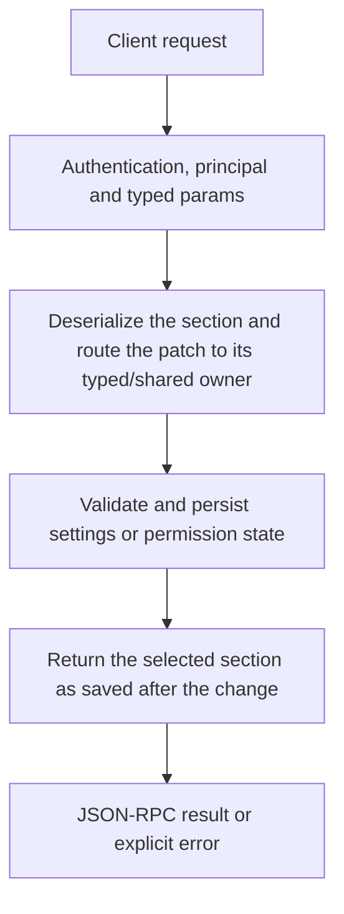

# config.set

Update a saved settings section through its existing validation/merge owner. This is not a universal JSON deep merge: behavior differs by section, and some nested objects replace their previous contents.

## Endpoint, execution and permissions

| Property | Contract |
|---|---|
| Wire endpoint | `POST /v1/cep`; logical method `config.set` |
| Execution | Synchronous domain result in the JSON-RPC result field |
| Required scope | `write` |
| MCP facade | Not exposed by the current read-only MCP facade |
| Side effects | Updates the state described below |

Send a Bearer token when API authentication is enabled. Authentication failures are HTTP 401; ordinary CEP method errors are JSON-RPC error objects, normally with HTTP 200. A successful HTTP status alone does not prove the operation succeeded. See [the common CEP contract](../../README.md).

## How it works

1. Deserialize the section and route the patch to its typed/shared owner
2. Validate and persist settings or permission state
3. Return the selected section as saved after the change



## Parameters, defaults and value effects

| Parameter | Type | Required | Meaning, default and constraints |
|---|---|---|---|
| `patch` | any | Yes | Only the fields to change Required object/value accepted by the selected section. See the section-specific behavior below. |
| `section` | "gguf" \| "onnx" \| "optimization" \| "context" \| "storage" \| "kv" \| "engine" | Yes | The section to change Required gguf, onnx, optimization, context, storage, kv or engine. |

Unknown top-level method parameters are rejected. `params._meta` is protocol metadata, not a domain option; approval retries must preserve the same method and domain parameters. Where a parameter is optional, omission follows the method-specific rules above rather than implying a universal zero or empty-string default.

## Request examples

Examples describe contracts, not measured execution. Replace IDs, paths and installed-package names with real values from your Engine. Do not execute write/delete/process examples against valuable data merely to read the documentation.

### 1. Basic request

This request uses the documented selection. Read the result semantics below before acting on it.

```json
{
  "jsonrpc": "2.0",
  "id": 1,
  "method": "config.set",
  "params": {
    "patch": {
      "cross_chat": "ask"
    },
    "section": "context"
  }
}
```

### 2. Bound saved KV disk usage

This may immediately evict saved cache. History is a separate owner.

```json
{
  "jsonrpc": "2.0",
  "id": 2,
  "method": "config.set",
  "params": {
    "section": "kv",
    "patch": {
      "max_disk_gb": 2,
      "max_age_days": 7
    }
  }
}
```

### 3. Set one GGUF hardware control

Requests CPU for future captures/reloads; does not migrate the live resident immediately.

```json
{
  "jsonrpc": "2.0",
  "id": 3,
  "method": "config.set",
  "params": {
    "section": "gguf",
    "patch": {
      "hardware_and_execution": {
        "n_gpu_layers": 0
      }
    }
  }
}
```

### 4. Update context policy

Use actual validated policy fields; changing percentages is not a one-off chat compaction command.

```json
{
  "jsonrpc": "2.0",
  "id": 4,
  "method": "config.set",
  "params": {
    "section": "context",
    "patch": {
      "compact_at_pct": 80,
      "compact_to_pct": 60
    }
  }
}
```

## Response and field meanings

The result is keyed by section, for example {kv:{...}}. It reflects the saved settings after the update, not necessarily values captured by already loaded models. An empty patch is not a documented reset-to-default operation.

The following response is an illustrative shape. IDs, byte counts, timings and array contents depend on the actual request and machine; shortened nested objects are not a second schema or a measured result.

```json
{
  "id": 1,
  "jsonrpc": "2.0",
  "result": {
    "context": {
      "cross_chat": "ask"
    }
  }
}
```

## Errors and recovery

| Code / boundary | Meaning | Recovery |
|---|---|---|
| HTTP 401 | Missing/invalid token while authentication is enabled | Supply the configured token; a CEP params change cannot repair authentication |
| `-32602` / typed params | Missing required fields, wrong JSON types or unknown fields | Correct the request against this page; do not retry the same invalid payload |
| `-32002` / principal | Required scope/owner/root authorization is absent | Inspect `error.data.needs`; use an authorized caller or permitted target |
| `-32602` / `invalid_params` | An unknown field or an invalid value in `patch` (section engine ignores unknown fields instead) | Correct the option/value combination; install required assets where relevant |
| `-32010` / `settings_not_saved` | settings.json or permission.json could not be written | Read the error message, correct the backend/filesystem/configuration condition, then retry deliberately |

### Invalid-field example

This is deliberately invalid. The extra field must be removed; it is not an alternate feature toggle.

```text
{
  "jsonrpc": "2.0",
  "id": 90,
  "method": "config.set",
  "params": {
    "patch": {
      "cross_chat": "ask"
    },
    "section": "context",
    "__unknown_option": true
  }
}
```

The error envelope is `{"jsonrpc":"2.0","id":90,"error":{"code":-32602,"message":"...","data":{"type":"invalid_params", "errors":[...]}}}`. Exact message and field diagnostics are generated by typed deserialization; callers should use codes and structured data, not match a sentence.

## cURL

Save one valid request above as `request.json`:

```bash
curl --fail-with-body http://127.0.0.1:8000/v1/cep \
  -H "Content-Type: application/json" \
  -H "Authorization: Bearer $CLUAIZ_TOKEN" \
  --data-binary @request.json
```

## Python

Install `requests` in your client environment. This executes the basic request; edit `params` for a different valid case.

```python
import json
import os
import requests

payload = json.loads(r'''{
  "id": 1,
  "jsonrpc": "2.0",
  "method": "config.set",
  "params": {
    "patch": {
      "cross_chat": "ask"
    },
    "section": "context"
  }
}''')
response = requests.post(
    "http://127.0.0.1:8000/v1/cep",
    headers={"Authorization": "Bearer " + os.environ["CLUAIZ_TOKEN"]},
    json=payload, timeout=60,
)
response.raise_for_status()
reply = response.json()
if "error" in reply:
    raise RuntimeError(json.dumps(reply["error"], ensure_ascii=False))
print(reply["result"])
```

## JavaScript / Node.js

Use an owner token only in a trusted client. Do not ship it inside a public web page.

```javascript
const payload = {
  "id": 1,
  "jsonrpc": "2.0",
  "method": "config.set",
  "params": {
    "patch": {
      "cross_chat": "ask"
    },
    "section": "context"
  }
};
const response = await fetch("http://127.0.0.1:8000/v1/cep", {
  method: "POST",
  headers: { "content-type": "application/json", authorization: `Bearer ${process.env.CLUAIZ_TOKEN}` },
  body: JSON.stringify(payload),
});
const raw = await response.text();
if (!response.ok) throw new Error(`HTTP ${response.status}: ${raw}`);
const reply = JSON.parse(raw);
if (reply.error) throw new Error(JSON.stringify(reply.error));
console.log(reply.result);
```

## Limits, state and related operations

GGUF accepts hardware_and_execution (n_gpu_layers -1 Auto/0 CPU/N, n_ctx -1 Max/0 Auto/N, no_mmap,batch_size,ubatch_size), samplers and user_moved_flags.think_mode. If samplers is supplied, the sampler struct is reconstructed: omitted sampler members become unset; do not assume nested merge. ONNX/optimization use their existing merged validation. Context patches allow policy fields; percentages are whole0–100 and recent_turns_min<=50, with a backup on first migration of that section. Storage requires cleanup_policy. KV accepts enabled,max_disk_gb>=0,max_age_days and immediately enforces disk/age limits, potentially deleting cache. Engine applies PermissionSchema merge rules (some objects replace whole), ignores unknown fields and can affect access/connectivity. None of this rewrites an already loaded model’s captured load settings.

- [`config.get`](config.get.md): use its separate documented contract.
- [`system.plan`](../system/system.plan.md): use its separate documented contract.
- [`kv.status`](../../ai-inference/kv/kv.status.md): use its separate documented contract.

## Implementation reference

- [api/src/cep/methods/config.rs](../../../../../api/src/cep/methods/config.rs)
