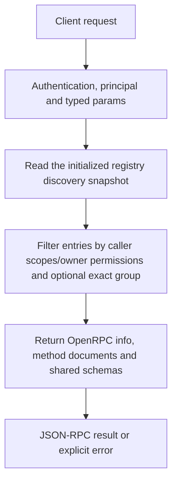

# rpc.discover

Read the caller-visible OpenRPC method catalogue and schemas. Use this to discover method names/typed parameters and build client tooling instead of maintaining an independent hardcoded API registry.

## Endpoint, execution and permissions

| Property | Contract |
|---|---|
| Wire endpoint | `POST /v1/cep`; logical method `rpc.discover` |
| Execution | Synchronous domain result in the JSON-RPC result field |
| Required scope | `read` |
| MCP facade | Not exposed by the current read-only MCP facade |
| Side effects | Read/control behavior described below; this scope alone is not a promise of zero side effects |

Send a Bearer token when API authentication is enabled. Authentication failures are HTTP 401; ordinary CEP method errors are JSON-RPC error objects, normally with HTTP 200. A successful HTTP status alone does not prove the operation succeeded. See [the common CEP contract](../../README.md).

## How it works

1. Read the initialized registry discovery snapshot
2. Filter entries by caller scopes/owner permissions and optional exact group
3. Return OpenRPC info, method documents and shared schemas



## Parameters, defaults and value effects

| Parameter | Type | Required | Meaning, default and constraints |
|---|---|---|---|
| `group` | string \| null | No | Only this group, for example "fs" Optional exact namespace such as fs, memory, tasks or models. Omitted returns every caller-visible method. An unmatched group yields an empty methods array rather than creating a namespace. |

Unknown top-level method parameters are rejected. `params._meta` is protocol metadata, not a domain option; approval retries must preserve the same method and domain parameters. Where a parameter is optional, omission follows the method-specific rules above rather than implying a universal zero or empty-string default.

## Request examples

Examples describe contracts, not measured execution. Replace IDs, paths and installed-package names with real values from your Engine. Do not execute write/delete/process examples against valuable data merely to read the documentation.

### 1. Basic request

This request uses the documented selection. Read the result semantics below before acting on it.

```json
{
  "jsonrpc": "2.0",
  "id": 1,
  "method": "rpc.discover",
  "params": {
    "group": "tasks"
  }
}
```

### 2. Discover filesystem methods

Use returned schemas/metadata rather than assuming method names from an old REST path.

```json
{
  "jsonrpc": "2.0",
  "id": 2,
  "method": "rpc.discover",
  "params": {
    "group": "fs"
  }
}
```

### 3. Discover all methods visible to this caller

A restricted caller can receive fewer entries than the owner.

```json
{
  "jsonrpc": "2.0",
  "id": 3,
  "method": "rpc.discover",
  "params": {}
}
```

## Response and field meanings

openrpc identifies document format; info identifies the Engine; methods[] carries names/summaries/params/results and x-cep metadata, and components.schemas contains shared referenced schemas. The returned method count depends on caller access and filtering, not a fixed universal79 claim.

The following response is an illustrative shape. IDs, byte counts, timings and array contents depend on the actual request and machine; shortened nested objects are not a second schema or a measured result.

```json
{
  "id": 1,
  "jsonrpc": "2.0",
  "result": {
    "info": {
      "title": "Cluaiz Engine Protocol"
    },
    "methods": [],
    "openrpc": "1.3.2"
  }
}
```

## Errors and recovery

| Code / boundary | Meaning | Recovery |
|---|---|---|
| HTTP 401 | Missing/invalid token while authentication is enabled | Supply the configured token; a CEP params change cannot repair authentication |
| `-32602` / typed params | Missing required fields, wrong JSON types or unknown fields | Correct the request against this page; do not retry the same invalid payload |
| `-32002` / principal | Required scope/owner/root authorization is absent | Inspect `error.data.needs`; use an authorized caller or permitted target |

### Invalid-field example

This is deliberately invalid. The extra field must be removed; it is not an alternate feature toggle.

```text
{
  "jsonrpc": "2.0",
  "id": 90,
  "method": "rpc.discover",
  "params": {
    "group": "tasks",
    "__unknown_option": true
  }
}
```

The error envelope is `{"jsonrpc":"2.0","id":90,"error":{"code":-32602,"message":"...","data":{"type":"invalid_params", "errors":[...]}}}`. Exact message and field diagnostics are generated by typed deserialization; callers should use codes and structured data, not match a sentence.

## cURL

Save one valid request above as `request.json`:

```bash
curl --fail-with-body http://127.0.0.1:8000/v1/cep \
  -H "Content-Type: application/json" \
  -H "Authorization: Bearer $CLUAIZ_TOKEN" \
  --data-binary @request.json
```

## Python

Install `requests` in your client environment. This executes the basic request; edit `params` for a different valid case.

```python
import json
import os
import requests

payload = json.loads(r'''{
  "id": 1,
  "jsonrpc": "2.0",
  "method": "rpc.discover",
  "params": {
    "group": "tasks"
  }
}''')
response = requests.post(
    "http://127.0.0.1:8000/v1/cep",
    headers={"Authorization": "Bearer " + os.environ["CLUAIZ_TOKEN"]},
    json=payload, timeout=60,
)
response.raise_for_status()
reply = response.json()
if "error" in reply:
    raise RuntimeError(json.dumps(reply["error"], ensure_ascii=False))
print(reply["result"])
```

## JavaScript / Node.js

Use an owner token only in a trusted client. Do not ship it inside a public web page.

```javascript
const payload = {
  "id": 1,
  "jsonrpc": "2.0",
  "method": "rpc.discover",
  "params": {
    "group": "tasks"
  }
};
const response = await fetch("http://127.0.0.1:8000/v1/cep", {
  method: "POST",
  headers: { "content-type": "application/json", authorization: `Bearer ${process.env.CLUAIZ_TOKEN}` },
  body: JSON.stringify(payload),
});
const raw = await response.text();
if (!response.ok) throw new Error(`HTTP ${response.status}: ${raw}`);
const reply = JSON.parse(raw);
if (reply.error) throw new Error(JSON.stringify(reply.error));
console.log(reply.result);
```

## Limits, state and related operations

This is CEP discovery, not the list of direct HTTP routes, installed tools or models. Direct /v1/ingest and chat/audio/embedding HTTP endpoints are documented separately. Discovery metadata/examples do not execute a method or certify every backend. The method itself is not advertised by the current MCP facade.

- [`models.list`](../../models/models/models.list.md): use its separate documented contract.
- [`tools.list`](../../agents-tools/tools/tools.list.md): use its separate documented contract.
- [`system.info`](../system/system.info.md): use its separate documented contract.

## Implementation reference

- [cep/src/protocol.rs](../../../../../cep/src/protocol.rs)
- [cep/src/discover.rs](../../../../../cep/src/discover.rs)
