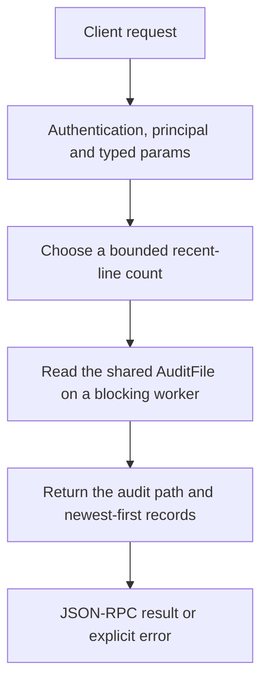

# system.audit

Read recent CEP audit records for owner inspection. This is the shared audit log of relevant writes/execution/admin calls and denials, not a raw chat transcript or a complete read-request trace.

## Endpoint, execution and permissions

| Property | Contract |
|---|---|
| Wire endpoint | `POST /v1/cep`; logical method `system.audit` |
| Execution | Synchronous domain result in the JSON-RPC result field |
| Required scope | `admin` |
| MCP facade | Not exposed by the current read-only MCP facade |
| Side effects | Updates the state described below |

Send a Bearer token when API authentication is enabled. Authentication failures are HTTP 401; ordinary CEP method errors are JSON-RPC error objects, normally with HTTP 200. A successful HTTP status alone does not prove the operation succeeded. See [the common CEP contract](../../README.md).

## How it works

1. Choose a bounded recent-line count
2. Read the shared AuditFile on a blocking worker
3. Return the audit path and newest-first records



## Parameters, defaults and value effects

| Parameter | Type | Required | Meaning, default and constraints |
|---|---|---|---|
| `limit` | integer \| null | No | How many of the newest lines (default 100, at most 1000) Defaults to100, capped at1000; 0 requests no rows rather than an unlimited dump. |

Unknown top-level method parameters are rejected. `params._meta` is protocol metadata, not a domain option; approval retries must preserve the same method and domain parameters. Where a parameter is optional, omission follows the method-specific rules above rather than implying a universal zero or empty-string default.

## Request examples

Examples describe contracts, not measured execution. Replace IDs, paths and installed-package names with real values from your Engine. Do not execute write/delete/process examples against valuable data merely to read the documentation.

### 1. Basic request

This request uses the documented selection. Read the result semantics below before acting on it.

```json
{
  "jsonrpc": "2.0",
  "id": 1,
  "method": "system.audit",
  "params": {
    "limit": 1
  }
}
```

### 2. Read the last twenty records

Returned order is newest first; this is not cursor pagination.

```json
{
  "jsonrpc": "2.0",
  "id": 2,
  "method": "system.audit",
  "params": {
    "limit": 20
  }
}
```

## Response and field meanings

path identifies the local audit file. lines[] can include ts, principal, method, scope, params_sha256, result code and elapsed ms. Parameters are represented by a hash, not recovered plaintext request bodies. null code indicates the audit record’s success convention.

The following response is an illustrative shape. IDs, byte counts, timings and array contents depend on the actual request and machine; shortened nested objects are not a second schema or a measured result.

```json
{
  "id": 1,
  "jsonrpc": "2.0",
  "result": {
    "lines": [
      {
        "code": null,
        "method": "fs.write",
        "ms": 3,
        "params_sha256": "9f2c…",
        "principal": "owner",
        "scope": "write",
        "ts": "2026-10-25T10:30:00.000Z"
      }
    ],
    "path": "C:/Users/me/.cluaiz/cep-audit.jsonl"
  }
}
```

## Errors and recovery

| Code / boundary | Meaning | Recovery |
|---|---|---|
| HTTP 401 | Missing/invalid token while authentication is enabled | Supply the configured token; a CEP params change cannot repair authentication |
| `-32602` / typed params | Missing required fields, wrong JSON types or unknown fields | Correct the request against this page; do not retry the same invalid payload |
| `-32002` / principal | Required scope/owner/root authorization is absent | Inspect `error.data.needs`; use an authorized caller or permitted target |

### Invalid-field example

This is deliberately invalid. The extra field must be removed; it is not an alternate feature toggle.

```text
{
  "jsonrpc": "2.0",
  "id": 90,
  "method": "system.audit",
  "params": {
    "limit": 1,
    "__unknown_option": true
  }
}
```

The error envelope is `{"jsonrpc":"2.0","id":90,"error":{"code":-32602,"message":"...","data":{"type":"invalid_params", "errors":[...]}}}`. Exact message and field diagnostics are generated by typed deserialization; callers should use codes and structured data, not match a sentence.

## cURL

Save one valid request above as `request.json`:

```bash
curl --fail-with-body http://127.0.0.1:8000/v1/cep \
  -H "Content-Type: application/json" \
  -H "Authorization: Bearer $CLUAIZ_TOKEN" \
  --data-binary @request.json
```

## Python

Install `requests` in your client environment. This executes the basic request; edit `params` for a different valid case.

```python
import json
import os
import requests

payload = json.loads(r'''{
  "id": 1,
  "jsonrpc": "2.0",
  "method": "system.audit",
  "params": {
    "limit": 1
  }
}''')
response = requests.post(
    "http://127.0.0.1:8000/v1/cep",
    headers={"Authorization": "Bearer " + os.environ["CLUAIZ_TOKEN"]},
    json=payload, timeout=60,
)
response.raise_for_status()
reply = response.json()
if "error" in reply:
    raise RuntimeError(json.dumps(reply["error"], ensure_ascii=False))
print(reply["result"])
```

## JavaScript / Node.js

Use an owner token only in a trusted client. Do not ship it inside a public web page.

```javascript
const payload = {
  "id": 1,
  "jsonrpc": "2.0",
  "method": "system.audit",
  "params": {
    "limit": 1
  }
};
const response = await fetch("http://127.0.0.1:8000/v1/cep", {
  method: "POST",
  headers: { "content-type": "application/json", authorization: `Bearer ${process.env.CLUAIZ_TOKEN}` },
  body: JSON.stringify(payload),
});
const raw = await response.text();
if (!response.ok) throw new Error(`HTTP ${response.status}: ${raw}`);
const reply = JSON.parse(raw);
if (reply.error) throw new Error(JSON.stringify(reply.error));
console.log(reply.result);
```

## Limits, state and related operations

Admin scope; not exposed by the read-only MCP facade. The returned path/records can contain sensitive host/operation metadata. No full-file export, since cursor, query filter or log-clear operation is provided here.

- [`system.exec`](system.exec.md): use its separate documented contract.
- [`approvals.list`](../../agents-tools/approvals/approvals.list.md): use its separate documented contract.
- [`tokens.list`](../tokens/tokens.list.md): use its separate documented contract.

## Implementation reference

- [api/src/cep/methods/audit.rs](../../../../../api/src/cep/methods/audit.rs)
