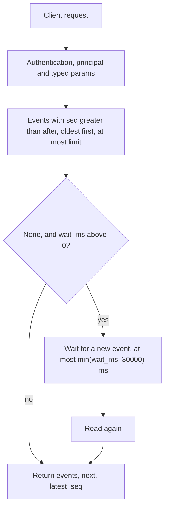

# system.events

Read the Engine's recent events after a cursor, so a client outside the Engine (the App, a script) sees what happened even when it did not start it: a model load moving step by step (`model.load_started`, `model.load_step`, `model.load_retry`, `model.loaded`, `model.load_failed`, `model.load_refused`, `model.unloaded`), a download (`model.downloaded`), a task ending (`task.done`, `task.failed`), an approval (`approval.requested`, `approval.decided`), a tool installed or removed (`tool.installed`, `tool.removed`), a flow (`flow.finished`, `flow.failed`) and `engine.started`. With `wait_ms` the call waits (long-polls) until a new event arrives, so a client does not have to ask again every second.

## Endpoint, execution and permissions

| Property | Contract |
|---|---|
| Wire endpoint | `POST /v1/cep`; logical method `system.events` |
| Execution | Synchronous domain result in the JSON-RPC result field; with `wait_ms` the reply may wait up to 30 seconds |
| Required scope | `read` |
| MCP facade | Eligible for the current read-only MCP facade |
| Side effects | None; reads an in-memory ring of the newest 1024 events |

Send a Bearer token when API authentication is enabled. Authentication failures are HTTP 401; ordinary CEP method errors are JSON-RPC error objects, normally with HTTP 200. See [the common CEP contract](../../README.md).

## How it works

1. Every event the Engine publishes gets the next `seq` (1, 2, 3, ... for this Engine run) and its time `at`, and goes into a ring that keeps the newest 1024; the oldest is dropped when it is full
2. Return the events with `seq` greater than `after`, oldest first, at most `limit`
3. When there are none and `wait_ms` is above 0, wait until a new event arrives or `wait_ms` (at most 30000) has passed, then read again
4. `next` is the `seq` of the last event returned (or `after` when none); `latest_seq` is the newest `seq` held



## Parameters, defaults and value effects

| Parameter | Type | Required | Meaning, default and constraints |
|---|---|---|---|
| `after` | integer \| null | No | Return events with `seq` strictly greater than this. Omitted or `null`: `0` (every event still held). Negative values are rejected |
| `limit` | integer \| null | No | Most events in one reply. Omitted or `null`: `100`. `0` counts as `1`; above `256` counts as `256` |
| `wait_ms` | integer \| null | No | When nothing is newer than `after`, wait up to this many milliseconds for an event. Omitted, `null` or `0`: answer at once. Above `30000` counts as `30000` |

Unknown parameters are rejected.

## Request examples

### 1. What the Engine still holds

```json
{
  "jsonrpc": "2.0",
  "id": 1,
  "method": "system.events",
  "params": {
    "after": 0,
    "limit": 50
  }
}
```

### 2. Wait for the next event after a cursor

Send the `next` of the previous reply as `after`. The reply comes as soon as an event arrives, or empty after 15 seconds.

```json
{
  "jsonrpc": "2.0",
  "id": 2,
  "method": "system.events",
  "params": {
    "after": 2,
    "limit": 50,
    "wait_ms": 15000
  }
}
```

## Response and field meanings

| Field | Meaning |
|---|---|
| `events[]` | Oldest first. `seq`: the event's number in this Engine run; `name`: what happened; `at`: RFC 3339 time, to the second; `data`: the event's fields (always an object) |
| `next` | Pass it as `after` next time: the last returned `seq`, or `after` itself when nothing was returned |
| `latest_seq` | The newest `seq` of this Engine run, `0` before the first event |

`data` of the model-load events is the load notice: `kind` (`started`, `step`, `retry`, `loaded`, `failed`, `refused`, `unloaded`), `model`, and when they apply `attempt`, `step` (`weights`, `fallback`, `context`, `warmup`), `percent` (weights read), `placement`, `n_gpu_layers`, `n_cpu_moe`, `n_ctx`, `vram_planned_gb`, `vram_taken_gb`, `ms`, `detail`, plus `message`, one line for a person (`reading weights 37%`). `task.done` and `task.failed` carry `task_id`, `method` and, for a failure, `error`.

Seen on a test Engine (debug build, empty home, 2026-11-22): a call with `wait_ms: 20000` returned in 1.7 s with the `task.failed` event of a download started 1 s after it, and a call with `wait_ms: 2000` and nothing new returned empty after 2.1 s.

## Errors and recovery

| Code / boundary | Meaning | Recovery |
|---|---|---|
| HTTP 401 | Missing/invalid token while authentication is enabled | Supply the configured token |
| `-32602` / `invalid_params` | Wrong JSON types (a negative or fractional number, a string) or an unknown field | Correct the request against this page |
| `-32002` / principal | The caller has no `read` scope | Use an authorized caller |

## cURL

Save one valid request above as `request.json`:

```bash
curl --fail-with-body http://127.0.0.1:8000/v1/cep \
  -H "Content-Type: application/json" \
  -H "Authorization: Bearer $CLUAIZ_TOKEN" \
  --data-binary @request.json
```

## Python

Install `requests` in your client environment. This follows the events: each reply's `next` is the next call's `after`.

```python
import json
import os
import requests

after = 0
while True:
    payload = {"jsonrpc": "2.0", "id": 1, "method": "system.events", "params": {"after": after, "limit": 50, "wait_ms": 15000}}
    response = requests.post(
        "http://127.0.0.1:8000/v1/cep",
        headers={"Authorization": "Bearer " + os.environ["CLUAIZ_TOKEN"]},
        json=payload, timeout=60,
    )
    response.raise_for_status()
    reply = response.json()
    if "error" in reply:
        raise RuntimeError(json.dumps(reply["error"], ensure_ascii=False))
    page = reply["result"]
    for event in page["events"]:
        print(event["seq"], event["name"], event["data"].get("message", ""))
    after = page["next"]
```

## JavaScript / Node.js

Use an owner token only in a trusted client. Do not ship it inside a public web page.

```javascript
const payload = { jsonrpc: "2.0", id: 1, method: "system.events", params: { after: 0, limit: 50, wait_ms: 15000 } };
const response = await fetch("http://127.0.0.1:8000/v1/cep", {
  method: "POST",
  headers: { "content-type": "application/json", authorization: `Bearer ${process.env.CLUAIZ_TOKEN}` },
  body: JSON.stringify(payload),
});
const raw = await response.text();
if (!response.ok) throw new Error(`HTTP ${response.status}: ${raw}`);
const reply = JSON.parse(raw);
if (reply.error) throw new Error(JSON.stringify(reply.error));
console.log(reply.result.events, reply.result.next);
```

## Limits, state and related operations

- Events carry ids, names, numbers and status text, never chat text or file contents.
- The ring is in memory: it starts empty (then `engine.started`) each time the Engine starts, and `seq` starts again at 1. A cursor above `latest_seq` comes from an earlier run: start again with `after: 0`.
- Only the newest 1024 events are kept. A chat-model load sends about 110 (one per weights percent), so the ring holds about the last 9 loads. A client that falls further behind misses the oldest ones; the first returned `seq` is then more than `after + 1`.
- A client should give the HTTP call a timeout longer than `wait_ms` (the App uses `wait_ms + 5000`).
- For the finished loads, kept on disk across restarts, read [`models.load_history`](../../models/models/models.load_history.md).

- [`system.ps`](system.ps.md): the model loaded now.
- [`models.load`](../../models/models/models.load.md): start a load (its task also reports progress).
- [`tasks.get`](../tasks/tasks.get.md): one task's progress and result.

## Implementation reference

- [api/src/cep/methods/system.rs](../../../../../api/src/cep/methods/system.rs)
- [cep/src/events.rs](../../../../../cep/src/events.rs)
- [api/src/lib.rs](../../../../../api/src/lib.rs) (`forward_load_events`)
- [engine/runtime/src/load_events.rs](../../../../../engine/runtime/src/load_events.rs)
