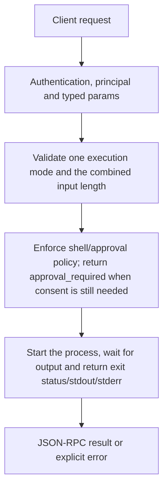

# system.exec

Run a host program through an explicit owner-approved CEP call. Prefer program plus literal args; shell command text is a separate policy-gated mode. This is native host execution, not a sandboxed fake command runner.

## Endpoint, execution and permissions

| Property | Contract |
|---|---|
| Wire endpoint | `POST /v1/cep`; logical method `system.exec` |
| Execution | Synchronous domain result in the JSON-RPC result field |
| Required scope | `admin` |
| MCP facade | Not exposed by the current read-only MCP facade |
| Side effects | Destructive; review the target before calling |

Send a Bearer token when API authentication is enabled. Authentication failures are HTTP 401; ordinary CEP method errors are JSON-RPC error objects, normally with HTTP 200. A successful HTTP status alone does not prove the operation succeeded. See [the common CEP contract](../../README.md).

## How it works

1. Validate one execution mode and the combined input length
2. Enforce shell/approval policy; return approval_required when consent is still needed
3. Start the process, wait for output and return exit status/stdout/stderr



## Parameters, defaults and value effects

| Parameter | Type | Required | Meaning, default and constraints |
|---|---|---|---|
| `args` | string[] | No | Its arguments, each passed as it is Defaults to []. Each argument is passed separately without shell interpolation in program mode. Cannot accompany command mode. |
| `command` | string \| null | No | One shell line instead of `program`; only when permission.json `exec.allow_shell` is on A single shell line; only with exec.allow_shell enabled. Windows uses cmd /C; Unix uses sh -c. |
| `program` | string \| null | No | The program to run (a name on PATH or a path); not passed through a shell Use a program on PATH or an executable path; trimmed non-empty. Cannot be combined with command. |

Unknown top-level method parameters are rejected. `params._meta` is protocol metadata, not a domain option; approval retries must preserve the same method and domain parameters. Where a parameter is optional, omission follows the method-specific rules above rather than implying a universal zero or empty-string default.

## Request examples

Examples describe contracts, not measured execution. Replace IDs, paths and installed-package names with real values from your Engine. Do not execute write/delete/process examples against valuable data merely to read the documentation.

### 1. Basic request

This request uses the documented selection. Read the result semantics below before acting on it.

```json
{
  "jsonrpc": "2.0",
  "id": 1,
  "method": "system.exec",
  "params": {
    "args": [
      "--version"
    ],
    "program": "git"
  }
}
```

### 2. Pass arguments without a shell

Spaces and metacharacters inside an argument are literal in program mode. Initial approval may still be required.

```json
{
  "jsonrpc": "2.0",
  "id": 2,
  "method": "system.exec",
  "params": {
    "program": "git",
    "args": [
      "status",
      "--short"
    ]
  }
}
```

## Response and field meanings

exit_code is the OS process exit code (can be null when unavailable); stdout/stderr are decoded lossily as UTF-8. A nonzero program exit is still a completed process result, not necessarily a CEP transport error. process_failed means it could not start.

The following response is an illustrative shape. IDs, byte counts, timings and array contents depend on the actual request and machine; shortened nested objects are not a second schema or a measured result.

```json
{
  "id": 1,
  "jsonrpc": "2.0",
  "result": {
    "exit_code": 0,
    "stderr": "",
    "stdout": "git version 2.47.0\n"
  }
}
```

## Errors and recovery

| Code / boundary | Meaning | Recovery |
|---|---|---|
| HTTP 401 | Missing/invalid token while authentication is enabled | Supply the configured token; a CEP params change cannot repair authentication |
| `-32602` / typed params | Missing required fields, wrong JSON types or unknown fields | Correct the request against this page; do not retry the same invalid payload |
| `-32002` / principal | Required scope/owner/root authorization is absent | Inspect `error.data.needs`; use an authorized caller or permitted target |
| `-32003` / `approval_required` | Every call, until the owner approves it (`data.approval_id`); send it again with `_meta.approval` | Ask the owner to decide the returned approval, then retry the same request with _meta.approval |
| `-32602` / `invalid_params` | Both or neither of `program` / `command`, `args` with `command`, or a shell line while `exec.allow_shell` is off | Correct the option/value combination; install required assets where relevant |
| `-32006` / `too_large` | The command is over 8192 characters | Reduce the input to the reported limit |
| `-32010` / `process_failed` | The program could not be started (not found, not executable) | Read the error message, correct the backend/filesystem/configuration condition, then retry deliberately |

### Invalid-field example

This is deliberately invalid. The extra field must be removed; it is not an alternate feature toggle.

```text
{
  "jsonrpc": "2.0",
  "id": 90,
  "method": "system.exec",
  "params": {
    "args": [
      "--version"
    ],
    "program": "git",
    "__unknown_option": true
  }
}
```

The error envelope is `{"jsonrpc":"2.0","id":90,"error":{"code":-32602,"message":"...","data":{"type":"invalid_params", "errors":[...]}}}`. Exact message and field diagnostics are generated by typed deserialization; callers should use codes and structured data, not match a sentence.

## cURL

Save one valid request above as `request.json`:

```bash
curl --fail-with-body http://127.0.0.1:8000/v1/cep \
  -H "Content-Type: application/json" \
  -H "Authorization: Bearer $CLUAIZ_TOKEN" \
  --data-binary @request.json
```

## Python

Install `requests` in your client environment. This executes the basic request; edit `params` for a different valid case.

```python
import json
import os
import requests

payload = json.loads(r'''{
  "id": 1,
  "jsonrpc": "2.0",
  "method": "system.exec",
  "params": {
    "args": [
      "--version"
    ],
    "program": "git"
  }
}''')
response = requests.post(
    "http://127.0.0.1:8000/v1/cep",
    headers={"Authorization": "Bearer " + os.environ["CLUAIZ_TOKEN"]},
    json=payload, timeout=60,
)
response.raise_for_status()
reply = response.json()
if "error" in reply:
    raise RuntimeError(json.dumps(reply["error"], ensure_ascii=False))
print(reply["result"])
```

## JavaScript / Node.js

Use an owner token only in a trusted client. Do not ship it inside a public web page.

```javascript
const payload = {
  "id": 1,
  "jsonrpc": "2.0",
  "method": "system.exec",
  "params": {
    "args": [
      "--version"
    ],
    "program": "git"
  }
};
const response = await fetch("http://127.0.0.1:8000/v1/cep", {
  method: "POST",
  headers: { "content-type": "application/json", authorization: `Bearer ${process.env.CLUAIZ_TOKEN}` },
  body: JSON.stringify(payload),
});
const raw = await response.text();
if (!response.ok) throw new Error(`HTTP ${response.status}: ${raw}`);
const reply = JSON.parse(raw);
if (reply.error) throw new Error(JSON.stringify(reply.error));
console.log(reply.result);
```

## Limits, state and related operations

Admin scope and not an MCP tool. Owner policy normally requires approval on each call; exec.without_approval can deliberately disable that check. The length bound uses String.len and is8192 UTF-8 bytes in this implementation. There is no method timeout, output-size cap, working-directory override or task-cancellation contract here. Approval does not make a destructive program reversible.

- [`approvals.list`](../../agents-tools/approvals/approvals.list.md): use its separate documented contract.
- [`approvals.approve`](../../agents-tools/approvals/approvals.approve.md): use its separate documented contract.
- [`system.audit`](system.audit.md): use its separate documented contract.

## Implementation reference

- [api/src/cep/methods/system_exec.rs](../../../../../api/src/cep/methods/system_exec.rs)
- [cep/src/registry.rs](../../../../../cep/src/registry.rs)
