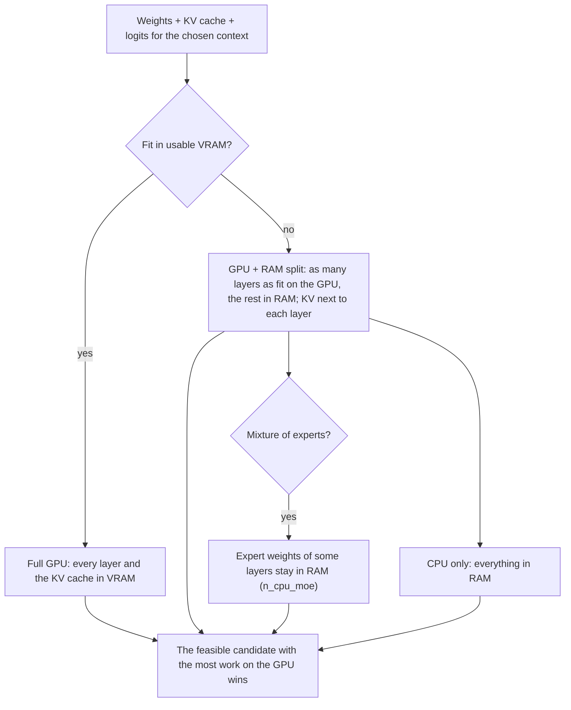

# system.plan

The execution plan an installed model would get on this machine, without loading its weights and without changing saved settings: how many layers go on the GPU, the context window, the KV cache type and where it lives, and the memory each part takes. Use it to show a user what will happen before they load a model, or to compare settings.

## What it does

1. Finds the model in the registry (`model`), or plans the file at `model_path` (which must pass the caller's roots).
2. Starts from the saved settings (`config` sections `gguf` / `optimization`) and applies only the overrides sent here (`n_ctx`, `batch_tokens`, `vram_buffer_gb`, `ram_buffer_gb`). The saved settings stay as they are.
3. For a GGUF, reads the file header (geometry: layers, heads, context length) and runs the same planner `models.load` and chat use. For an ONNX package, reports its inputs, outputs, task routes and missing assets instead.
4. Answers the plan. No weights are read and nothing is loaded.

## Rules

- `n_ctx`: `-1` = the model's maximum, `0` = automatic (the planner picks), `N` = exactly N tokens.
- `batch_tokens` must be at least 1; the buffers must be 0 or more.
- Live free memory is read when planning, so a plan can differ from minute to minute while other programs use the GPU.

## How the planner chooses

The planner works out every placement that could run the model and keeps the fastest one that fits. Generating a token is limited by memory bandwidth, so weights in VRAM beat weights in RAM, and RAM beats streaming from disk.



"Usable VRAM" is the GPU's free memory now, minus the VRAM buffer (`vram_buffer_gb`, or the planner's rule). With `n_ctx: 0` the planner picks the context window too: it starts at a floor (4096 tokens) and grows it while the placement still fits.

## Result

| Field | Meaning |
|---|---|
| `model_info` | `model_id`, `architecture`, `context_window` (the model's own limit), `total_layers`, `model_size_gb`, `inputs[]` (`type`, `available`), `outputs[]` |
| `execution_plan` | The winner: `context_window` and `context_reason`, `gpu_layers` / `n_gpu_layers` / `ram_layers`, `n_cpu_moe`, `placement_mode`, `batch_size` / `ubatch_size`, `kv_cache_type`, `kv_cache_location`, `offload_kqv`, `use_mmap`, `disk_stream_gb`, `decision_reason`, `model_memory_breakdown` (`vram_gb`, `ram_gb`, `kv_cache_vram_gb`, `kv_cache_ram_gb`, `logits_buffer_gb`, `remaining_free_vram_gb`, `remaining_free_ram_gb`) |
| `candidates[]` | Every placement considered: `name` (`Full GPU`, `GPU + RAM split`, `CPU only`), `tier`, `feasible`, `n_gpu_layers`, `vram_required_gb`, `ram_required_gb`, `kv_gpu_gb`, `kv_ram_gb`, `missing_gb` (how much memory was short), `reason` |
| `active_user_settings` | The settings the plan used (saved settings with this call's overrides) |
| `hardware_info` | `cpu`, `gpu`, `ram` as the planner saw them |

A real candidate list for a 27B model with 1-bit weights on a 4 GB GPU: `Full GPU` not feasible ("weights 3.37 + KV 0.53 + logits 0.47 = 4.37 GB vs usable VRAM 1.62 GB"), `GPU + RAM split` feasible (16 of 64 blocks plus the output head on the GPU), `CPU only` feasible. The split wins.

## Example

```bash
curl -s http://127.0.0.1:8000/v1/cep -H "Content-Type: application/json" \
  -H "Authorization: Bearer $TOKEN" \
  -d '{"jsonrpc":"2.0","id":1,"method":"system.plan","params":{"model":"bonsai-27b-gguf-q1_0","n_ctx":8192}}'
```

Leave out the `Authorization` header when API authentication is off.
