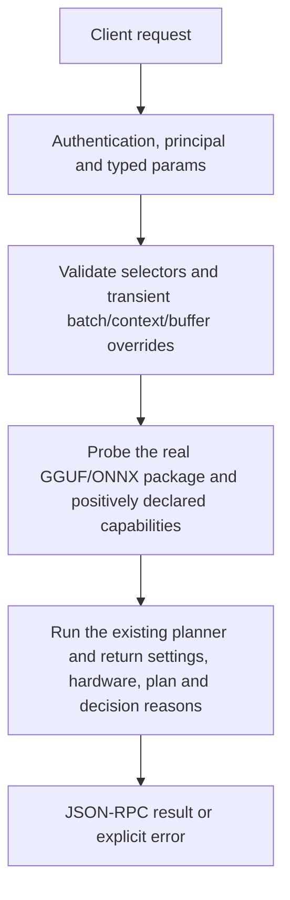

# system.plan

Plan an installed package using actual model geometry and current hardware/settings without loading its inference weights or persisting the request overrides. This helps explain placement/context choices but is not a load admission reservation.

## Endpoint, execution and permissions

| Property | Contract |
|---|---|
| Wire endpoint | `POST /v1/cep`; logical method `system.plan` |
| Execution | Synchronous domain result in the JSON-RPC result field |
| Required scope | `read` |
| MCP facade | Eligible for the current read-only MCP facade |
| Side effects | Read/control behavior described below; this scope alone is not a promise of zero side effects |

Send a Bearer token when API authentication is enabled. Authentication failures are HTTP 401; ordinary CEP method errors are JSON-RPC error objects, normally with HTTP 200. A successful HTTP status alone does not prove the operation succeeded. See [the common CEP contract](../../README.md).

## How it works

1. Validate selectors and transient batch/context/buffer overrides
2. Probe the real GGUF/ONNX package and positively declared capabilities
3. Run the existing planner and return settings, hardware, plan and decision reasons



## Parameters, defaults and value effects

| Parameter | Type | Required | Meaning, default and constraints |
|---|---|---|---|
| `batch_tokens` | integer \| null | No | Logical batch size in tokens for the plan (llama.cpp `-b`; default: the saved setting) Omitted: saved setting. Positive logical batch size; 0 is invalid. |
| `model` | string | Yes | An installed model id (from `models.list`) Required selection; normally an installed id. An explicit authorized model_path can supply the file according to the existing planner lookup rules. |
| `model_path` | string \| null | No | Plan this weight file instead of the model's primary file (it must pass the caller's roots) Optional actual host weight path; must pass caller-root authorization. Not a synthetic model geometry override. |
| `n_ctx` | integer \| null | No | Context size: -1 = the model's maximum, 0 = automatic, N = N tokens (default: the saved setting) Omitted: saved setting. -1: native maximum; 0: Auto; positive: requested context capped by model limits. Below-1 or aboveu32 is invalid. |
| `ram_buffer_gb` | number \| null | No | RAM to keep free, in GB (default: the planner's rule) Optional finite nonnegative RAM reserve for this plan only. |
| `vram_buffer_gb` | number \| null | No | VRAM to keep free, in GB (default: the planner's rule) Optional finite nonnegative VRAM reserve for this plan only. |

Unknown top-level method parameters are rejected. `params._meta` is protocol metadata, not a domain option; approval retries must preserve the same method and domain parameters. Where a parameter is optional, omission follows the method-specific rules above rather than implying a universal zero or empty-string default.

## Request examples

Examples describe contracts, not measured execution. Replace IDs, paths and installed-package names with real values from your Engine. Do not execute write/delete/process examples against valuable data merely to read the documentation.

### 1. Basic request

This request uses the documented selection. Read the result semantics below before acting on it.

```json
{
  "jsonrpc": "2.0",
  "id": 1,
  "method": "system.plan",
  "params": {
    "model": "installed-model"
  }
}
```

### 2. Compare an explicit context and batch

Compare with the basic saved-settings plan; no settings write occurs.

```json
{
  "jsonrpc": "2.0",
  "id": 2,
  "method": "system.plan",
  "params": {
    "model": "<installed-model-id>",
    "n_ctx": 4096,
    "batch_tokens": 128
  }
}
```

### 3. Ask for native maximum with reserves

The real model and machine still determine whether the requested plan can fit.

```json
{
  "jsonrpc": "2.0",
  "id": 3,
  "method": "system.plan",
  "params": {
    "model": "<installed-model-id>",
    "n_ctx": -1,
    "ram_buffer_gb": 2,
    "vram_buffer_gb": 0.5
  }
}
```

## Response and field meanings

model_info describes intrinsic declarations/context/geometry. execution_plan gives chosen context, split, batches, KV/placement/memory breakdown and reasons. hardware_info is the snapshot; active_user_settings preserves saved controls, and request_overrides identifies only explicitly supplied transient values. Fields are plan facts/estimates, not a measured generation result.

The following response is an illustrative shape. IDs, byte counts, timings and array contents depend on the actual request and machine; shortened nested objects are not a second schema or a measured result.

```json
{
  "id": 1,
  "jsonrpc": "2.0",
  "result": {
    "active_user_settings": {
      "flash_attention": "Auto",
      "kv_cache_quantization": "Auto"
    },
    "candidates": [],
    "execution_plan": {
      "batch_size": 512,
      "context_reason": "Auto: floor 4096 tokens, KV Kv8; model does not fit on one device",
      "context_window": 4096,
      "decision_reason": "GPU + RAM split: 16 / 64 blocks + output head on GPU (1.57 GB), 48 blocks in RAM",
      "gpu_layers": 16,
      "kv_cache_location": "vram + ram (next to each layer)",
      "kv_cache_type": "Kv8",
      "model_memory_breakdown": {
        "kv_cache_ram_gb": 0.4,
        "kv_cache_vram_gb": 0.13,
        "ram_gb": 2.96,
        "vram_gb": 1.57
      },
      "n_gpu_layers": 17
    },
    "hardware_info": {},
    "model_info": {
      "architecture": "qwen35",
      "context_window": 262144,
      "inputs": [
        {
          "available": true,
          "type": "text"
        }
      ],
      "model_id": "bonsai-27b-gguf-q1_0",
      "model_size_gb": 3.54,
      "outputs": [
        "text"
      ],
      "total_layers": 64
    }
  }
}
```

## Errors and recovery

| Code / boundary | Meaning | Recovery |
|---|---|---|
| HTTP 401 | Missing/invalid token while authentication is enabled | Supply the configured token; a CEP params change cannot repair authentication |
| `-32602` / typed params | Missing required fields, wrong JSON types or unknown fields | Correct the request against this page; do not retry the same invalid payload |
| `-32002` / principal | Required scope/owner/root authorization is absent | Inspect `error.data.needs`; use an authorized caller or permitted target |
| `-32602` / `invalid_params` | `model` is empty, `n_ctx` is below -1, `batch_tokens` is 0, or a buffer is negative | Correct the option/value combination; install required assets where relevant |
| `-32004` / `model_not_found` | No installed model with this id, and no usable `model_path` | Refresh the relevant inventory/IDs and check whether the resource expired |
| `-32002` / `forbidden` | `model_path` is outside the caller's roots (`data.needs: "roots"`) | Read the error message, correct the backend/filesystem/configuration condition, then retry deliberately |
| `-32010` / `gguf_probe_failed` | The GGUF header could not be read | Read the error message, correct the backend/filesystem/configuration condition, then retry deliberately |
| `-32010` / `onnx_probe_failed` | The ONNX package could not be inspected | Read the error message, correct the backend/filesystem/configuration condition, then retry deliberately |

### Invalid-field example

This is deliberately invalid. The extra field must be removed; it is not an alternate feature toggle.

```text
{
  "jsonrpc": "2.0",
  "id": 90,
  "method": "system.plan",
  "params": {
    "model": "installed-model",
    "__unknown_option": true
  }
}
```

The error envelope is `{"jsonrpc":"2.0","id":90,"error":{"code":-32602,"message":"...","data":{"type":"invalid_params", "errors":[...]}}}`. Exact message and field diagnostics are generated by typed deserialization; callers should use codes and structured data, not match a sentence.

## cURL

Save one valid request above as `request.json`:

```bash
curl --fail-with-body http://127.0.0.1:8000/v1/cep \
  -H "Content-Type: application/json" \
  -H "Authorization: Bearer $CLUAIZ_TOKEN" \
  --data-binary @request.json
```

## Python

Install `requests` in your client environment. This executes the basic request; edit `params` for a different valid case.

```python
import json
import os
import requests

payload = json.loads(r'''{
  "id": 1,
  "jsonrpc": "2.0",
  "method": "system.plan",
  "params": {
    "model": "installed-model"
  }
}''')
response = requests.post(
    "http://127.0.0.1:8000/v1/cep",
    headers={"Authorization": "Bearer " + os.environ["CLUAIZ_TOKEN"]},
    json=payload, timeout=60,
)
response.raise_for_status()
reply = response.json()
if "error" in reply:
    raise RuntimeError(json.dumps(reply["error"], ensure_ascii=False))
print(reply["result"])
```

## JavaScript / Node.js

Use an owner token only in a trusted client. Do not ship it inside a public web page.

```javascript
const payload = {
  "id": 1,
  "jsonrpc": "2.0",
  "method": "system.plan",
  "params": {
    "model": "installed-model"
  }
};
const response = await fetch("http://127.0.0.1:8000/v1/cep", {
  method: "POST",
  headers: { "content-type": "application/json", authorization: `Bearer ${process.env.CLUAIZ_TOKEN}` },
  body: JSON.stringify(payload),
});
const raw = await response.text();
if (!response.ok) throw new Error(`HTTP ${response.status}: ${raw}`);
const reply = JSON.parse(raw);
if (reply.error) throw new Error(JSON.stringify(reply.error));
console.log(reply.result);
```

## Limits, state and related operations

Planning can read headers/package assets and fail for missing/broken models. ONNX and embedding plans have their own contract handling. Available memory may change before models.load or inference. Context capacity is a total token budget, not a guaranteed answer length. This endpoint does not save a new device/context configuration.

- [`config.get`](../config/config.get.md): use its separate documented contract.
- [`models.inspect`](../../models/models/models.inspect.md): use its separate documented contract.
- [`models.load`](../../models/models/models.load.md): use its separate documented contract.

## Implementation reference

- [api/src/cep/methods/system.rs](../../../../../api/src/cep/methods/system.rs)
