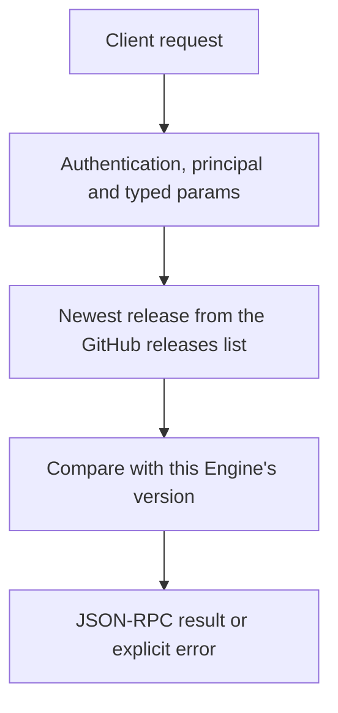

# system.update_check

Check whether a newer Cluaiz release is published. The Engine compares its own version with the newest release on GitHub (the same list the installers read, pre-releases included). Nothing is downloaded or installed: an app shows the answer and the user runs `cluaiz self update`.

## Endpoint, execution and permissions

| Property | Contract |
|---|---|
| Wire endpoint | `POST /v1/cep`; logical method `system.update_check` |
| Execution | Synchronous domain result in the JSON-RPC result field |
| Required scope | `read` |
| MCP facade | Eligible for the current read-only MCP facade |
| Side effects | One HTTPS request from the Engine to `api.github.com`; nothing on the machine changes |

Send a Bearer token when API authentication is enabled. Authentication failures are HTTP 401; ordinary CEP method errors are JSON-RPC error objects, normally with HTTP 200. A successful HTTP status alone does not prove the operation succeeded. See [the common CEP contract](../../README.md).

## How it works

1. Read the newest release from `https://api.github.com/repos/cluaiz/cluaiz/releases?per_page=1` (5 s to connect, 15 s in all)
2. Compare its version with this Engine's version
3. Return both versions and whether the release is newer



## Parameters, defaults and value effects

| Parameter | Type | Required | Meaning, default and constraints |
|---|---|---|---|
| `params` | object | No fields | Use `{}`. Unknown fields are rejected. |

## Request examples

### 1. Basic request

```json
{
  "jsonrpc": "2.0",
  "id": 1,
  "method": "system.update_check",
  "params": {}
}
```

## Response and field meanings

| Field | Meaning |
|---|---|
| `current` | This Engine's version (the release it was built for) |
| `latest.version` | The newest release, without the `v` of its tag |
| `latest.tag` | The release tag, e.g. `v0.1.2` |
| `latest.url` | The release page with its notes |
| `latest.prerelease` | True when GitHub marks the release as a pre-release |
| `latest.published_at` | When it was published (RFC 3339), or null |
| `update_available` | True only when `latest.version` is a higher version than `current`. Versions compare as numbers (`0.1.10` > `0.1.9`); at the same number a final release is newer than a pre-release. A local development build is never told to update to an older release |

```json
{
  "id": 1,
  "jsonrpc": "2.0",
  "result": {
    "current": "0.1.1",
    "latest": {
      "prerelease": true,
      "published_at": "2026-11-01T08:00:00Z",
      "tag": "v0.1.2",
      "url": "https://github.com/cluaiz/cluaiz/releases/tag/v0.1.2",
      "version": "0.1.2"
    },
    "update_available": true
  }
}
```

## Errors and recovery

| Code / boundary | Meaning | Recovery |
|---|---|---|
| HTTP 401 | Missing/invalid token while authentication is enabled | Supply the configured token |
| `-32602` / typed params | Unknown fields | Send `{}` |
| `-32010` / `update_check_failed` | No network, GitHub unreachable or rate-limited (60 unauthenticated requests per hour per address), or no release published | Try again later; the Engine keeps working, this check is optional |

## cURL

```bash
curl --fail-with-body http://127.0.0.1:8000/v1/cep \
  -H "Content-Type: application/json" \
  -H "Authorization: Bearer $CLUAIZ_TOKEN" \
  --data-binary '{"jsonrpc":"2.0","id":1,"method":"system.update_check","params":{}}'
```

## Python

```python
import os
import requests

reply = requests.post(
    "http://127.0.0.1:8000/v1/cep",
    headers={"Authorization": "Bearer " + os.environ["CLUAIZ_TOKEN"]},
    json={"jsonrpc": "2.0", "id": 1, "method": "system.update_check", "params": {}},
    timeout=30,
).json()
if "error" in reply:
    raise RuntimeError(reply["error"])
result = reply["result"]
if result["update_available"]:
    print(f"Cluaiz {result['latest']['version']} is out (this is {result['current']}): run `cluaiz self update`")
```

## Limits, state and related operations

There is no update or uninstall method in the API, on purpose. A running server cannot replace its own files (on Windows they are locked), and a remote caller must not be able to replace or delete the Engine. Update and uninstall are terminal commands on the machine itself:

| Task | Command |
|---|---|
| Is a newer release out? | `cluaiz self update --check` |
| Update (models and settings stay) | `cluaiz self update` |
| Install a given release | `cluaiz self update --to 0.1.2` |
| Remove Cluaiz | `cluaiz self uninstall` (`--keep-models` keeps the models) |

- [`system.info`](system.info.md): this Engine's version and hardware.
- [`models.remove`](../../models/models/models.remove.md): remove one model.

## Implementation reference

- [api/src/cep/methods/system.rs](../../../../../api/src/cep/methods/system.rs)
- [api/src/update.rs](../../../../../api/src/update.rs)
- [cmd/src/cli/self_cmd.rs](../../../../../cmd/src/cli/self_cmd.rs)
