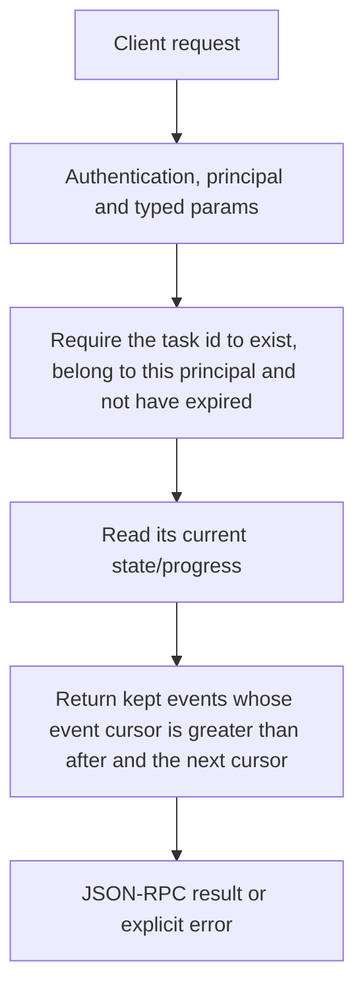

# tasks.get

Inspect one caller-owned CEP task’s status, progress and events after a cursor. This is the task envelope for long operations, not saved chat history or filesystem content.

## Endpoint, execution and permissions

| Property | Contract |
|---|---|
| Wire endpoint | `POST /v1/cep`; logical method `tasks.get` |
| Execution | Synchronous domain result in the JSON-RPC result field |
| Required scope | `read` |
| MCP facade | Eligible for the current read-only MCP facade |
| Side effects | Read/control behavior described below; this scope alone is not a promise of zero side effects |

Send a Bearer token when API authentication is enabled. Authentication failures are HTTP 401; ordinary CEP method errors are JSON-RPC error objects, normally with HTTP 200. A successful HTTP status alone does not prove the operation succeeded. See [the common CEP contract](../../README.md).

## How it works

1. Require the task id to exist, belong to this principal and not have expired
2. Read its current state/progress
3. Return kept events whose event cursor is greater than after and the next cursor



## Parameters, defaults and value effects

| Parameter | Type | Required | Meaning, default and constraints |
|---|---|---|---|
| `after` | integer \| null | No | Events after this cursor (`next` of the last answer); 0 or absent = all kept events Defaults to0; strict greater-than cursor filter. Feed back the returned next for incremental event reads. |
| `task_id` | string | Yes | The `task.task_id` a task method answered with Required result.task.task_id from a task method; not a completion id or original method name. |

Unknown top-level method parameters are rejected. `params._meta` is protocol metadata, not a domain option; approval retries must preserve the same method and domain parameters. Where a parameter is optional, omission follows the method-specific rules above rather than implying a universal zero or empty-string default.

## Request examples

Examples describe contracts, not measured execution. Replace IDs, paths and installed-package names with real values from your Engine. Do not execute write/delete/process examples against valuable data merely to read the documentation.

### 1. Basic request

This request uses the documented selection. Read the result semantics below before acting on it.

```json
{
  "jsonrpc": "2.0",
  "id": 1,
  "method": "tasks.get",
  "params": {
    "after": 0,
    "task_id": "t_5f0c…"
  }
}
```

### 2. Resume event polling

Use an actual next cursor from the previous view; do not assume twelve means twelve source files.

```json
{
  "jsonrpc": "2.0",
  "id": 2,
  "method": "tasks.get",
  "params": {
    "task_id": "<returned-task-id>",
    "after": 12
  }
}
```

## Response and field meanings

The view includes task_id/method/status/created_at/last_updated_at/ttl_ms/poll_ms and optional progress/status_message, plus events and next. States are working/completed/failed/cancelled. Suggested poll_ms is500. Event cursors are not the same as indices inside domain audio chunks.

The following response is an illustrative shape. IDs, byte counts, timings and array contents depend on the actual request and machine; shortened nested objects are not a second schema or a measured result.

```json
{
  "id": 1,
  "jsonrpc": "2.0",
  "result": {
    "events": [],
    "next": 0,
    "progress": {
      "done": 1,
      "total": 3
    },
    "status": "working"
  }
}
```

## Errors and recovery

| Code / boundary | Meaning | Recovery |
|---|---|---|
| HTTP 401 | Missing/invalid token while authentication is enabled | Supply the configured token; a CEP params change cannot repair authentication |
| `-32602` / typed params | Missing required fields, wrong JSON types or unknown fields | Correct the request against this page; do not retry the same invalid payload |
| `-32002` / principal | Required scope/owner/root authorization is absent | Inspect `error.data.needs`; use an authorized caller or permitted target |
| `-32004` / `task_not_found` | No task with this id for this caller, or it expired | Refresh the relevant inventory/IDs and check whether the resource expired |

### Invalid-field example

This is deliberately invalid. The extra field must be removed; it is not an alternate feature toggle.

```text
{
  "jsonrpc": "2.0",
  "id": 90,
  "method": "tasks.get",
  "params": {
    "after": 0,
    "task_id": "t_5f0c…",
    "__unknown_option": true
  }
}
```

The error envelope is `{"jsonrpc":"2.0","id":90,"error":{"code":-32602,"message":"...","data":{"type":"invalid_params", "errors":[...]}}}`. Exact message and field diagnostics are generated by typed deserialization; callers should use codes and structured data, not match a sentence.

## cURL

Save one valid request above as `request.json`:

```bash
curl --fail-with-body http://127.0.0.1:8000/v1/cep \
  -H "Content-Type: application/json" \
  -H "Authorization: Bearer $CLUAIZ_TOKEN" \
  --data-binary @request.json
```

## Python

Install `requests` in your client environment. This executes the basic request; edit `params` for a different valid case.

```python
import json
import os
import requests

payload = json.loads(r'''{
  "id": 1,
  "jsonrpc": "2.0",
  "method": "tasks.get",
  "params": {
    "after": 0,
    "task_id": "t_5f0c…"
  }
}''')
response = requests.post(
    "http://127.0.0.1:8000/v1/cep",
    headers={"Authorization": "Bearer " + os.environ["CLUAIZ_TOKEN"]},
    json=payload, timeout=60,
)
response.raise_for_status()
reply = response.json()
if "error" in reply:
    raise RuntimeError(json.dumps(reply["error"], ensure_ascii=False))
print(reply["result"])
```

## JavaScript / Node.js

Use an owner token only in a trusted client. Do not ship it inside a public web page.

```javascript
const payload = {
  "id": 1,
  "jsonrpc": "2.0",
  "method": "tasks.get",
  "params": {
    "after": 0,
    "task_id": "t_5f0c…"
  }
};
const response = await fetch("http://127.0.0.1:8000/v1/cep", {
  method: "POST",
  headers: { "content-type": "application/json", authorization: `Bearer ${process.env.CLUAIZ_TOKEN}` },
  body: JSON.stringify(payload),
});
const raw = await response.text();
if (!response.ok) throw new Error(`HTTP ${response.status}: ${raw}`);
const reply = JSON.parse(raw);
if (reply.error) throw new Error(JSON.stringify(reply.error));
console.log(reply.result);
```

## Limits, state and related operations

Only the newest1000 events per task are kept; next still advances when older events are dropped, so this is not lossless archival replay. Default task retention is one hour from creation in this Engine, not completion; a restart forgets tasks. This is one snapshot, not SSE.

- [`tasks.result`](tasks.result.md): use its separate documented contract.
- [`tasks.list`](tasks.list.md): use its separate documented contract.
- [`tasks.cancel`](tasks.cancel.md): use its separate documented contract.

## Implementation reference

- [cep/src/protocol.rs](../../../../../cep/src/protocol.rs)
- [cep/src/task.rs](../../../../../cep/src/task.rs)
