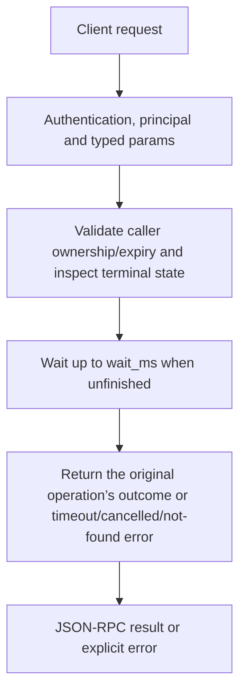

# tasks.result

Read a long operation’s final domain result/error, optionally waiting briefly if it is still running. This is not another execution of the original task method and does not itself restart failed work.

## Endpoint, execution and permissions

| Property | Contract |
|---|---|
| Wire endpoint | `POST /v1/cep`; logical method `tasks.result` |
| Execution | Synchronous domain result in the JSON-RPC result field |
| Required scope | `read` |
| MCP facade | Eligible for the current read-only MCP facade |
| Side effects | Read/control behavior described below; this scope alone is not a promise of zero side effects |

Send a Bearer token when API authentication is enabled. Authentication failures are HTTP 401; ordinary CEP method errors are JSON-RPC error objects, normally with HTTP 200. A successful HTTP status alone does not prove the operation succeeded. See [the common CEP contract](../../README.md).

## How it works

1. Validate caller ownership/expiry and inspect terminal state
2. Wait up to wait_ms when unfinished
3. Return the original operation’s outcome or timeout/cancelled/not-found error



## Parameters, defaults and value effects

| Parameter | Type | Required | Meaning, default and constraints |
|---|---|---|---|
| `task_id` | string | Yes | The `task.task_id` a task method answered with Required actual id from the initial task handle. |
| `wait_ms` | integer \| null | No | How long to wait for the end, at most 30000 ms; 0 or absent = do not wait Defaults to0 (no wait); values above30000 are clamped to30000ms. This is milliseconds, unlike audio keep_alive minutes. |

Unknown top-level method parameters are rejected. `params._meta` is protocol metadata, not a domain option; approval retries must preserve the same method and domain parameters. Where a parameter is optional, omission follows the method-specific rules above rather than implying a universal zero or empty-string default.

## Request examples

Examples describe contracts, not measured execution. Replace IDs, paths and installed-package names with real values from your Engine. Do not execute write/delete/process examples against valuable data merely to read the documentation.

### 1. Basic request

This request uses the documented selection. Read the result semantics below before acting on it.

```json
{
  "jsonrpc": "2.0",
  "id": 1,
  "method": "tasks.result",
  "params": {
    "task_id": "t_5f0c…",
    "wait_ms": 30000
  }
}
```

### 2. Check immediately

Working state can produce -32009 timeout; continue polling the same id.

```json
{
  "jsonrpc": "2.0",
  "id": 2,
  "method": "tasks.result",
  "params": {
    "task_id": "<returned-task-id>",
    "wait_ms": 0
  }
}
```

### 3. Wait for up to thirty seconds

If it still runs, ask again with the same id. Do not treat HTTP200 alone as domain success.

```json
{
  "jsonrpc": "2.0",
  "id": 3,
  "method": "tasks.result",
  "params": {
    "task_id": "<returned-task-id>",
    "wait_ms": 30000
  }
}
```

## Response and field meanings

On success, result is the task method’s domain object/value, without another task wrapper. A failed task returns its original structured error. Cancelled tasks return cancelled. timeout means no outcome was ready within the chosen wait, not that the worker failed.

The following response is an illustrative shape. IDs, byte counts, timings and array contents depend on the actual request and machine; shortened nested objects are not a second schema or a measured result.

```json
{
  "id": 1,
  "jsonrpc": "2.0",
  "result": {
    "any": "the result the method returns"
  }
}
```

## Errors and recovery

| Code / boundary | Meaning | Recovery |
|---|---|---|
| HTTP 401 | Missing/invalid token while authentication is enabled | Supply the configured token; a CEP params change cannot repair authentication |
| `-32602` / typed params | Missing required fields, wrong JSON types or unknown fields | Correct the request against this page; do not retry the same invalid payload |
| `-32002` / principal | Required scope/owner/root authorization is absent | Inspect `error.data.needs`; use an authorized caller or permitted target |
| `-32004` / `task_not_found` | No task with this id for this caller, or it expired | Refresh the relevant inventory/IDs and check whether the resource expired |
| `-32009` / `timeout` | The task is still running after `wait_ms`: ask again | Read the error message, correct the backend/filesystem/configuration condition, then retry deliberately |
| `-32008` / `cancelled` | The task was cancelled | Treat as cancelled; review partial side effects before starting new work |

### Invalid-field example

This is deliberately invalid. The extra field must be removed; it is not an alternate feature toggle.

```text
{
  "jsonrpc": "2.0",
  "id": 90,
  "method": "tasks.result",
  "params": {
    "task_id": "t_5f0c…",
    "wait_ms": 30000,
    "__unknown_option": true
  }
}
```

The error envelope is `{"jsonrpc":"2.0","id":90,"error":{"code":-32602,"message":"...","data":{"type":"invalid_params", "errors":[...]}}}`. Exact message and field diagnostics are generated by typed deserialization; callers should use codes and structured data, not match a sentence.

## cURL

Save one valid request above as `request.json`:

```bash
curl --fail-with-body http://127.0.0.1:8000/v1/cep \
  -H "Content-Type: application/json" \
  -H "Authorization: Bearer $CLUAIZ_TOKEN" \
  --data-binary @request.json
```

## Python

Install `requests` in your client environment. This executes the basic request; edit `params` for a different valid case.

```python
import json
import os
import requests

payload = json.loads(r'''{
  "id": 1,
  "jsonrpc": "2.0",
  "method": "tasks.result",
  "params": {
    "task_id": "t_5f0c…",
    "wait_ms": 30000
  }
}''')
response = requests.post(
    "http://127.0.0.1:8000/v1/cep",
    headers={"Authorization": "Bearer " + os.environ["CLUAIZ_TOKEN"]},
    json=payload, timeout=60,
)
response.raise_for_status()
reply = response.json()
if "error" in reply:
    raise RuntimeError(json.dumps(reply["error"], ensure_ascii=False))
print(reply["result"])
```

## JavaScript / Node.js

Use an owner token only in a trusted client. Do not ship it inside a public web page.

```javascript
const payload = {
  "id": 1,
  "jsonrpc": "2.0",
  "method": "tasks.result",
  "params": {
    "task_id": "t_5f0c…",
    "wait_ms": 30000
  }
};
const response = await fetch("http://127.0.0.1:8000/v1/cep", {
  method: "POST",
  headers: { "content-type": "application/json", authorization: `Bearer ${process.env.CLUAIZ_TOKEN}` },
  body: JSON.stringify(payload),
});
const raw = await response.text();
if (!response.ok) throw new Error(`HTTP ${response.status}: ${raw}`);
const reply = JSON.parse(raw);
if (reply.error) throw new Error(JSON.stringify(reply.error));
console.log(reply.result);
```

## Limits, state and related operations

Tasks are caller-owned and RAM-only, with creation-based expiry. Retrying tasks.result after timeout is normal; retrying models.download/tools.install instead would start/recheck another operation. Server/client timeout settings should allow the bounded wait. A task whose side effects occurred before failure is not automatically rolled back.

- [`tasks.get`](tasks.get.md): use its separate documented contract.
- [`tasks.cancel`](tasks.cancel.md): use its separate documented contract.
- [`tasks.list`](tasks.list.md): use its separate documented contract.

## Implementation reference

- [cep/src/protocol.rs](../../../../../cep/src/protocol.rs)
- [cep/src/task.rs](../../../../../cep/src/task.rs)
