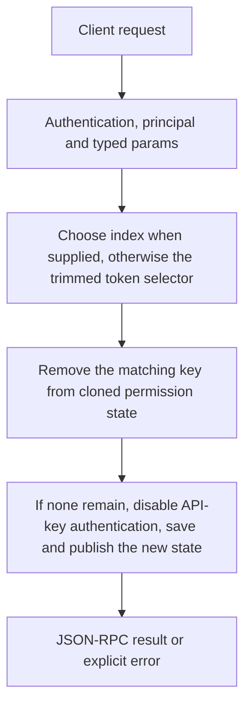

# tokens.revoke

Remove one API key by its current one-based position or supported token/masked-token selector. Removing the final configured key also disables api_auth.required to avoid locking clients out.

## Endpoint, execution and permissions

| Property | Contract |
|---|---|
| Wire endpoint | `POST /v1/cep`; logical method `tokens.revoke` |
| Execution | Synchronous domain result in the JSON-RPC result field |
| Required scope | `admin` |
| MCP facade | Not exposed by the current read-only MCP facade |
| Side effects | Destructive; review the target before calling |

Send a Bearer token when API authentication is enabled. Authentication failures are HTTP 401; ordinary CEP method errors are JSON-RPC error objects, normally with HTTP 200. A successful HTTP status alone does not prove the operation succeeded. See [the common CEP contract](../../README.md).

## How it works

1. Choose index when supplied, otherwise the trimmed token selector
2. Remove the matching key from cloned permission state
3. If none remain, disable API-key authentication, save and publish the new state



## Parameters, defaults and value effects

| Parameter | Type | Required | Meaning, default and constraints |
|---|---|---|---|
| `index` | integer \| null | No | Or its position in `tokens.list`, from 1 Optional one-based position from the current tokens.list; takes precedence if token is also supplied. |
| `token` | string \| null | No | The key itself, or its masked form (at least 4 visible trailing characters) Optional raw/masked selector supported by ApiAuth; masked form needs at least four visible trailing characters. Required when index is omitted. |

Unknown top-level method parameters are rejected. `params._meta` is protocol metadata, not a domain option; approval retries must preserve the same method and domain parameters. Where a parameter is optional, omission follows the method-specific rules above rather than implying a universal zero or empty-string default.

## Request examples

Examples describe contracts, not measured execution. Replace IDs, paths and installed-package names with real values from your Engine. Do not execute write/delete/process examples against valuable data merely to read the documentation.

### 1. Basic request

This request uses the documented selection. Read the result semantics below before acting on it.

```json
{
  "jsonrpc": "2.0",
  "id": 1,
  "method": "tokens.revoke",
  "params": {
    "index": 1
  }
}
```

### 2. Revoke a current list position

Refresh tokens.list first and intentionally select the key; no index0 exists.

```json
{
  "jsonrpc": "2.0",
  "id": 2,
  "method": "tokens.revoke",
  "params": {
    "index": 1
  }
}
```

### 3. Use a masked selector

Illustrative mask only. Use the actual supported masked representation with enough matching trailing characters.

```json
{
  "jsonrpc": "2.0",
  "id": 3,
  "method": "tokens.revoke",
  "params": {
    "token": "sk-cluaiz-****abcd"
  }
}
```

## Response and field meanings

revoked_token identifies the removed key, tokens is the remaining inventory, api_auth_required is the post-save toggle. Treat the response as sensitive. A stale index can identify a different key after other changes: prefer a deliberate current selector.

The following response is an illustrative shape. IDs, byte counts, timings and array contents depend on the actual request and machine; shortened nested objects are not a second schema or a measured result.

```json
{
  "id": 1,
  "jsonrpc": "2.0",
  "result": {
    "api_auth_required": false,
    "revoked_token": "sk-cluaiz-1f0c…",
    "tokens": []
  }
}
```

## Errors and recovery

| Code / boundary | Meaning | Recovery |
|---|---|---|
| HTTP 401 | Missing/invalid token while authentication is enabled | Supply the configured token; a CEP params change cannot repair authentication |
| `-32602` / typed params | Missing required fields, wrong JSON types or unknown fields | Correct the request against this page; do not retry the same invalid payload |
| `-32002` / principal | Required scope/owner/root authorization is absent | Inspect `error.data.needs`; use an authorized caller or permitted target |
| `-32602` / `invalid_params` | Neither `token` nor `index` was sent | Correct the option/value combination; install required assets where relevant |
| `-32004` / `token_not_found` | No key matches `token`, or `index` is out of range | Refresh the relevant inventory/IDs and check whether the resource expired |
| `-32010` / `settings_not_saved` | permission.json could not be written | Read the error message, correct the backend/filesystem/configuration condition, then retry deliberately |

### Invalid-field example

This is deliberately invalid. The extra field must be removed; it is not an alternate feature toggle.

```text
{
  "jsonrpc": "2.0",
  "id": 90,
  "method": "tokens.revoke",
  "params": {
    "index": 1,
    "__unknown_option": true
  }
}
```

The error envelope is `{"jsonrpc":"2.0","id":90,"error":{"code":-32602,"message":"...","data":{"type":"invalid_params", "errors":[...]}}}`. Exact message and field diagnostics are generated by typed deserialization; callers should use codes and structured data, not match a sentence.

## cURL

Save one valid request above as `request.json`:

```bash
curl --fail-with-body http://127.0.0.1:8000/v1/cep \
  -H "Content-Type: application/json" \
  -H "Authorization: Bearer $CLUAIZ_TOKEN" \
  --data-binary @request.json
```

## Python

Install `requests` in your client environment. This executes the basic request; edit `params` for a different valid case.

```python
import json
import os
import requests

payload = json.loads(r'''{
  "id": 1,
  "jsonrpc": "2.0",
  "method": "tokens.revoke",
  "params": {
    "index": 1
  }
}''')
response = requests.post(
    "http://127.0.0.1:8000/v1/cep",
    headers={"Authorization": "Bearer " + os.environ["CLUAIZ_TOKEN"]},
    json=payload, timeout=60,
)
response.raise_for_status()
reply = response.json()
if "error" in reply:
    raise RuntimeError(json.dumps(reply["error"], ensure_ascii=False))
print(reply["result"])
```

## JavaScript / Node.js

Use an owner token only in a trusted client. Do not ship it inside a public web page.

```javascript
const payload = {
  "id": 1,
  "jsonrpc": "2.0",
  "method": "tokens.revoke",
  "params": {
    "index": 1
  }
};
const response = await fetch("http://127.0.0.1:8000/v1/cep", {
  method: "POST",
  headers: { "content-type": "application/json", authorization: `Bearer ${process.env.CLUAIZ_TOKEN}` },
  body: JSON.stringify(payload),
});
const raw = await response.text();
if (!response.ok) throw new Error(`HTTP ${response.status}: ${raw}`);
const reply = JSON.parse(raw);
if (reply.error) throw new Error(JSON.stringify(reply.error));
console.log(reply.result);
```

## Limits, state and related operations

Admin-only via scope, not offered by MCP. Neither field is invalid_params; a missing match is token_not_found. Revocation does not prove every other credential/session mechanism was erased. Last-key removal changes access policy; do not describe it as leaving authentication on.

- [`tokens.list`](tokens.list.md): use its separate documented contract.
- [`tokens.create`](tokens.create.md): use its separate documented contract.
- [`config.get`](../config/config.get.md): use its separate documented contract.

## Implementation reference

- [api/src/cep/methods/tokens.rs](../../../../../api/src/cep/methods/tokens.rs)
