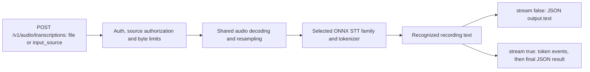

# Speech-to-Text (STT) Transcriptions API (`/v1/audio/transcriptions`)

`POST /v1/audio/transcriptions` (CEP also exposes `audio.run` with task `speech_to_text`; that uses a task envelope over the shared audio dispatch)

Transcribes a recording using a compatible installed ONNX STT package (for example Whisper or a supported Moonshine export). Returns text, rather than synthesized speech or an audio chat answer. Graph/tokenizer assets and language behavior depend on the package. Installing an arbitrary ONNX file does not establish compatibility.

## Choose an installed model



| Input/control | Choose it when | Result/limitation |
|---|---|---|
| `file` with a server-local path | The recording already exists on the Engine machine | Shared canonical file resolution; no browser upload is performed |
| `input_source` with a real data URI | Sending a recording from a browser/remote client | Actual encoded bytes travel in JSON; bare Base64 is invalid |
| `language` | The recording's language is known and supported | Explicit model language selection; model coverage still applies |
| `languages` | Restricting automatic detection candidates | Candidate list, not a request to translate the recording |
| `stream:true` | Reading incremental transcription output | Recording transcription SSE; no bidirectional microphone session |
| `timestamps:true` | Not available in this contract | Rejected; `output.segments` is null rather than invented timestamps |

This Cluaiz endpoint accepts JSON. It does not implement a multipart upload contract. Use the file/data-URI Python and JavaScript examples below rather than passing an unmodified multipart SDK request.

Read `models.list` with your Bearer token and copy an exact `models[].id` that declares an STT task. The API Explorer Model dropdown updates the JSON `model`; the CEP `audio.languages` method accepts the selected ID as `params.model`. STT has language controls, not speaker voices. Use `/v1/audio/speech` for TTS and `/v1/chat/completions` for audio questions with a compatible multimodal chat model.

An explicit ID selects that installed package. Omission/`auto` uses the active eligible STT slot, otherwise an eligible installed package. The example IDs below are examples, not packages bundled with every installation. Paths are read on the engine's computer; browser clients normally send a data URI.

---

## 📌 Endpoint Information

* **HTTP Method:** `POST`
* **Path:** `/v1/audio/transcriptions` (or `audio.run`)
* **Content-Type:** `application/json` (Pure JSON contract — `multipart/form-data` is **not** supported)
* **Authentication:** `Authorization: Bearer <session-token>` when API authentication is on
* **Streaming Protocol:** Server-Sent Events (SSE) via `text/event-stream` when `stream: true`

---

## 📥 Request Parameters

| Parameter | Type | Required | Default | Allowed Values / Formats | Description |
|:---|:---|:---:|:---|:---|:---|
| **`input_source`** | Object | No* | — | `{"type": "file" \| "audio" \| "base64" \| "url", "data": "..."}` | Audio input descriptor. For browser/client uploads, provide standard Base64 Data URI (`data:audio/wav;base64,...`). Desktop clients can supply an authorized local filesystem path. (*Required if `file` is omitted). |
| **`file`** | String | No* | — | Local file path or URI | Direct file path shortcut (OpenAI-compatible alternative to `input_source`). |
| **`model`** | String | No | Active/eligible installed STT package | Installed STT model ID | Exact registry ID. Do not send a Hugging Face repository name or invent a quantization suffix. |
| **`language`** | String | No | `"auto"` | ISO-639-1 code (e.g. `"en"`, `"hi"`, `"es"`, `"fr"`, `"auto"`) | Target spoken language. Setting `"auto"` runs Whisper language identification. |
| **`languages`** | String[] | No | `[]` | Up to 10 language codes (e.g. `["hi", "en"]`) | Candidate languages for automatic identification; prefer omitting `language` when using this list. Unknown candidates are skipped; if none match, available model languages are considered. Monolingual packages ignore this list. Identification and mixed-language accuracy are not guaranteed. |
| **`temperature`** | Float | No | `0.0` | `0.0` only | Nonzero sampling temperature is not implemented and is rejected. |
| **`timestamps`** | Boolean | No | `false` | `false` only | `true` is rejected; `output.segments` is currently null. |
| **`stream`** | Boolean | No | `false` | `true`, `false` | When `true`, tokens are emitted incrementally via SSE. When `false`, returns single complete JSON object. |
| **`keep_alive`** | Integer | No | `null` | Minutes (e.g. `5`, `0` to unload, `-1` forever) | Session cache lifetime in memory before automatic session cleanup. |

Use one of `input_source` and `file`; if both are present, `input_source` wins. A bare Base64 string is not a source URI: include `data:audio/<format>;base64,`. `prompt` is accepted by the wrapper, but a nonempty prompt is rejected by the current graph contract. Unknown fields, timestamps, VAD, diarization, and beam search beyond one beam are not implemented. This endpoint processes a recording; SSE is not a bidirectional live-microphone protocol.

---

### Which languages a model can transcribe

`audio.languages` (model optional: the active or first installed STT model) lists the codes accepted by `language` and `languages`:

```json
{ "object": "list", "model": "whisper-large-v3-turbo-FP16", "data": ["af", "am", "ar", "...", "hi", "...", "zh"] }
```

A model that reads one language only (Moonshine) returns an empty list.

---

## 🎵 Supported Audio Formats

* **WAV (`audio/wav`)**: A practical recording format (for example PCM 16-bit 16kHz mono); shared decoding/resampling still applies.
* **MP3 (`audio/mp3`, `audio/mpeg`)**: Supported via built-in audio decoders.
* **OGG / Opus (`audio/ogg`, `audio/opus`)**: Supported.
* **FLAC (`audio/flac`)**: Supported.

> [!IMPORTANT]
> **No Multipart Uploads:** Unlike OpenAI's standard multipart endpoint, Cluaiz Engine uses a unified, secure **pure JSON contract**. Audio files must be encoded as Base64 Data URIs (`data:audio/wav;base64,...`) or passed as local authorized file paths.

**Long recordings:** audio longer than the model's window (Whisper: 30 s) is split at its quietest moment near each 30 s mark, and the windows are transcribed in order into one text (as whisper.cpp and OpenAI do). Without `language`, each window's language is identified on its own (among `languages` when given). The size limit is the engine's media input limit (`settings.media.limits`, 64 MiB of audio by default), the same as chat attachments.

---

## 💻 Code Examples

### 1. cURL (Actual WAV Data URI - Non-streaming)

Replace `<actual-base64-wav-bytes>` with bytes from a real recording. An empty WAV header is not a speech fixture. A complete file-encoding example appears below.

```bash
curl -X POST http://localhost:8000/v1/audio/transcriptions \
  -H "Content-Type: application/json" \
  -H "Authorization: Bearer <session-token>" \
  -d '{
    "model": "whisper-large-v3-turbo-INT8",
    "input_source": {
      "type": "audio",
      "data": "data:audio/wav;base64,<actual-base64-wav-bytes>"
    },
    "language": "auto",
    "temperature": 0.0,
    "timestamps": false,
    "stream": false,
    "keep_alive": 5
  }'
```

### 2. cURL (Authorized Local File Path / Direct File Field)

```bash
curl -X POST http://localhost:8000/v1/audio/transcriptions \
  -H "Content-Type: application/json" \
  -H "Authorization: Bearer <session-token>" \
  -d '{
    "model": "whisper-large-v3-turbo-INT8",
    "file": "C:/audio/voice_memo.mp3",
    "language": "en",
    "temperature": 0.0,
    "stream": false,
    "keep_alive": 5
  }'
```

### 3. Python (Encode an Existing Recording)

```python
import requests
import base64

# Read audio file and create Data URI
with open("voice_memo.wav", "rb") as f:
    audio_bytes = f.read()
audio_uri = "data:audio/wav;base64," + base64.b64encode(audio_bytes).decode("utf-8")

headers = {
    "Content-Type": "application/json",
    "Authorization": "Bearer <session-token>"
}

payload = {
    "model": "whisper-large-v3-turbo-INT8",
    "input_source": {
        "type": "audio",
        "data": audio_uri
    },
    "language": "auto",
    "temperature": 0.0,
    "timestamps": False,
    "stream": False,
    "keep_alive": 5
}

response = requests.post("http://localhost:8000/v1/audio/transcriptions", json=payload, headers=headers)
response.raise_for_status()
data = response.json()

if data.get("status") == "success":
    transcript = data["output"]["text"]
    print("Transcript:", transcript)
else:
    print("Error:", data.get("error"))
```

### 4. JavaScript / TypeScript (Web Audio API / Tauri)

```typescript
async function transcribeBlob(blob: Blob, token: string): Promise<string> {
  const reader = new FileReader();
  const base64DataUri = await new Promise<string>((resolve) => {
    reader.onloadend = () => resolve(reader.result as string);
    reader.readAsDataURL(blob);
  });

  const res = await fetch("http://localhost:8000/v1/audio/transcriptions", {
    method: "POST",
    headers: {
      "Content-Type": "application/json",
      "Authorization": `Bearer ${token}`
    },
    body: JSON.stringify({
      model: "whisper-large-v3-turbo-INT8",
      input_source: {
        type: "audio",
        data: base64DataUri
      },
      language: "auto",
      temperature: 0.0,
      timestamps: false,
      stream: false,
      keep_alive: 5
    })
  });

  const json = await res.json();
  if (json.status !== "success") {
    throw new Error(json.error?.message || "Transcription failed");
  }
  return json.output.text;
}
```

### 5. Automatic identification among candidate languages

```json
{
  "model": "whisper-large-v3-turbo-INT8",
  "input_source": {"type":"url","data":"https://example.com/voice_memo.wav"},
  "languages": ["hi", "en"],
  "temperature": 0,
  "timestamps": false,
  "stream": true,
  "keep_alive": 0
}
```

Use an allowed URL serving real audio. Set `language: "en"` instead of the candidate list when the spoken language is known. A model that reads one language only can return an empty language list; that does not mean it supports every language.

---

## 📤 Response Schema & Fields

### Complete JSON Response (`stream: false`)

```json
{
  "status": "success",
  "task": "speech_to_text",
  "model": "whisper-large-v3-turbo-INT8",
  "info": null,
  "output": {
    "text": "Hello, this is a live speech-to-text transcription test using Cluaiz Engine.",
    "audio_data": null,
    "segments": null
  }
}
```

### Real-Time SSE Stream Format (`stream: true`)

When streaming is enabled, tokens are emitted incrementally using typed Server-Sent Events:
```text
data: {"status":"chunk","token":"Hello"}

data: {"status":"chunk","token":", this"}

data: {"status":"chunk","token":" is a test"}

data: {"status":"done","result":{"output":{"text":"Hello, this is a test"}}}
```

Read records separated by blank lines and wait for the terminal `done` or `error` event. Post-start failures can arrive as `{"status":"error","error":{"type":"engine_error","message":"..."}}` after HTTP 200. Audio SSE uses `token`/`result`, not chat's `choices[].delta` or `[DONE]`. The done result has the same complete response schema as `stream:false`.

## Errors, device placement and limits

Missing/invalid Bearer tokens return HTTP 401 when API authentication is required. An uninstalled explicit model returns HTTP 404 `model_not_found`; a wrong-task/incomplete package, unsupported option, corrupt audio or unauthorized source returns an error with details. The engine does not substitute a placeholder transcript.

Inline transport capacity includes Base64 expansion and JSON envelope space: `4 * ceil(media.limits.max_input_bytes / 3) + 2 MiB`. Over-limit JSON returns HTTP 413 `request_too_large`. Encoded source bytes, decoded audio and live memory admission have separate limits. ONNX provider/device settings apply; `device` is not a field in this payload. A small download does not establish peak RAM/VRAM requirements or realtime speed.
