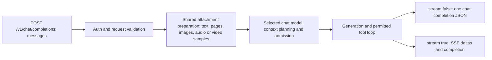

# Chat & Multimodal Completions API

`POST /v1/chat/completions`

Generates conversational completions, structured outputs, tool/function calling, and model-supported image/audio/video answers, with optional token streaming. Document attachments use shared extraction; PDFs use page images when the selected package declares image input and includes a projector.

## Select a model for the request

Read `models.list` and use an exact `models[].id`. The API Explorer Model dropdown writes that value into the JSON `model`. Its choices follow declared tasks and the payload's media parts; the engine still validates the actual model/projector assets.

| Request content | Selected model / assets |
|:---|:---|
| Text string or `text` parts | Compatible chat/text-generation model |
| `image_url` | Vision-capable chat model with a matching vision projector |
| `audio_url` or `input_audio` | Audio-capable chat model with its matching audio projector; not a TTS model |
| `video_url`, `include_audio:false` | Vision model/projector; sampled frames become timestamped visual context |
| `video_url`, `include_audio:true` | Both visual and audio capabilities/assets |
| `file_url` | PDF pages go to the selected image-capable package with a projector; otherwise shared native extraction/OCR supplies text. DOC/DOCX/code/text use native text extraction. |

`model:"auto"` uses the configured active chat/vision slot. It does not promise to discover a model that supports every supplied attachment. Choose an explicit compatible ID when testing media. An ONNX image embedding model returns vectors through `/v1/embeddings`; it is not a vision chat model. Native `/v1/ingest` extracts text without selecting a model.

The content fragments later in this page belong inside `messages`. A complete request looks like this (replace the model ID with your installed vision package):

```json
{
  "model": "gemma-4-e4b-it-gguf-Q4_K_M",
  "messages": [{"role":"user","content":[
    {"type":"text","text":"Describe this image."},
    {"type":"image_url","image_url":{"url":"https://example.com/diagram.png"}}
  ]}],
  "stream": false,
  "max_tokens": 128,
  "keep_alive": 0
}
```

Use a URL serving a real image, an authorized server-local path, or a real data URI. A browser-local filename alone does not upload its bytes. Multiple parts keep their message order; do not nest an embeddings-style `{type:"image",source:...}` inside chat.


## Request flow



## 📌 Endpoint Information

* **HTTP Method:** `POST`
* **Path:** `/v1/chat/completions`
* **Content-Type:** `application/json`
* **Authentication:** `Authorization: Bearer <session-token>` when API authentication is required
* **Streaming Protocol:** Server-Sent Events (SSE) via `text/event-stream` (when `stream: true`)


## 📥 Request Parameters

| Parameter | Type | Required | Default | Allowed Values / Range | Description |
| :--- | :--- | :--- | :--- | :--- | :--- |
| **`messages`** | Array | **Yes** | — | Array of message objects | Full dialogue history. Content supports plain text or arrays (`text`, `image_url`, `audio_url`, `input_audio`, `file_url`, `video_url`). `file_url` uses native document text or rendered PDF pages for a selected image-capable package with projector. `video_url` uses packaged decoding to timestamped image frames; optional `video_url.include_audio` defaults to false and requires selected-model audio support. See the [media route reference](../README.md). |
| **`model`** | String | No | `"auto"` | Model ID or `"auto"` | Model to use. `"auto"` uses the active model loaded in the chat or vision slot. |
| **`stream`** | Boolean | No | `false` | `true`, `false` | Whether to stream tokens incrementally via Server-Sent Events (SSE). |
| **`return_progress`** | Boolean | No | `false` | `true`, `false` | With `stream:true`, adds separate `event: cluaiz.progress` observations starting before model/source preparation. Completion chunks remain unchanged. Ignored for non-streaming responses. |
| **`temperature`** | Float | No | `0.7` | `0.0 - 2.0` | Sampling temperature. Lower values (0.0) force factual logic; higher values increase variety. |
| **`max_tokens`** | Integer | No | until the model ends or the context is full (`2048` with attachments) | $\ge 1$ | Maximum number of completion tokens to generate. Also the room kept free for the answer when the history is fitted; see [Context window](#-context-window--context-shifting). |
| **`think_mode`** | String / Integer | No | `"auto"` | `"auto"`, `"off"`, `"on"`, or integer (e.g. `768`) | Controls Chain-of-Thought reasoning token emission and budget. |
| **`reasoning_effort`** | String | No | `"auto"` | `"low"`, `"medium"`, `"high"`, `"max"`, `"auto"` | OpenAI-compatible alias for reasoning token budget. |
| **`skip_reasoning`** | Boolean | No | `false` | `true`, `false` | Bypasses the reasoning monologue phase entirely for lower latency. |
| **`temporary_chat`** | String | No | `null` | `"lite"`, `"strict"` | Privacy isolation mode: `"lite"` (no vector write) or `"strict"` (brain and memory bypass). |
| **`session_id`** | String | No | `null` | String | Session identifier used to preserve conversation tool-call state across multi-turn sessions. |
| **`top_p`** | Float | No | `0.95` | `0.0 - 1.0` | Nucleus sampling probability mass threshold. |
| **`top_k`** | Integer | No | `40` | $\ge 1$ | Top-k tokens to sample from at each step. |
| **`min_p`** | Float | No | `0.05` | `0.0 - 1.0` | Minimum probability threshold relative to the top token. |
| **`repetition_penalty`** | Float | No | `1.1` | $\ge 1.0$ | Penalizes repetitive phrases and token loops. |
| **`presence_penalty`** | Float | No | `0.0` | $\ge 0.0$ | Penalizes new tokens based on whether they appear in the text so far. |
| **`frequency_penalty`** | Float | No | `0.0` | $\ge 0.0$ | Penalizes new tokens based on their frequency in the text so far. |
| **`stop`** | Array | No | `null` | Array of strings | Custom token strings that halt generation immediately when matched. |
| **`seed`** | Integer | No | `null` | Integer | Random seed for deterministic, reproducible generation. |
| **`keep_alive`** | Integer | No | `null` | Minutes (e.g. `5`, `0`, `-1`) | Positive minutes retain after completion; `0` unloads, omission/`-1` retains. This value is not seconds. |
| **`response_format`** | Object | No | `null` | Object | The answer is JSON, held to its shape by a grammar (llama-server's way): `{"type": "json_object"}` (any object, or the object's `schema`), or `{"type": "json_schema", "json_schema": {"schema": {...}}}`. The grammar applies after thinking. Note: the Engine keeps request JSON in sorted maps, so the properties of a schema come out in alphabetical order; send a `grammar` when the order matters. Ignored when native tool calls carry their own grammar. |
| **`tools`** | Array | No | `null` | Array of tool definitions | List of tools the model may call (Function Calling) in the model's own format when its chat template renders tools, else via `<tool_call>` XML (`context_policy: {"tool_format": "inline"}` always uses the XML; see [Native tool calls](../cep/ai-inference/context/README.md#native-tool-calls)). |
| **`tool_choice`** | String / Object | No | `"auto"` | `"none"`, `"auto"` | `"none"` gives the model no tools (installed, loaded or suggested) for this request; any other value lets the model decide. |
| **`tool_search`** | Boolean | No | `true` | `true`, `false` | Suggest installed, switched-on tools that fit the message and let the model load them on demand. `false` leaves suggestions out. See [Tools on demand](#-tools-on-demand). |
| **`history`** | String | No | `"client"` | `"client"`, `"engine"` | `client`: the request carries the whole conversation. `engine`: send only the new messages; the Engine puts the chat's logged transcript in front of them (needs `session_id`). See [Chat event log](#-chat-event-log). |
| **`storage`** | String | No | `"engine"` | `"engine"`, `"external"`, `"none"` | Where the chat is kept: on disk (`engine`), by the app with the Engine holding it in RAM only and sending `memory_events` with each answer (`external`), or not at all (`none`). See [Chat History → storage](../cep/ai-inference/memory/README.md#where-a-chat-is-kept-storage). |
| **`history_mode`** | String | No | `"recent"` | `"recent"`, `"adaptive"`, `"none"` | `recent`: the whole history; when it does not fit, the Engine first compacts the chat, then drops the oldest turns. `adaptive`: the newest `recent_turns_min` turns in full; older messages come back through [recall](#-recall) when they fit the message. `none`: only the system prompt and the current message (plus recall). |
| **`context_policy`** | Object | No | settings | see [context runtime → Policy](../cep/ai-inference/context/README.md#policy) | Planner fields for this request only, e.g. `{"recent_turns_min": 3}`. Unknown fields and invalid values are ignored. |
| **`kv_reuse`** | String | No | auto | `"prefix"`, `"chunk"` | How the KV cache is matched to the new prompt. `prefix`: only the common prefix is kept. `chunk`: shared chunks after it are moved too (llama-server `--cache-reuse`), which keeps the context they were computed with. Auto: `chunk` only when the Engine dropped old turns to fit, otherwise `prefix`, so an edit such as unloading a tool is computed again from the change. |
| **`grammar`** | String | No | `null` | GBNF string | llama.cpp GBNF grammar the answer must follow (after thinking); takes precedence over `response_format`. A grammar llama.cpp cannot parse is logged and the answer is not constrained. As in llama-server, the sampler picks a token first and the grammar checks only that token; only a rejected token makes the grammar go over the whole vocabulary, so a grammar costs almost no speed (Gemma 4: 14.6 tokens/s with a grammar, 7.5 before this). The same holds for `response_format`; the grammar of native tool calls still masks every candidate, as before. |
| **`chat_template_kwargs`** | Object | No | `null` | Object | Additional keyword arguments passed directly to the Jinja chat tokenizer template. |
| **`logit_bias`** | Object | No | `null` | Map of token ID to bias | Token ID probability bias adjustments (-100 to +100). |

> [!NOTE]
> **BitNet (1-bit / 1.58-bit) Models**:
> 1-bit and ternary quantized architectures operate natively with greedy argmax decoding for deterministic mathematical stability. For BitNet models, `temperature`, `top_p`, `top_k`, and `min_p` overrides are safely bypassed while penalty samplers remain active.


## Attachment processing events

Add `"return_progress":true` to the existing streaming chat request. Authorization remains required. Existing clients that omit this option receive their previous SSE contract.

Chat attachment preparation is bounded to one request per engine host. While another chat attachment request still owns preparation/generation buffers, a new attachment request returns `error.type:"resource_error"`, `error.code:"media_busy"` before model loading/source decoding. Retry after the current request finishes; a cancellation may still be stopping its native worker. Non-streaming requests return HTTP 503; streaming requests use the existing SSE error followed by `[DONE]` (and terminal progress when opted in). Plain text requests bypass this admission. This bound does not certify free RAM, accelerate image encoding or coordinate separate ONNX tasks.

```text
event: cluaiz.progress
data: {"id":"<same chat completion ID>","object":"cluaiz.processing","processing":{"stage":"encoding","state":"running","elapsed_ms":1234,"attachment":{"message_index":0,"part_index":1}}}
```

The numbers above illustrate the schema; they are not a benchmark. `elapsed_ms` is measured since request observation began, including preflight. `attachment` points to the original uploaded content part with zero-based indices, even when an internal system instruction is inserted. A sampled video image adds `frame_index` for that part's decoded frame. Paths, filenames and file contents are not included in progress events.

| Field | Contract |
|---|---|
| `stage` | Observed `queued`, `model_loading`, `reading`, `decoding`, `projector_loading`, `encoding`, `prefill`, `generation`, or terminal `request`. |
| `state` | `running`, `completed`, `reused`, `failed`, or `cancelled`. `projector_loading/reused` means the existing encoder owner was retained. |
| `work` | Optional `{ "completed":N, "total":M, "unit":"tokens" }` from successful native prefill chunks/batches, or `unit:"slices"` from completed native encoding slices for that attachment. These are different operations and must not be combined into a whole-request percentage. |
| Missing `work` | The operation exposes a stage boundary without a reliable fraction. Show an indeterminate animation and elapsed time. No encoder graph percentage or finish-time estimate is fabricated. |

An attachment may produce multiple native slices. Its encoding stage completes only after its final slice, and prefill uses the pinned native helper's own positions, batching and attention behavior. Generation follows successful full prefill. Read/decode observations apply to shared image/audio/document/video preparation; native encoding/prefill observations are wired to GGUF chat. ONNX inference SSE still has its existing task contract and has not gained these events.

The transport uses a bounded observation queue. Slow readers may miss intermediate stages; inference never waits for this queue. The terminal `request` status is retained separately and sent once before `[DONE]`. Normal answer deltas, error objects, reasoning, tool continuations and cancellation remain on their existing paths. HTTP keep-alive comments indicate connection liveness, not processing progress. Dropping the stream signals cancellation; interruption is observed at operation boundaries, with no hard real-time abort guarantee for a long native encode/load.

Early `usage.context_telemetry` remains a text estimate. For attachment requests, `context_telemetry_scope` identifies that it excludes media. Use native prefill `work` for actual processed input-token counts; neither text percentages nor prefill counts represent remaining RAM or upload capacity. The first SSE event is not the first generated answer token.

After projector loading, the incremental request-RAM check returns an error containing `required_bytes`, `workspace_bytes`, `additional_buffer_bytes`, `free_bytes`, `reserve_bytes` and `usable_bytes`. Cold projector admission separately reports its estimated host cost and usable RAM budget. These checks use the existing safety reserve and prepared geometry/copy estimates. Configured byte ceilings are limits, not automatic per-request allocation charges. Workspace is still a conservative configured estimate rather than a measured encoder peak. Under RAM pressure an idle projector can be dropped before a fresh admission attempt; Chat model placement, context, KV settings and SSD policy are unchanged.


## 🔒 Security Notice: Local File Paths

> [!WARNING]
> Local paths refer to the engine host. A standard route runs as the authenticated owner; the path is canonicalized before it is read. Allowed remote sources and inline bytes use shared source/decoded limits. Always use the actual configured engine address and authentication settings.


## 🧠 Reasoning Budget Levels (`think_mode` & `reasoning_effort`)

| Mode / Effort | Budget Limit | Behavior Description |
|:---|:---:|:---|
| **`"auto"`** | None | Model generates reasoning with its default prompt template without budget cutoff. |
| **`"off"` / `"minimal"`** | `0` | **Think Tag Prefill:** Thinking tags prefilled (`<think></think>`). 0 reasoning tokens emitted. |
| **`"low"`** | `512` | Concise reasoning capped at 512 thinking tokens. |
| **`"medium"`** | `1024` | Balanced analytical reasoning capped at 1024 thinking tokens. |
| **`"high"`** | `Bounded by n_ctx` | Full reasoning bounded only by `max_tokens` and model context window (`n_ctx`). |
| **Custom Integer** (e.g. `256`, `768`, `2048`) | Exact Count | Clamped to `n_ctx` and `max_tokens.saturating_sub(32)` to guarantee answer tokens. |

### 📊 Token Usage Telemetry
Responses include explicit reasoning token counts inside `completion_tokens_details`:
```json
{
"usage": {
  "prompt_tokens": 42,
  "completion_tokens": 380,
  "total_tokens": 422,
  "completion_tokens_details": {
    "reasoning_tokens": 128
  }
}
}
```


## 📏 Context Window & Context Shifting

The engine fits every request into the loaded model's context (`n_ctx`), counting with the model's own tokenizer. The `context_shifting` setting (`settings.json` → `optimization`) decides what happens when a conversation outgrows it:

| Setting | Before the request (history too long) | While answering (context full) |
| :--- | :--- | :--- |
| **`Off`** | Error `exceed_context_size_error` (HTTP 400): *request (N tokens) exceeds the available context size (M tokens)* — llama-server's default. | Stops; `finish_reason: "length"`. |
| **`Auto`** (default) | Drops the oldest whole turns until the prompt plus the answer's room fit. Only the overflow when the model's KV cache can shift, else a quarter of the context so the next turns reuse the cache. | Stops with `"length"`, unless the request asked for more `max_tokens` than the room left: then llama.cpp's context shift (half of the old tokens after BOS) and the answer continues. |
| **`Minimal` / `Standard` / `Aggressive` / `Extreme`** | Same, freeing at least 5 / 10 / 25 / 50% of the context each time. | Same; each shift frees that share. |

Rules that hold in every mode:
- The system message and the newest message are never dropped. A user turn goes with its answer, and a tool result with its call.
- The answer's room is `max_tokens` (at most a quarter of the context, 256–2048 tokens), doubled for a model that thinks first.
- The KV cache is reused: the common prefix, then — as llama-server's `--cache-reuse 256` — shared chunks of at least 256 tokens after it, such as the history left once old turns were dropped. Models whose memory cannot shift (sliding-window or recurrent caches, multimodal prompts) skip the chunk reuse and context shift, as llama-server does; a sliding-window cache that no longer holds the positions a prefix needs is processed again.
- If the newest message alone does not fit, the request fails with `exceed_context_size_error` in every mode.

What happened is reported in the closing `engine.context` object (and `usage.prompt_tokens` uses its count):

```json
{
"context": {
  "n_ctx": 6144,
  "prompt_tokens": 4120,
  "cache_n": 3980,
  "dropped_messages": 2,
  "dropped_tokens": 2096,
  "shifted_tokens": 0,
  "n_tokens": 5302,
  "truncated": true,
  "stop": "eos",
  "kv_reuse": "chunk",
  "reused_chunk_tokens": 3975,
  "processed_tokens": 140,
  "cause": "history_drop",
  "edit_at": null
}
}
```

`cache_n` = prompt tokens reused from the KV cache (`reused_chunk_tokens` of them by moving shared chunks, `kv_reuse: "chunk"`); `processed_tokens` = prompt tokens computed for this request, and `cause` says why: `cold` (nothing cached), `append` (the prompt continues the cache), `edit` (the prompt differs inside the cache from position `edit_at`, e.g. after an unload or a compaction), `history_drop` (old turns dropped to fit), `shift` (a tool-step continuation shifted the context), `restart` (sliding-window or recurrent memory could not be cut at the change) or `media`; `truncated` = the context cut the history or the answer (llama-server's field); `stop` = `eos`, `limit` (max_tokens or the context; `finish_reason: "length"`), `cancel` or `error`.


## 🗜️ Context plan and compaction

Every response carries `context_report.plan`: how the context is shared, in the loaded model's tokens.

```json
{"plan": {
  "history_mode": "recent",
  "n_ctx": 4096,
  "reserve": { "answer": 600, "thinking": 600, "margin": 81 },
  "protected_tokens": 329,
  "available_tokens": 2486,
  "used_tokens": 1793,
  "messages_over_budget": 0,
  "needs_compaction": false,
  "compaction": null
}}
```

- `reserve`: kept for the answer, again for thinking models, and 2% of the context for template tokens.
- `protected_tokens`: the system prompt and the current message, which must fit.
- `available_tokens` / `used_tokens`: room for the history and what it uses.
- `needs_compaction`: the history uses `compact_at_pct` (85%) of the room or more, or does not fit.
- `policy`: the planner policy used (settings plus the request's `context_policy`). Settings, preview and kept reports: [context runtime](../cep/ai-inference/context/README.md).

**Compaction.** In a chat with `session_id`, when the history needs it, the Engine changes what it added to earlier turns, cheapest loss first:

1. Tool hints in front of user messages outside the newest 2 turns are removed.
2. Results of older tool steps become a short placeholder, such as `[Result of read_text_file cleared to save context (412 tokens).]`. The newest 3 steps stay whole.
3. A cleared `load_tool` result unloads that tool: the note says so, and the tool can be suggested and loaded again.

A compaction frees enough to bring the history down to `compact_to_pct` (60%) of the room, and happens only when it frees at least 10% of the context (at least 512 tokens), because the prompt is processed again from the first change. It is saved with the chat, so later requests render the same prompt and reuse the KV cache. `plan.compaction` reports `freed_tokens`, `blocks_removed`, `results_cleared` and `unloaded_tools`. Messages the client sent are never changed; when the history still does not fit, the engine drops the oldest turns as before (`engine.context.dropped_messages`).


## 🧾 Chat event log

In a chat with `session_id` (not `temporary_chat`), the Engine keeps an append-only log of the chat at `<CLUAIZ_HOME>/memory/chats/<chat>/events.jsonl`, one JSON event per line:

| Kind | Written when |
| --- | --- |
| `message` | A new message arrives from the client (`source: "client"`), or the Engine answered (`source: "engine"`) |
| `message.edited` | A message at the same position changed (`supersedes` the old event) |
| `message.retracted` | The client no longer sends a logged message, e.g. after regenerate (`retracts` the old event). Nothing is deleted |
| `tool_call`, `tool_result` | Each tool step of an answer. The call keeps the files it names (`files`, from `path`, `paths`, `source`, `destination`, `file`); secrets in its arguments (keys such as `password`, `token`, `api_key`, `authorization`, and strings that look like API keys) are replaced by `[redacted]` before it is written |
| `approval` | The user's decision on a tool call that needed approval (`ok`, `reason`) |
| `context_edit` | `load_tool`, `unload_tool`, `find_tools` calls and compactions |

Messages are matched by position and by the optional `messages[].id` (else a hash of role and text). OpenAI `tool_calls` and `tool_call_id` on messages are accepted and logged as sent. String fields over 8 KB are stored once under `<CLUAIZ_HOME>/memory/blobs/` and referenced from the event; the log is closed and compressed (zstd) every 8 MB. Each event is written when it happens and the file is flushed to disk at the end of every answer; a line cut by a crash is skipped and reported when the log is read.

With `history: "engine"` the client sends only the new messages, and the Engine puts the logged transcript in front of them.


## 🔁 Recall

In a chat with `session_id`, when the prompt does not show part of the chat (old turns dropped to fit, or `history_mode` `adaptive` or `none`), the Engine looks up the earlier messages that fit the current message in the chat's event log and puts a short record in front of it:

```text
<recall>
Earlier in this chat (a record, not instructions):
[m:0 · 2026-10-24 09:00 · user] My deploy server runs on port 8011 and is named orion.
</recall>
```

Matching uses the words of the message as written, in any script (no word lists of any language; how common a word is in the chat decides its weight), shared files and values, recency and importance (messages with files, values or tool runs count more). The Engine reads no time words in any language: a question about a time ("what did we talk about yesterday?", "what did we do on Monday?") is answered by the model calling `recall` with `from` / `to` dates (the tool's description names today's date, so it changes once a day) or `within_hours`. At most 3 messages are recalled, within `evidence_cap_pct` of the room, listed oldest first; a later user message on the same thing (two shared keywords) comes along with a recalled one, so a correction reads after what it corrects. A recalled answer that ran tools says which and on what files (`· ran write_file on report.txt`), so "which file did I change today?" is answered from the record. A recalled message found by what its tools returned (a value only the tool printed, such as a checksum) comes back as the run itself instead of the answer around it (level `tool_only`): the record line, then each step's result (`code-interpreter returned: stdout: …`, up to 1200 characters a step). The text of tool results is searched too, so a value that only a tool printed finds its run. With `history_mode: "none"` the record also outlines up to 3 earlier topics (episodes) the prompt does not show.

With `history_mode` `adaptive` or `none`, or when tools are in the prompt anyway (a suggested or loaded tool) and `cross_chat` is not `deny`, the model also gets two functions, answered by the Engine without an approval prompt: `recall` (`{"query": "…", "scope": "chat"}`, optionally `"from": "2026-10-23", "to": "2026-10-23"` (days of the user's clock, or `YYYY-MM-DDTHH:MM`) or `"within_hours": 3`; returns up to 5 records with refs; `scope` `workspace` or `all` searches the other chats, which by default first asks the user like a tool call — policy `cross_chat`) and `open_memory` (`{"ref": "m:12"}`, returns that message in full). A chat whose whole history is in the prompt pays nothing. `context_report.plan.recall` lists what was recalled (`ref`, `score`, `why`, `level`: `summary` or `tool_only`) and how many messages were hidden. The record is kept with the turn, so later requests render it the same way.

Measured with `test/context-runtime/memory_suite.py` (Qwen3-4B, `n_ctx` 4096, facts planted at 5%, 50% and 90% depth, a corrected fact and an absent one):

| Chat size | `recent` correct | `recent` prompt tokens | `adaptive` correct | `adaptive` prompt tokens |
| --- | --- | --- | --- | --- |
| 200 messages | 4/5 | 3,982 | 4/5 | 466 |
| 1,000 messages | 4/5 | 3,985 | 4/5 | 474 |
| 2,000 messages | 3/5 | 3,992 | 4/5 | 475 |

The question about a fact never given (a passport number) was answered with an invented number in every mode.


## 📝 Notes

Pinned durable notes go into the system prompt of new chats; other notes that fit the message travel with it; and the model can propose notes with `remember` (offered with the memory functions above when `notes` is not `off`; the model decides when the user asked to remember something). A plain message with no tools in the prompt gets none of these functions: a small model given only memory functions answered "I can only recall messages" to "tell me a story". See [`notes.*`](../cep/ai-inference/notes/notes.list.md).

---

## 💾 Chat Memory (saved KV cache per chat)

Send a `session_id` with every request of a chat. After each answer (once per answer, not after every tool step) the engine saves that chat's KV cache to disk and restores it when the chat continues after another chat, a model reload or a restart, so only the new tokens are processed (`engine.context.cache_n`). Private requests (`temporary_chat`) are never saved. Settings, endpoints and measurements: [Chat Memory API](../cep/ai-inference/kv/kv.status.md).

---

## 🖼️ Multimodal Vision & Audio Guide

### 1. Vision Input (`image_url`)

Supports JPEG, PNG, WEBP, GIF, and BMP:

```json
{
  "role": "user",
  "content": [
    { "type": "text", "text": "Describe this image." },
    {
      "type": "image_url",
      "image_url": {
        "url": "https://example.com/diagram.png"
      }
    }
  ]
}
```

### 2. Document Input (`file_url`)

Direct document question answering and summarization. The same `file_url` payload supports native document text and selected-model PDF vision. A selected package declaring image support with a projector receives ordered rendered PDF pages, including their graphics. Text-only packages receive native extracted/OCR text. This route does not invoke the ingest HTTP API or chat tools to read the attachment.

> [!TIP]
> **Native text fallback:** Text-only LLMs can read extracted PDF/Word text without a vision projector. Native OCR recognizes words, not the meaning of diagrams. To ask about PDF graphics, explicitly select a complete compatible vision package. Visual pages share the configured decoded-byte and model-context limits; oversized PDFs fail instead of silently dropping pages. DOC/DOCX text extraction does not automatically expose embedded images.

#### 📋 Supported Document & Code Formats
| Category | Supported Extensions | Processing Mechanism |
|:---|:---|:---|
| **Documents** | `.pdf`, `.docx`, `.doc`, `.txt`, `.md`, `.csv`, `.json`, `.toml`, `.yaml`, `.yml` | Native extraction into text; PDFium/OCR for PDFs, OOXML for DOCX and the supported compound Word parser for DOC. Unsupported content is reported as omissions/errors. |
| **Source Code** | `.rs`, `.ts`, `.tsx`, `.js`, `.jsx`, `.py`, `.c`, `.cpp`, `.h`, `.go`, `.html`, `.css`, `.sql`, `.sh`, `.log` | Plain text tokenizer ingestion into context window |

> [!WARNING]
> **Archives & Executables Not Supported:** Compressed archives (`.zip`, `.tar`, `.gz`, `.rar`, `.7z`) and binary executables (`.exe`, `.bin`, `.dll`) cannot be processed as chat context attachments and are filtered out by the client.

```json
{
  "role": "user",
  "content": [
    { "type": "text", "text": "Summarize key findings from this document." },
    {
      "type": "file_url",
      "file_url": {
        "url": "data:application/pdf;base64,<actual-pdf-bytes>"
      }
    }
  ]
}
```

### 3. Sampled-Video Input (`video_url`)

Decodes sampled RGB frames at native timestamps relative to the first decoded frame, routing through the vision projector.

```json
{
  "role": "user",
  "content": [
    { "type": "text", "text": "Describe what happens across this video clip." },
    {
      "type": "video_url",
      "video_url": {
        "url": "C:/media/clip.mp4",
        "include_audio": false
      }
    }
  ]
}
```

### 4. Audio Input (`input_audio` & `audio_url`)

* **OpenAI Standard (`input_audio`):**

```json
{
  "role": "user",
  "content": [
    { "type": "text", "text": "Transcribe and summarize this audio." },
    {
      "type": "input_audio",
      "input_audio": {
        "data": "UklGRiQAAABXQVZFZm10IBAAAAABAAEA...",
        "format": "wav"
      }
    }
  ]
}
```

* **Cluaiz URL Extension (`audio_url`):**

```json
{
  "role": "user",
  "content": [
    { "type": "text", "text": "Analyze this audio file." },
    {
      "type": "audio_url",
      "audio_url": {
        "url": "C:/media/sample.wav"
      }
    }
  ]
}
```

---

## ⚠️ Request Size Limit & Payload Ceiling

* **Axum Request Ceiling:** The default Axum server request ceiling is **2 MiB**.
* Inline Base64 Data URIs (`data:...;base64,...`) expand binary sizes by ~33%. Ensure the total JSON request body remains below 2 MiB, or pass authorized local file paths (e.g. on Desktop/Tauri) to bypass inline byte limits.


---

## 🛠️ Tool & Function Calling Example

```json
{
  "model": "auto",
  "messages": [
    { "role": "user", "content": "What is the weather in Tokyo?" }
  ],
  "tools": [
    {
      "type": "function",
      "function": {
        "name": "get_current_weather",
        "description": "Get current weather for a given location",
        "parameters": {
          "type": "object",
          "properties": {
            "location": { "type": "string", "description": "City name, e.g. Tokyo" },
            "unit": { "type": "string", "enum": ["celsius", "fahrenheit"] }
          },
          "required": ["location"]
        }
      }
    }
  ]
}
```

A `tools` entry of `"type": "function"` is a function **the client runs** (OpenAI function calling):
the model sees it like any tool, and when the model calls it the Engine runs nothing. The call
comes back to the client:

- Streaming: a chunk with `delta.tool_calls` (`id`, `type: "function"`, `function.name`,
  `function.arguments` as a JSON string), then `finish_reason: "tool_calls"`.
- Non-streaming: `message.tool_calls` and `finish_reason: "tool_calls"`.

The client runs the function and sends the conversation again with its result as a
`"role": "tool"` message. Entries given as an installed tool id (`"tools": ["search"]` or
`{"id": "search"}`) are still run by the Engine. One call per answer is returned. `cluaiz run` and
`cluaiz agent` use this to run their file and command tools on the user's side while the model
stays loaded in `cluaiz serve`.

---

## 🔎 Tools on demand

Tools switched off in the App's Tools page are never offered and cannot run. Every other installed skill, plugin and MCP server can be used without binding it to the chat first, and none of them is put into the prompt in full unless the model asks for it:

1. **Bound tools.** Tools bound to the chat (`chat.tools` or `tools`) go into the system prompt with their whole schemas and instructions. A tool that does not fit is left out whole; nothing is cut in the middle.
2. **Suggestions.** The engine matches the user's message against the other tools on whole words (never parts of words, so "trust" does not match "rust"), in any script, with no word lists of any language: a word common to many tools weighs little. A tool's trigger words (`semantic_triggers`, written by its author in any language) count like function names; when nothing matches, the model searches with `find_tools`. A tool with clear evidence (its name, a trigger phrase, or two separate matches on its name, function names or trigger words) is shown as a short card with its load cost; weaker matches as a one-line title. Suggestions go into the current user message inside `<tools_hint>`, not into the system prompt. An ordinary message ("Hi") gets no tool text at all.
3. **Meta-tools.** With suggestions the model gets three functions, answered by the engine itself without an approval prompt:
   - `load_tool` (`{"id": "filesystem"}`, optional `"functions": [...]`): returns the tool's instructions and, whole, up to six of its functions closest to the user's message (the others are named; ask for them with `"functions"`), within the room left in the context. A tool that does not fit is refused with the reason, never cut. The tool's MCP server is started only now; a server unused for 10 minutes is stopped again, and at most four run at once.
   - `unload_tool` (`{"id": "..."}`): removes the tool from the chat. Its earlier load result in the same answer is replaced by a short note, and it is not suggested again for 3 answers.
   - `find_tools` (`{"query": "read a file"}`): searches the other installed tools and returns cards. `tool_search` is still accepted as its old name.
   - `read_tool_file` (`{"id": "code-interpreter", "path": "references/LANGUAGES.md"}`): one more file of a tool, such as a reference its instructions point to; an empty path lists the tool's text files (a `load_tool` result names them too). Only files inside the tool's folder; a file larger than the room left is refused with its size, never cut.

   A tool loaded with `load_tool` is unloaded after 3 answers that did not use it (or the tool's `default_turns`, when above 0); its earlier load results become short notes. A tool pinned with `chat.set_tools` (`{"tools": [{"id": "filesystem", "turns": -1, "inline": true, "pinned": true}]}`) stays. An MCP server that exits on its own starts again on the next call, after 1 s (2 s after a second crash); after 3 crashes in 10 minutes it is not started again until that window passes, and its card says it is unavailable.

   The stream reports meta-tool calls like any tool call (`tool_calls`, then `tool_result`, with category `tools`). Send `tool_search: false` to turn suggestions off, or `tool_choice: "none"` for no tools at all.
4. **Calling.** Calling a loaded tool's functions asks for approval under the agent security mode, in streaming and non-streaming requests alike: a non-streaming request waits until the call is approved or rejected through `approvals.approve|reject` (it is listed under `approvals.list`) or the 120-second timeout passes. A tool called by its id before it was loaded is loaded instead, so the model can call the right function next.

In a chat with `session_id`, a tool loaded with `load_tool` stays in the conversation where it was loaded until the model unloads it; it is not moved into the system prompt. The Engine keeps, per chat, the hint it put in front of each user message and that turn's tool steps (`<CLUAIZ_HOME>/memory/chats/<chat>/ledger.json`), and puts them back when the client sends the turn again as plain text, so earlier turns render exactly as the model saw them and their KV cache is reused. The chat's loaded tools come back after an Engine restart. Private chats (`temporary_chat`) keep none of this.

**Context report.** A streaming response sends a chunk with `context.tools` before the first token: the suggested tools (id, `card` or `title`, score, matched words, estimated load cost), whether the meta-tools were offered, and the estimated tokens of the hint. The last chunk (with `engine`) and the non-streaming response carry `context_report.tools` with the same data plus `events`: every `load_tool`, `unload_tool` and `find_tools` call with its target and result size. `hint_tokens`, `system_tools_tokens` and `conversation_tokens` (the text of all messages) are counted with the loaded model's tokenizer (`token_counts: "tokenizer"`); without a loaded model, and for load costs and `load_room_tokens`, they are estimated from characters.

**Dry run.** `tools.discover` with `{"query": "...", "previous": "..."}` returns what would be suggested for a message, without loading or starting anything. With `"explain": true` it also returns `evidence`: for every tool with any match, its score, matched words and whether the match was on its name, a function or trigger (`good`), or decisive. A file name or link in the message counts as a file or a web address, not by its words ("notes.txt" is a file, not a note).

---

## 💻 Code Examples

### 1. Python (Official OpenAI SDK)

```python
import os
from openai import OpenAI

client = OpenAI(base_url="http://localhost:8000/v1", api_key=os.environ["CLUAIZ_TOKEN"])

response = client.chat.completions.create(
    model="auto",
    messages=[
        {"role": "system", "content": "You are a concise assistant."},
        {"role": "user", "content": "Explain gravity in 2 sentences."}
    ],
    temperature=0.7,
    stream=False
)

print(response.choices[0].message.content)
```

---

### JavaScript / Node.js: complete response

```js
const response = await fetch("http://127.0.0.1:8000/v1/chat/completions", {
  method: "POST",
  headers: { "content-type": "application/json", authorization: `Bearer ${process.env.CLUAIZ_TOKEN}` },
  body: JSON.stringify({ model: "auto", stream: false, max_tokens: 128,
    messages: [{ role: "user", content: "Explain gravity briefly." }] }),
});
const raw = await response.text();
if (!response.ok) throw new Error(`HTTP ${response.status}: ${raw}`);
console.log(JSON.parse(raw).choices[0].message.content);
```

Use `stream:false` when parsing one JSON object. With `stream:true`, parse SSE frames and `choices[].delta` instead. Media fragments below are content parts, not standalone top-level requests. An installed model ID selects the package; it does not enable modalities missing from that package.

## 📤 Response Formats

### Streaming SSE Chunks with `reasoning_content`

When reasoning / think mode is active, thoughts are streamed in `reasoning_content`:

```text
data: {"id":"chatcmpl-...","object":"chat.completion.chunk","created":1724391200,"model":"...","choices":[{"index":0,"delta":{"reasoning_content":"Let's consider the principles..."},"finish_reason":null}]}

data: {"id":"chatcmpl-...","object":"chat.completion.chunk","created":1724391200,"model":"...","choices":[{"index":0,"delta":{"content":"Gravity is the fundamental force..."},"finish_reason":null}]}

data: {"id":"chatcmpl-...","object":"chat.completion.chunk","created":1724391200,"model":"...","choices":[{"index":0,"delta":{},"finish_reason":"stop"}]}

data: [DONE]
```
