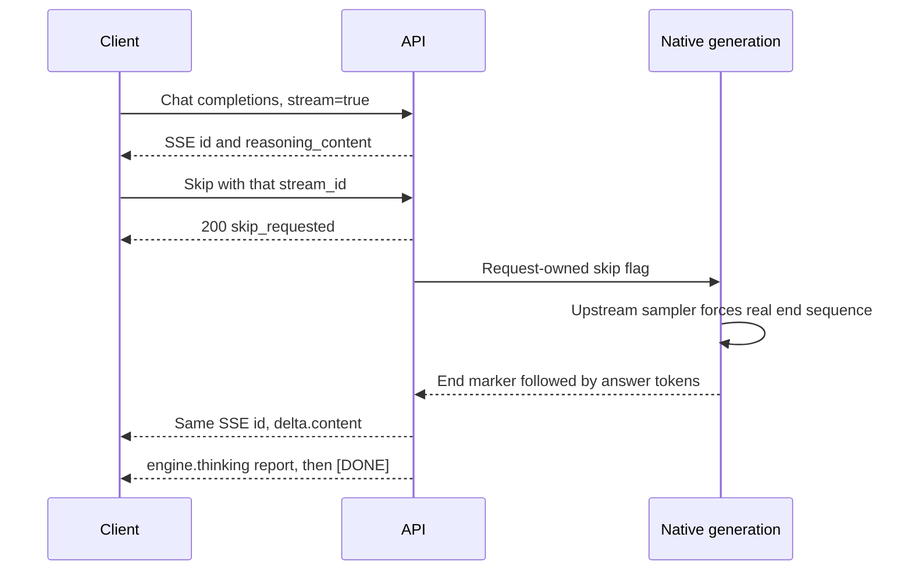

# Skip Reasoning API

`POST /v1/chat/skip-reasoning` requests a native reasoning exit for one running chat stream. The same `/v1/chat/completions` SSE continues with the answer; the model is not restarted.

## Request

Use the configured engine URL, `Content-Type: application/json`, and `Authorization: Bearer <session-or-api-token>`. The required `stream_id` is the actual `id` from the running chat SSE, not an example identifier.

```json
{"stream_id":"<actual running chat SSE id>"}
```

```javascript
const response = await fetch(`${engineUrl}/v1/chat/skip-reasoning`, {
  method: "POST",
  headers: {
    "Content-Type": "application/json",
    Authorization: `Bearer ${token}`,
  },
  body: JSON.stringify({ stream_id: activeStreamId }),
});
const acknowledgment = await response.json();
```

## Responses

| HTTP | Code/status | Meaning |
|---|---|---|
| 200 | `skip_requested` | This eligible stream's signal is set. It is not proof that generation has already reached the answer. |
| 401 | Authentication error | The configured authentication check rejected the request. |
| 404 | `stream_not_found` | The ID is unknown or the stream has completed. |
| 409 | `reasoning_unavailable` | The stream has no enabled native reasoning control. |
| 503 | `stream_control_unavailable` | The active-stream registry cannot be accessed. |

```json
{
  "status": "skip_requested",
  "stream_id": "<same running chat SSE id>",
  "message": "Native reasoning exit requested; the same stream continues with the answer."
}
```

Errors use an `error` object with `code` and `message`. Repeating an accepted request for the same active eligible stream sets the same signal again.

## Stream behavior



Continue consuming the original SSE after the acknowledgment. The parser changes phase on the actual model/template end sequence. The final `engine.thinking.ended_by` identifies an accepted native `skip`, an automatic `budget` exit, or a natural `model` end. Another request has its own signal.

The control is checked between native sampling/decode operations. It does not certify immediate kernel interruption or a correct, brief answer; a model may explain its final answer. Use `/v1/chat/cancel` to cancel generation instead.
