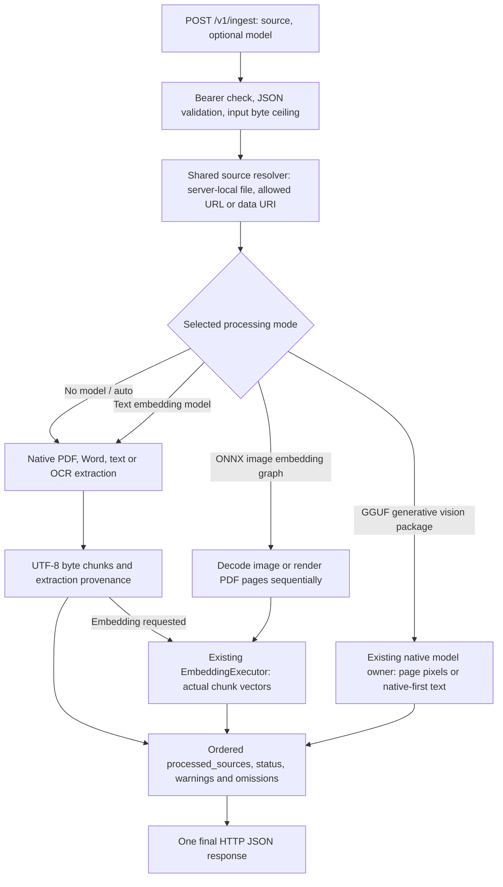

# Document Ingest API

`POST /v1/ingest` — direct JSON request and final JSON response. No CEP envelope or task polling.

Reads documents/images and returns text chunks, selected-model output, or vectors. **Model selection is optional.** Without a model the engine uses native document/OCR providers. With a model it runs that installed package through the existing inference owner.

Send JSON and your configured `Authorization: Bearer <token>`. Paths refer to the engine computer; local sources still require filesystem authorization. HTTP(S) sources follow remote-source policy, and inline data must contain actual bytes.

## Processing modes



| Selection | Image | PDF | DOCX / DOC / text | Output |
|:---|:---|:---|:---|:---|
| Native extraction (no `model`, or `auto`) | Native OCR | Native text, automatic OCR where needed | Native extraction | Text/chunks and provenance |
| Text embedding package, ONNX or GGUF | Native OCR, then text vectors | Native extraction/OCR, then chunk vectors | Native extraction, then chunk vectors | Text vectors; optional extracted text |
| ONNX image embedding graph | Real image pixels | Each rendered page's real pixels | Unsupported by an image-only graph; choose a text embedding model | Image/page vectors |
| Generative GGUF vision package | Model reads pixels | Model reads rendered page pixels in order | Native text extraction, then selected model processing | Model-generated text/chunks |

Audio/video understanding belongs to the dedicated STT/Chat APIs, not this document endpoint. UTF-8 CSV/Markdown/source code can be extracted as text; this does not provide spreadsheet formula evaluation, table reconstruction or code execution. XLSX/PPTX parsing and DOCX embedded-image reasoning are not implemented here.

A folder named `ingest` is an installation category, not proof of an OCR decoder. FashionCLIP-style feature graphs return vectors. A generative vision package returns text. The engine does not turn an embedding vector into invented OCR text, and does not silently substitute a different model.

A client can expose two controls: **Model** (including Native extraction) and **Payload example** under Body Payload. Offer PDF, scanned PDF, image, DOCX, legacy DOC, text, batch, metadata, vectors, or model text. Replace the example source with your real file/URL/data URI.

## Request fields

| Field | Type | Default | Meaning |
|:---|:---|:---|:---|
| `source` | string or string[] | Required | Authorized server-local path/file URI, allowed HTTP(S) URL, or actual data URI. Arrays preserve source order. |
| `model` | string | Native extraction | Exact installed ID from CEP `models.list`. Omit/`auto` for native processing. Explicit missing/unsupported models error. |
| `output_controls.return_text` | boolean | `true` | Return available text/chunks. False removes raw text while retaining metadata. Image-only vectors do not produce text. |
| `output_controls.return_embeddings` | boolean | Implied by an embedding model | True requires a selected embedding model. False conflicts with selecting an embedding model. Vision text models do not produce vectors. |
| `chunking_strategy.type` | string | `semantic` | Only semantic chunking is supported. |
| `chunking_strategy.max_chunk_size` | positive integer | `512` | Maximum UTF-8 bytes per returned chunk, not tokenizer tokens. Must fit media limits. |
| `chunking_strategy.overlap` | integer | `0` | Only zero overlap is supported. |
| `vision_settings.use_vision` | boolean | `true` for selected vision model | Images/PDF pages go to the selected vision encoder. False uses native extraction first, then the selected model reads that text. |
| `vision_settings.system_instruction` | string | Packaged extraction instruction | Overrides the selected generative model's extraction instruction; for example request dates/amounts present in the document. Not an embedding control. |
| `vision_settings.max_tokens` | positive integer | `2048` (shared chat generation default) | Output-token cap for each image/page/model text generation. A cap can leave partial text. |
| `vision_settings.detail_level` | — | — | Not implemented; rejected rather than ignored. |
| `namespace` | — | — | Unknown field; rejected. This route does not save a persistent vector index. |

Unknown fields are rejected. There is no per-request `keep_alive` or `device` field on ingest. Model owners use the engine's existing settings, admission and cached residency; a model may stay resident until replaced/unloaded/shutdown. This route does not execute chat tools or create a persistent chat session.

### What changes when an option changes

| Choice | What the Engine does | What the client receives |
|---|---|---|
| Omit `model`, including for a scanned PDF | Native extraction; OCR requires the packaged native providers | Recognized text and page provenance; omissions when content is unavailable |
| Select a text embedding package | Extract native text, chunk it, then pass each chunk to that exact model | Real chunk vectors; text is also included unless disabled |
| Select an ONNX image embedding package | Feed actual image pixels or rendered PDF pages to its image graph | Image/page vectors, not captions or OCR prose |
| Select a GGUF vision package | Read images/rendered pages with its matching projector | Generated text; model output can be inaccurate and must be checked |
| Set `use_vision:false` with a generative package | Extract text first, then ask the backbone to process that text | Model text without claiming that the model saw pixels |
| Set `return_text:false` | Still parse and process the source | Counts, provenance and requested vectors, without raw text/chunks |
| Reduce `max_chunk_size` | Split the available text into smaller byte-bounded chunks | More chunks; it does not increase the selected model's context window |
| Set `max_tokens` for vision | Bound generated output per page/image or native-text generation | Potentially shortened generated text; this is not an input-byte limit |

This is a direct owner API, like the direct chat/media routes: its Bearer token represents the Engine owner. Local files use the shared canonicalizer relative to the selected workspace; the workspace is not a restriction on the owner's accessible files. CEP extension principals and their roots are a separate authorization model. Do not expose an owner's token to an untrusted extension.

## Payload examples by file type

Example IDs must be replaced with your exact installed IDs when different. Sources such as `C:/documents/report.pdf` are examples, not files shipped with the engine. Shortened Base64 placeholders are not executable fixtures.

### 1. Plain text: native, no model

```json
{
  "source": "data:text/plain;base64,SGVsbG8gQ2x1YWl6IQ==",
  "output_controls": {"return_text": true}
}
```

This complete data URI contains `Hello Cluaiz!`. A UTF-8/recognized text file path is also accepted. Supported native text decoding includes the extractor's BOM handling; unknown binary files are not accepted as text.

### 2. Digital PDF: native, no model

```json
{
  "source": "C:/documents/report.pdf",
  "output_controls": {"return_text": true},
  "chunking_strategy": {"type": "semantic", "max_chunk_size": 512, "overlap": 0}
}
```

The native provider extracts page text. Image-only/empty PDF regions use packaged OCR where available; inspect page omissions/warnings.

### 3. Scanned PDF: actual inline bytes

```json
{
  "source": "data:application/pdf;base64,<actual-base64-pdf-bytes>",
  "output_controls": {"return_text": true}
}
```

Do not set a model merely to enable native OCR. Packaged renderer/OCR assets must be available; an unavailable provider is reported.

### 4. Receipt/image: native OCR

```json
{
  "source": "C:/images/receipt.png",
  "output_controls": {"return_text": true}
}
```

An allowed image URL or actual `data:image/png;base64,...` is an alternative. Native OCR reads text; it does not describe image meaning.

### 5. Word DOCX: native, no model

```json
{
  "source": "C:/documents/report.docx",
  "output_controls": {"return_text": true}
}
```

The OOXML provider reads supported main-body text/table content. It is not a screenshot interpretation model; headers/footers or unsupported objects can appear as omissions.

### 6. Legacy Word DOC: supported native text

```json
{
  "source": "C:/documents/report.doc",
  "output_controls": {"return_text": true}
}
```

A real supported compound Word document is required. Legacy DOC and DOCX use different parsers. Native text extraction does not promise full layout/image reconstruction.

### 7. Mixed native batch

```json
{
  "source": ["C:/documents/report.pdf", "C:/documents/report.docx", "C:/documents/notes.txt"],
  "output_controls": {"return_text": true}
}
```

Results keep source order. Inspect each source status; a successful source does not make every other source successful.

### 8. Metadata only

```json
{
  "source": "C:/documents/report.pdf",
  "output_controls": {"return_text": false}
}
```

Extraction still occurs. Raw text and chunks are omitted; counts, methods, pages, warnings, omissions and available recognition confidence remain.

### 9. PDF/DOCX/text directly to selected text vectors

```json
{
  "model": "embeddinggemma-2-GGUF",
  "source": "C:/documents/report.pdf",
  "output_controls": {"return_text": true, "return_embeddings": true},
  "chunking_strategy": {"type": "semantic", "max_chunk_size": 512, "overlap": 0}
}
```

Choose a compatible installed ONNX or GGUF **text** embedding package. The engine extracts chunks and sends their actual text to that package's shared embedding executor. Replace the source with a DOCX/DOC/text file to use the same pipeline. Chunk bytes are not tokenizer counts; oversized model sequences error instead of being silently truncated.

### 10. Image to selected ONNX image vectors

```json
{
  "model": "fashion_clip-unknown-onnx-fp32",
  "source": "C:/images/jacket.png",
  "output_controls": {"return_text": false, "return_embeddings": true}
}
```

Returns an image vector, not OCR prose. Graph inputs/signatures determine whether the selected ONNX package accepts pixels. No fake text vector or caption is generated.

### 11. PDF page vectors with selected ONNX image graph

```json
{
  "model": "fashion_clip-unknown-onnx-fp32",
  "source": "C:/documents/catalog.pdf",
  "output_controls": {"return_text": false, "return_embeddings": true}
}
```

Requires packaged PDF rendering. Each page is rendered and processed in order, retaining one page image at a time. `embeddings[].page` identifies the physical page. An image-only graph cannot embed raw DOCX/text; choose a text embedding package for those sources.

### 12. Image with selected generative vision model

```json
{
  "model": "MiniCPM-V-4.6-gguf-Q4_K_M",
  "source": "C:/images/receipt.png",
  "output_controls": {"return_text": true},
  "vision_settings": {"use_vision": true, "max_tokens": 512}
}
```

The selected GGUF and matching projector process actual pixels through the existing native media host. `parts[].method` is `model_text`; generated recognition may be inaccurate.

### 13. Scanned PDF with selected vision model

```json
{
  "model": "MiniCPM-V-4.6-gguf-Q4_K_M",
  "source": "C:/documents/scanned_report.pdf",
  "output_controls": {"return_text": true},
  "vision_settings": {"use_vision": true, "max_tokens": 512}
}
```

Each page is rendered and inferred separately. The output cap applies per page. Large documents can take time; page rendering and selected-model inference are distinct from native PDF text extraction.

### 14. DOCX native read, then selected model processing

```json
{
  "model": "MiniCPM-V-4.6-gguf-Q4_K_M",
  "source": "C:/documents/report.docx",
  "output_controls": {"return_text": true},
  "vision_settings": {
    "system_instruction": "Extract dates and amounts present in this document. Do not invent missing values.",
    "max_tokens": 256
  }
}
```

DOCX/DOC/text is first extracted natively. The selected model processes the extracted text; it does not see a Word page screenshot. Incomplete native extraction is not promoted to complete model context. For image/PDF input, `use_vision:false` explicitly chooses native extraction first.

### 15. PDF native read, then selected model text (without visual pixels)

```json
{
  "model": "MiniCPM-V-4.6-gguf-Q4_K_M",
  "source": "C:/documents/report.pdf",
  "output_controls": {"return_text": true},
  "vision_settings": {
    "use_vision": false,
    "system_instruction": "Extract dates and amounts present in this document. Do not invent missing values.",
    "max_tokens": 256
  }
}
```

Native PDF/OCR provides text; the selected backbone reads that text. This mode does not require a visual projector for the model. It still requires native extraction/OCR to complete. In contrast, image/PDF pixel mode requires the matching projector: an installed backbone file alone cannot see images, and an incomplete package is rejected before loading its weights for a visual request.

## Code snippets

Save a chosen payload as `request.json`, after replacing its model/source. In a POSIX shell:

```bash
curl --fail-with-body http://127.0.0.1:8000/v1/ingest \
  -H "Authorization: Bearer $CLUAIZ_TOKEN" \
  -H "Content-Type: application/json" \
  --data-binary @request.json
```

PowerShell request/authentication example: [API reference](../README.md#model-selection-and-media-routes).

Python with real PDF bytes:

```python
import base64
import os
from pathlib import Path
import requests

payload = {
    "source": "data:application/pdf;base64," + base64.b64encode(Path("report.pdf").read_bytes()).decode("ascii"),
    "output_controls": {"return_text": True}
}
# Optional: payload["model"] = os.environ["CLUAIZ_MODEL"]
response = requests.post("http://127.0.0.1:8000/v1/ingest",
    headers={"Authorization": "Bearer " + os.environ["CLUAIZ_TOKEN"]}, json=payload)
response.raise_for_status()
data = response.json()
for item in data["processed_sources"]:
    print(item["status"], item.get("processing", "native"), item.get("chunks", []))
    print(item.get("embeddings", []))
    print(item.get("error"))
```

## Response fields

### JavaScript / Node.js: upload actual file bytes

```js
import { readFile } from "node:fs/promises";
const source = "data:application/pdf;base64," + (await readFile("report.pdf")).toString("base64");
const response = await fetch("http://127.0.0.1:8000/v1/ingest", {
  method: "POST",
  headers: { "content-type": "application/json", authorization: `Bearer ${process.env.CLUAIZ_TOKEN}` },
  body: JSON.stringify({ source, output_controls: { return_text: true } }),
});
const raw = await response.text();
if (!response.ok) throw new Error(`HTTP ${response.status}: ${raw}`);
const result = JSON.parse(raw);
for (const item of result.processed_sources) {
  // A 200 response may still contain partial or failed sources.
  console.log(item.source, item.status, item.chunks, item.error);
}
```

In a browser, read the chosen `File` as a data URI (for example with `FileReader.readAsDataURL`) and send the same JSON. A browser file name alone is not its contents. For an already authorized server-local file, send its path instead; no Base64 conversion is necessary.

A native response shape (text is illustrative):

```json
{
  "status": "success",
  "total_sources": 1,
  "processed_sources": [{
    "source": "C:/documents/notes.txt",
    "status": "ingested",
    "mime_type": "text/plain",
    "chunk_size": 512,
    "chunks_count": 1,
    "chunks": ["Hello from the document."],
    "parts": [{"page":null,"method":"utf8","text":"Hello from the document.","omissions":[],"warnings":[]}]
  }]
}
```

Selected-model items add `model` and `processing` (`text_embeddings`, `image_embeddings`, or `model_text`). Vector items add `embeddings`: an ordered array of standard embedding responses with `data[].embedding`, `data[].index`, `usage`, `model`, and a `page` for rendered PDF/image work. Text vectors map to native chunks; page vectors map to physical PDF pages. Vector-only items have no OCR text.

Model text appears in `parts[].text` and returned `chunks`. Page numbers are one-based for PDFs, otherwise null. Native recognition confidence is not a model confidence score; generated text has no invented numeric confidence.

## Partial results and errors

| HTTP result | Body shape | Client action |
|---|---|---|
| 200, `status:"success"` | Final `processed_sources[]` | Read text/vectors directly; do not poll tasks |
| 200, `status:"partial"` | Successful, incomplete or failed sources in original order | Inspect every source and its page omissions/warnings |
| 400 validation | `{status:"error",error:{type,message,details}}` | Correct the unsupported value or option combination |
| 400 all native parse failures | `{status:"error",total_sources,processed_sources}` | Read each source's `error`; repair the file/input |
| 404 selected model missing | `{status:"error",error:{type:"model_not_found",...}}` | Select an installed compatible ID |
| 401 token rejected | `{error:"Unauthorized",message:...}` | Send a valid owner token when authentication is enabled |
| 413 inline JSON too large | `{status:"error",error:{type:"request_too_large",...}}` | Reduce the body or send a permitted server-local file/URL |
| 422 invalid JSON field schema | Axum JSON rejection text, not the domain envelope | Fix missing/unknown fields or wrong JSON types |
| All sources fail during model execution | Final per-source results; first nested model HTTP status when available | Inspect `http_status` and `model_error`, including resource/backend failure |

Malformed JSON syntax returns HTTP 400 and a JSON-parser rejection text. Missing JSON content type returns HTTP 415. Error bodies are not all identical: read HTTP status and the raw body before assuming it is JSON. The `source`/chunk settings are validated before extraction; a bad local locator can abort the request, while decoding/parsing failures inside the source loop are recorded per source.

- Native/no-model behavior remains extraction, without loading an LLM.
- Missing explicit models return HTTP 404. Unsupported model tasks/options return errors before dispatch where possible.
- No/invalid Bearer token returns HTTP 401 when API authentication is required. Source policy can reject an unauthorized file before processing.
- Mixed source successes/errors or incomplete pages can return HTTP 200 with `status:"partial"`. Inspect every source's status, omissions and warnings.
- If every source errors, the response is an error; a nested embedding executor's HTTP status/error is preserved. Native parse failures return HTTP 400.
- Renderer/projector/helper failures, model admission failures and graph/input mismatches are explicit. The engine does not silently choose another model or substitute hashes as vectors.
- `namespace`, unknown fields, non-semantic chunking and nonzero overlap are not implemented.
- Inline JSON over `4 * ceil(media.limits.max_input_bytes / 3) + 2 MiB` returns HTTP 413 `request_too_large`. Encoded bytes, decoded buffers, output size, context and live memory admission have separate bounds.
- RAM/VRAM reserves, native drivers and the downloader are unchanged. A small model download is not a promise about peak runtime memory or realtime performance.

Ingest can return vectors, but saving, indexing and searching them remains your application's responsibility.

Package task references: [FashionCLIP's model authors](https://github.com/patrickjohncyh/fashion-clip), [MiniCPM-V's model authors](https://github.com/OpenBMB/MiniCPM-V). Runtime compatibility still depends on the actual installed export and matching assets.
