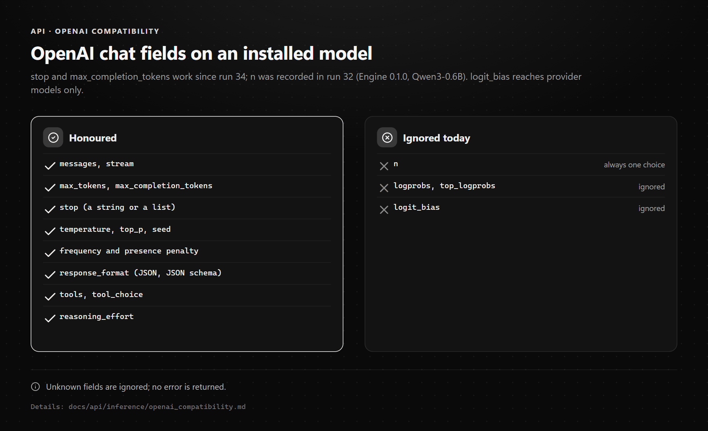

# OpenAI compatibility

Cluaiz serves OpenAI's chat, models, embeddings and audio routes, so an OpenAI client library works by
pointing its base URL at the Engine. This page lists which request fields an installed (llama.cpp) model
honours, which it ignores, and what Cluaiz adds. Everything marked "recorded" was checked in run 32
(`test/cloud/runs/2026-11-21-run32-openai-compat-probe/`, Engine 0.1.0, Windows, Qwen3-0.6B) or, after the fix, run 34
(`test/cloud/runs/2026-11-21-run34-openai-stop-and-limit/`).

## Connect a client

```python
from openai import OpenAI

client = OpenAI(base_url="http://localhost:8000/v1", api_key="sk-cluaiz-...")  # any text when keys are off
reply = client.chat.completions.create(
    model="qwen3-0.6b-gguf-Q4_K_M",           # the installed ID from `cluaiz list`
    messages=[{"role": "user", "content": "Name the capital of France."}],
)
print(reply.choices[0].message.content)
```

The `model` is the installed ID that `cluaiz list` prints, not the Hugging Face repository name. The
Python example above was not run in run 32 (the requests there used `curl`).

## Routes

| OpenAI route | Cluaiz | Page |
|---|---|---|
| `POST /v1/chat/completions` | yes, streaming and not | [Chat completions](chat_completions.md) |
| `GET /v1/models` | yes | [Models](../models/list_models.md) |
| `POST /v1/embeddings` | yes | [Embeddings](embeddings.md) |
| `POST /v1/audio/speech` | yes | [Speech](audio_speech.md) |
| `POST /v1/audio/transcriptions` | yes | [Transcriptions](audio_transcriptions.md) |
| Responses, Assistants, Files, Batches, Images | no | |

## Chat request fields on an installed model



| Field | Honoured | Notes |
|---|---|---|
| `model`, `messages`, `stream` | yes | |
| `stream_options.include_usage` | yes | the usage chunk at the end, as OpenAI sends it |
| `max_tokens` | yes | limits the answer; thinking has its own budget (`reasoning_effort`) |
| `temperature`, `top_p`, `frequency_penalty`, `presence_penalty`, `seed` | yes | passed to the sampler |
| `response_format` | yes | JSON or a JSON schema, enforced by a grammar |
| `tools`, `tool_choice` | yes | `tool_choice: "none"` sends no tools |
| `reasoning_effort` | yes | `low`, `medium`, `high`, plus `auto`, `max` or a number of tokens |
| `stop` | yes (recorded) | a string or an array; the answer ends before the first match, `finish_reason: "stop"` (run 34) |
| `max_completion_tokens` | yes (recorded) | the answer limit when `max_tokens` is not sent; `max_tokens` wins when both are (run 34) |
| `n` | **no** (recorded) | always one choice |
| `logprobs`, `top_logprobs` | no | ignored |
| `logit_bias` | no | only provider models get it |
| unknown fields | ignored | no error is returned |

## What Cluaiz adds

Extra request fields (all optional): `think_mode`, `reasoning_budget_message`, `top_k`, `min_p`,
`repetition_penalty`, `grammar`, `chat_template_kwargs`, `session_id`, `kv_reuse`, `max_steps`,
`tool_search`, `context_policy`, `llama` (load settings). The reply carries OpenAI's fields plus
`context_report` (how the context was planned); OpenAI libraries ignore fields they do not know.
Details of each: [Chat completions](chat_completions.md).

An OpenAI client library sends these through `extra_body`; they are merged into the request body as
they are (the same way vLLM documents its extra parameters):

```python
reply = client.chat.completions.create(
    model="qwen3-0.6b-gguf-Q4_K_M",
    messages=[{"role": "user", "content": "Summarise this file."}],
    max_tokens=512,
    extra_body={
        "think_mode": "off",          # no thinking for this request
        "top_k": 40,
        "llama": {"n_ctx": 8192},     # load settings: here the context size
        "keep_alive": 0,              # unload the model after the answer
    },
)
```

OpenAI's API has no field for the context size or the GPU layers; on Cluaiz they go in `llama`
(`n_ctx`, `n_gpu_layers`, `cache_type_k`, ...). Unset, the planner chooses them from free memory. A
request with different load settings reloads the model. (The `extra_body` example was not run; the fields are the ones `/v1/chat/completions` reads, `api/src/handlers/chat/types.rs`.)

## Known differences

The fields marked **no** above are recorded gaps in the Engine, not choices. Until they are fixed:

- do not rely on `n`, `logprobs` or `logit_bias` with an installed model.
