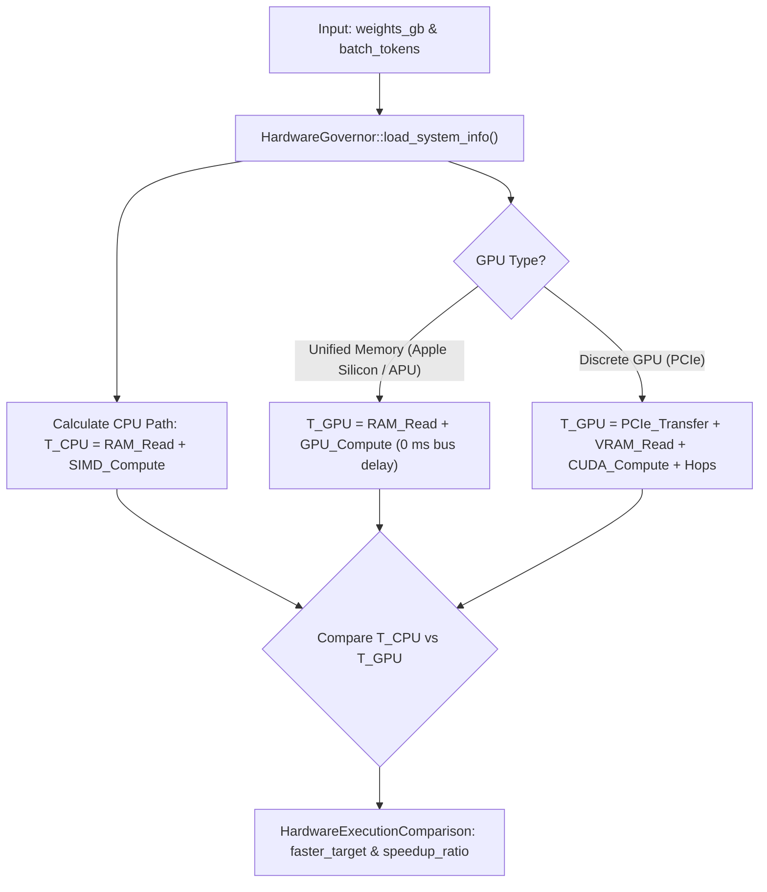

# Dynamic Execution Latency Comparison Engine API

`POST /v1/system/compare`

Performs deterministic, physics-based evaluation of the 5 llama.cpp execution candidates against real probed hardware:

* **Candidate A (Full GPU):** All layers and KV cache fit resident in VRAM. 0 PCIe transfer during token generation.
* **Candidate B (Weights GPU, KV RAM):** All weights in VRAM, KV cache in Host RAM (`offload_kqv=false`). Attention executes on CPU with per-layer ping-pong round-trips.
* **Candidate C (Split Hybrid):** Highest layers offloaded to GPU ($g$ layers), remaining layers executed directly on CPU in RAM. 1 PCIe activation boundary transfer.
* **Candidate D (CPU Only):** Entire model and KV cache reside in Host RAM, computed via multi-threaded AVX2 SIMD.
* **Candidate E (MoE Split):** Attention/shared layers in VRAM, routed sparse experts resolved from Host RAM.

---

## 📌 Endpoint Information

* **HTTP Method:** `POST`
* **Path:** `/v1/system/compare`
* **Authentication:** Optional for local development; Bearer token required in secured mode.
* **Content-Type:** `application/json`
* **Response Format:** `application/json`

---

## 🧠 Candidate Arbitration Architecture

LLM token generation ($N = 1$) is strictly **memory bandwidth bound**.

1. **VRAM-Resident Execution (Candidate A):**
   When model weights fit within free VRAM minus the safety buffer, weights reside permanently in high-speed GPU memory (e.g., 192 GB/s on RTX 3050).
   $$\text{Latency}_{\text{Gen}} \approx \frac{\text{Weights}}{\text{VRAM Bandwidth} \times 0.70} + \text{Overhead}$$
   **PCIe streaming cost during token generation is 0.0 ms!**

2. **Split Hybrid Execution (Candidate C):**
   When model weights exceed dedicated VRAM, llama.cpp keeps $g$ layers on GPU and $L - g$ layers on CPU.
   RAM layers compute on CPU directly without copying weights over PCIe on every token. Activations cross the boundary once per forward pass.

3. **CPU Direct RAM Execution (Candidate D):**
   Model weights reside in Host DDR5 RAM (e.g. ~38.4 GB/s) and compute via multi-threaded AVX2 SIMD.

---

## 📥 Request Body Schema

| Parameter | Type | Required | Default | Description |
|:---|:---|:---|:---|:---|
| `weights_gb` | `number` (f64) | Optional | `1.96` | Total model weights size in gigabytes (e.g., `1.96` or `11.96`). |
| `model_path` | `string` | Optional | `null` | Absolute path to GGUF model for exact layer & tensor geometry probing. |
| `batch_tokens` | `integer` (usize) | Optional | `1` | Evaluation batch size in tokens (1 for single-token generation; $\ge 64$ for prefill). |
| `total_layers` | `integer` (usize) | Optional | Auto | Total transformer layer count. |
| `n_ctx` | `integer` (usize) | Optional | Auto | Context window size (auto-tuned per CTX Rule 3). |
| `vram_buffer_gb`| `number` (f64) | Optional | `0.25-0.5` | VRAM buffer reserved for desktop & OS. |
| `ram_buffer_gb` | `number` (f64) | Optional | `5%` | RAM safety buffer. |

```json
{
  "weights_gb": 1.96,
  "batch_tokens": 1
}
```

---

## 💻 Code Examples

### 1. cURL
```bash
curl -X POST http://localhost:8000/v1/system/compare \
  -H "Content-Type: application/json" \
  -d '{"weights_gb": 1.96, "batch_tokens": 1}'
```

### 2. Python
```python
import requests

payload = {
    "weights_gb": 1.96,
    "batch_tokens": 1
}

res = requests.post("http://localhost:8000/v1/system/compare", json=payload)
data = res.json()

if data.get("status") == "success":
    decision = data["decision"]
    print(f"Winner: {decision['winner_candidate_id']}")
    print(f"TPS: {decision['winner_generation_tps']:.1f}")
    print(f"Speedup: {decision['speedup_ratio']:.2f}x")
    print(f"Reason: {decision['decision_reason']}")
```

---

## 📤 Response Schema

```json
{
  "status": "success",
  "decision": {
    "weights_gb": 1.96,
    "batch_tokens": 1,
    "total_layers": 28,
    "n_ctx": 2048,
    "kv_cache_gb": 0.29,
    "compute_buffer_gb": 0.08,
    "vram_safety_buffer_gb": 0.25,
    "ram_safety_buffer_gb": 1.19,
    "model_fits_in_vram": true,
    "faster_target": "GPU_VRAM (Candidate A: Full GPU)",
    "speedup_ratio": 5.92,
    "cpu_latency_ms": 89.28,
    "gpu_vram_latency_ms": 15.08,
    "gpu_pcie_latency_ms": 266.38,
    "winner_candidate_id": "candidate_a_full_gpu",
    "winner_generation_tps": 66.3,
    "decision_reason": "Candidate A: Full GPU (VRAM-Resident) wins with 66.3 tokens/sec (5.92x faster than CPU 11.2 TPS). The 1.96 GB model fits entirely inside 4.00 GB VRAM (usable 2.35 GB), incurring 0 PCIe transfer penalties during token generation.",
    "breakdown": "Model: 1.96 GB (28 layers, ctx: 2048) | Winner: Candidate A: Full GPU (VRAM-Resident) @ 66.3 TPS (5.92x vs CPU 11.2 TPS) | VRAM: 1.40/4.00 GB, RAM: 15.80/23.70 GB",
    "candidates": [
      {
        "id": "candidate_a_full_gpu",
        "name": "Candidate A: Full GPU (VRAM-Resident)",
        "feasible": true,
        "gpu_layers": 28,
        "cpu_layers": 0,
        "vram_required_gb": 2.33,
        "generation_tps": 66.3,
        "is_winner": true
      },
      {
        "id": "candidate_b_weights_gpu_kv_ram",
        "name": "Candidate B: Weights GPU, KV in Host RAM (offload_kqv=false)",
        "feasible": true,
        "generation_tps": 23.9,
        "is_winner": false
      },
      {
        "id": "candidate_c_split_hybrid",
        "name": "Candidate C: Split Hybrid (Partial Offload)",
        "feasible": true,
        "generation_tps": 56.4,
        "is_winner": false
      },
      {
        "id": "candidate_d_cpu_only",
        "name": "Candidate D: CPU Only (Host RAM SIMD)",
        "feasible": true,
        "generation_tps": 11.2,
        "is_winner": false
      },
      {
        "id": "candidate_e_moe_split",
        "name": "Candidate E: MoE Split (Active Experts in RAM)",
        "feasible": false,
        "generation_tps": 0.0,
        "is_winner": false
      }
    ]
  }
}
```

---

## 📊 Decision Matrix Flow


