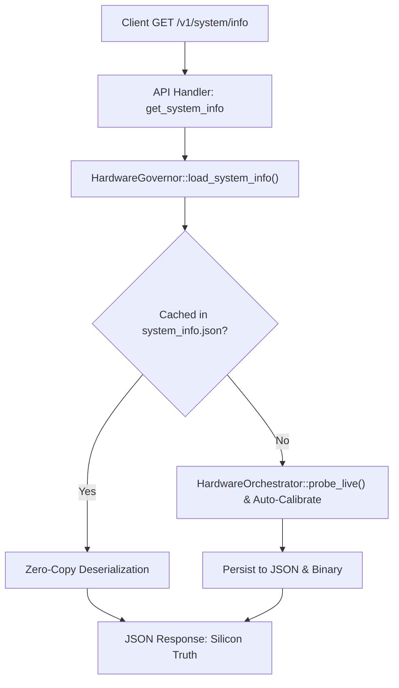

# Hardware Profile & Silicon Truth API

`GET /v1/system/info` (Alias: `GET /v1/system/control`)

Retrieves the calibrated host hardware profile and silicon truth: CPU GFLOPS, measured RAM read bandwidth and pointer latency, GPU accelerators, VRAM capacity, PCIe Gen/width transfer metrics, and storage benchmarks.

---

## 📌 Endpoint Information

* **HTTP Method:** `GET`
* **Paths:**
  * `/v1/system/info` — Primary route for hardware identity and calibrated silicon profile.
  * `/v1/system/control` — Backward-compatible alias route.
* **Authentication:** Optional for local development; Bearer token required in secured mode.
* **Response Format:** `application/json`

---

## ⚙️ Hardware Calibration & Persistence

When Cluaiz initializes, `HardwareGovernor::auto_calibrate()` probes physical hardware:
1. **CPU:** Evaluates AVX2/AVX-512/NEON vector extensions, physical cores, logical threads, and peak FP32 GFLOPS.
2. **RAM:** Measures sequential read bandwidth (`GB/s`) using aligned chunk reads and pointer chase latency (`ns`).
3. **GPU & PCIe:** Detects vendor, model, total VRAM, PCIe Generation (e.g. Gen 4), link width (e.g. x8, x16), host-to-device streaming bandwidth (`GB/s`), and PCIe bus roundtrip hop latency (`μs`).
4. **Storage:** Measures 4KB random read/write throughput (`MB/s`) and IOPS.

Calibrated results are cached in user profile (`~/.cluaiz/system_info.json` and binary serialization `~/.cluaiz/system_info.bin`) for zero-overhead startup.

---

## 💻 Code Examples

### 1. cURL
```bash
curl -X GET http://localhost:8000/v1/system/info
```

### 2. Python
```python
import requests

response = requests.get("http://localhost:8000/v1/system/info")
data = response.json()

if data.get("status") == "success":
    info = data.get("info", {})
    cpu = info.get("silicon_truth", {}).get("cpu", {})
    mem = info.get("silicon_truth", {}).get("memory", {})
    gpus = info.get("silicon_truth", {}).get("accelerators", {}).get("gpus", [])
    
    print(f"Host: {info.get('identity', {}).get('machine_name')} ({info.get('identity', {}).get('os_target')})")
    print(f"CPU: {cpu.get('brand')} | Cores: {cpu.get('physical_cores')}P / {cpu.get('logical_threads')}T | GFLOPS: {cpu.get('gflops_fp32')}")
    print(f"RAM: {mem.get('total_capacity_gb')} GB | Bandwidth: {mem.get('bandwidth_gbps')} GB/s | Latency: {mem.get('latency_ns')} ns")
    for gpu in gpus:
        print(f"GPU: {gpu.get('vendor')} {gpu.get('model')} | VRAM: {gpu.get('vram_total_gb')} GB | PCIe Gen {gpu.get('pcie_gen')} x{gpu.get('pcie_width')} ({gpu.get('pcie_h2d_bandwidth_gbps')} GB/s)")
```

### 3. JavaScript / Node.js
```javascript
const response = await fetch("http://localhost:8000/v1/system/info");
const result = await response.json();

if (result.status === "success") {
  const { silicon_truth } = result.info;
  console.log("CPU:", silicon_truth.cpu.brand, `(${silicon_truth.cpu.gflops_fp32} GFLOPS)`);
  console.log("RAM Bandwidth:", silicon_truth.memory.bandwidth_gbps, "GB/s");
  silicon_truth.accelerators.gpus.forEach(gpu => {
    console.log(`GPU: ${gpu.model} - ${gpu.vram_total_gb} GB VRAM`);
  });
}
```

### 4. Rust (reqwest)
```rust
use serde_json::Value;

#[tokio::main]
async fn main() -> Result<(), Box<dyn std::error::Error>> {
    let res = reqwest::get("http://localhost:8000/v1/system/info").await?;
    let json: Value = res.json().await?;
    println!("{:#?}", json["info"]["silicon_truth"]);
    Ok(())
}
```

---

## 📤 Response Schema

```json
{
  "status": "success",
  "info": {
    "identity": {
      "machine_name": "CLUAIZ-WORKSTATION",
      "os_target": "windows",
      "architecture": "x86_64",
      "kernel_version": "10.0.22631"
    },
    "silicon_truth": {
      "cpu": {
        "brand": "12th Gen Intel(R) Core(TM) i5-12450H",
        "physical_cores": 8,
        "logical_threads": 12,
        "frequency_mhz": 2500,
        "gflops_fp32": 480.0
      },
      "memory": {
        "total_capacity_gb": 15.77,
        "bandwidth_gbps": 38.4,
        "measured_read_bandwidth_gbps": 38.4,
        "latency_ns": 75.2
      },
      "accelerators": {
        "gpus": [
          {
            "vendor": "NVIDIA",
            "model": "NVIDIA GeForce RTX 3050 Laptop GPU",
            "vram_total_gb": 4.0,
            "bandwidth_gbps": 192.0,
            "tflops_fp32": 9.1,
            "pcie_gen": 4,
            "pcie_width": 8,
            "pcie_h2d_bandwidth_gbps": 7.8,
            "pcie_roundtrip_latency_us": 12.0,
            "is_unified_with_system": false
          }
        ]
      },
      "storage": {
        "disks": [
          {
            "name": "NVMe Drive 0",
            "read_mbps": 3200.0,
            "write_mbps": 2800.0,
            "is_ssd": true
          }
        ]
      }
    }
  }
}
```

---

## 📊 Architectural Flow


