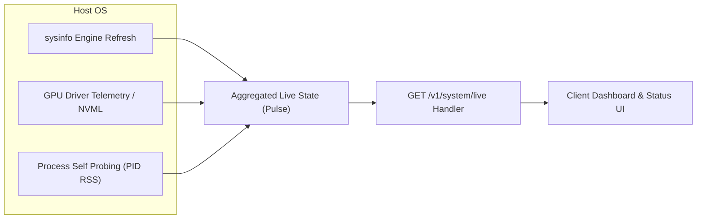

# Real-Time System Telemetry & Engine Footprint API

`GET /v1/system/live`

Retrieves real-time live host metrics and engine process resource utilization: Host RAM (Total/Used/Free/Utilization %), GPU VRAM pressure %, per-core CPU utilization %, and engine process RSS memory footprint.

---

## 📌 Endpoint Information

* **HTTP Method:** `GET`
* **Path:** `/v1/system/live`
* **Authentication:** Optional for local development; Bearer token required in secured mode.
* **Polling Interval Recommended:** 500ms to 2000ms for live dashboards and performance graphs.
* **Response Format:** `application/json`

---

## 🔍 Metric Definitions

1. **`ram`:**
   - `total_gb`: Total physical RAM installed on host.
   - `used_gb`: Current memory in use across all processes and OS buffer cache.
   - `free_gb`: Available memory that can be allocated immediately.
   - `utilization_pct`: Percentage of total memory consumed (`used / total * 100`).
   - `engine_rss_mb`: Exact memory resident set size (RSS) consumed solely by the Cluaiz engine process.

2. **`cpu`:**
   - `utilization_pct`: Aggregate host CPU usage percentage across all cores.
   - `clock_ghz`: Current operating clock frequency.
   - `temperature_c`: Package temperature in Celsius (when supported by hardware sensors).
   - `engine_cpu_pct`: Current CPU core percentage occupied by the Cluaiz engine process.
   - `per_core_pct`: Real-time utilization percentage array for every logical thread.

3. **`vram`:**
   - `total_gb`: Combined physical VRAM across attached GPU accelerators.
   - `used_gb`: Current allocated VRAM (weights + KV cache + intermediate buffers).
   - `free_gb`: Free unallocated VRAM remaining for context or model weights.
   - `pressure_pct`: VRAM allocation ratio (`used / total * 100`).

4. **`engine_process`:**
   - `pid`: Process ID of the running Cluaiz engine daemon.
   - `memory_rss_mb`: Resident memory in megabytes.
   - `cpu_usage_pct`: Direct process compute consumption.

---

## 💻 Code Examples

### 1. cURL
```bash
curl -X GET http://localhost:8000/v1/system/live
```

### 2. Python (Live Polling Stream)
```python
import time
import requests

def poll_live_telemetry():
    res = requests.get("http://localhost:8000/v1/system/live")
    if res.status_code == 200:
        data = res.json()
        ram = data["ram"]
        cpu = data["cpu"]
        vram = data["vram"]
        proc = data["engine_process"]
        
        print(f"[{data['timestamp']}] CPU: {cpu['utilization_pct']}% | RAM: {ram['used_gb']}/{ram['total_gb']} GB ({ram['utilization_pct']}%) | VRAM: {vram['used_gb']}/{vram['total_gb']} GB | Engine RSS: {proc['memory_rss_mb']} MB")

if __name__ == "__main__":
    for _ in range(5):
        poll_live_telemetry()
        time.sleep(1.0)
```

### 3. JavaScript / WebSocket / Dashboard
```javascript
async function fetchSystemLive() {
  const res = await fetch("http://localhost:8000/v1/system/live");
  const data = await res.json();
  
  const ramUsage = data.ram.utilization_pct;
  const cpuUsage = data.cpu.utilization_pct;
  const vramPressure = data.vram.pressure_pct;
  const engineRss = data.engine_process.memory_rss_mb;
  
  console.log(`Live CPU: ${cpuUsage}% | RAM: ${ramUsage}% | VRAM Pressure: ${vramPressure}% | Engine RSS: ${engineRss} MB`);
}

fetchSystemLive();
```

### 4. Rust (reqwest)
```rust
use serde_json::Value;

#[tokio::main]
async fn main() -> Result<(), Box<dyn std::error::Error>> {
    let res = reqwest::get("http://localhost:8000/v1/system/live").await?;
    let json: Value = res.json().await?;
    println!("Engine RSS: {} MB", json["engine_process"]["memory_rss_mb"]);
    println!("Per-core CPU: {:?}", json["cpu"]["per_core_pct"]);
    Ok(())
}
```

---

## 📤 Response Schema

```json
{
  "status": "success",
  "timestamp": 1728300250,
  "ram": {
    "total_gb": 15.77,
    "used_gb": 10.42,
    "free_gb": 5.35,
    "utilization_pct": 66.0,
    "engine_rss_mb": 342.15
  },
  "cpu": {
    "utilization_pct": 14.8,
    "clock_ghz": 2.5,
    "temperature_c": 48.0,
    "engine_cpu_pct": 1.8,
    "per_core_pct": [12.5, 18.0, 9.2, 14.1, 20.4, 8.9, 11.2, 15.0]
  },
  "vram": {
    "total_gb": 4.0,
    "used_gb": 1.85,
    "free_gb": 2.15,
    "pressure_pct": 46.25
  },
  "gpus": [
    {
      "vendor": "NVIDIA",
      "model": "NVIDIA GeForce RTX 3050 Laptop GPU",
      "vram_total_gb": 4.0,
      "vram_used_gb": 1.85,
      "temperature_c": 52.0,
      "utilization_pct": 28.0
    }
  ],
  "storage": {
    "throughput_mbps": 12.4
  },
  "network": {
    "throughput_mbps": 0.8
  },
  "engine_process": {
    "pid": 14220,
    "memory_rss_mb": 342.15,
    "cpu_usage_pct": 1.8
  }
}
```

---

## 📊 Telemetry Pipeline


